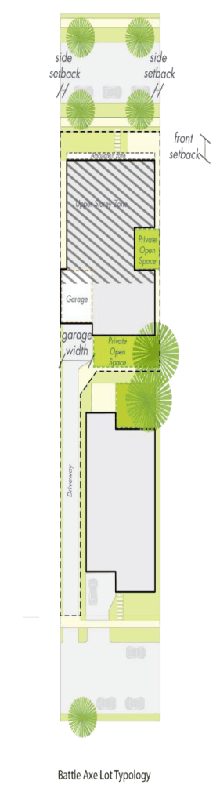

#### 5.2.3. Battle-Axe Lots

1\. Principles for the location of battle-axe lots are illustrated at Figure 5.9.

2\. All residential allotments are to have direct frontage to a public road. Battle-axe and right of carriageways will only be considered if no other options are available, and an appropriate development outcome can be achieved.

3\. Subdivision layout should minimise the use of battle-axe lots without public frontage to resolve residual land issues.

4\. Battle axe lots are to provide a building envelope which demonstrates compliance with provisions for solar access, private open space, setbacks and site coverage of this DCP, and to show adequate distance from existing or proposed dwellings to ensure privacy and amenity is achievable.

5\. Battle-axe allotments are to:

a. Have a minimum site area of 420m2 (excluding the handle),

b. only permit a detached dwelling house,

c. have a minimum access handle width of 3.5m,

d. provide 500mm landscaping verge on each side of the access handle. This is to be provided within the required 3.5m wide access handle.

e. have a minimum 3m x 3m splay at the dwelling end of access handle,

f. Have a maximum battle-axe handle length of 50m, and

g. Provide a driveway design that is in accordance with Council’s specifications.

6\. Battle-axes are to comply with the requirements under section 5.2 Dwelling Design Controls, however, the garage can utilise the side setback control, while the remainder of the house must be setback as per the rear setback control.

7\. Applicants must demonstrate that a vehicle can leave the allotment in a forward direction without impacting the amenity of the front setback, or private open space. Pervious material will not be supported within the front setback to cater for vehicle manoeuvring.

8\. Where battle-axe lots front open space or road, development is to be designed to a dual frontage form, whereby the rear setback is facing the handle.

9\. Shared access handles are to be 6m in width and service no more than 2 lots, stacked battle allotments are not permitted. Shared access handles must also provide 500mm of landscaping on either side.

> [Picture on page 73: a picture, saved as a picture (images/vol-2-part-08a-menangle-park-page-73-11.gif, 150 dpi).]

Figure 5.9 Battle Axe Lot Typology
