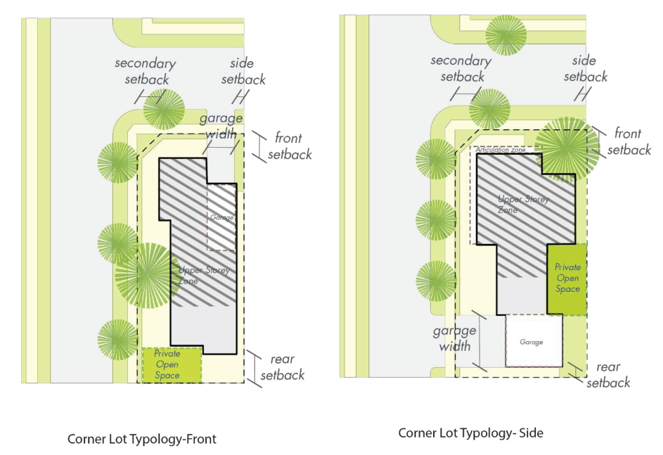

#### 5.2.4. Corner Lots

1\. Corner lots, including splays and driveway location, are to be designed in accordance with AS 2890 and Council’s Engineering Specifications.

2\. Corner lots are to be designed to allow dwellings to positively address both street frontages as indicated in Figure 5.10.

3\. Garages on corner lots are encouraged to be accessed from the secondary street or a rear lane.

4\. Plans of subdivision are to show the location of proposed or existing substations, kiosks, sewer manholes and/or vents affecting corner lots.

5\. Corner lots are to comply with the requirements under section 6.12 and 6.13 Dwelling Design Controls.

6\. Garages located on secondary street frontages are to be setback a minimum of 0.9m from the rear boundary of the lot (see Figure 5.10 Corner Lot Typology – side).

APP Corporation Pty Limited | ABN 29 003 764 770

app.com.au | 73

> [Picture on page 75: a picture, saved as a picture (images/vol-2-part-08a-menangle-park-page-75-1.gif, 150 dpi).]

Figure 5.10 Corner lot typical configuration
