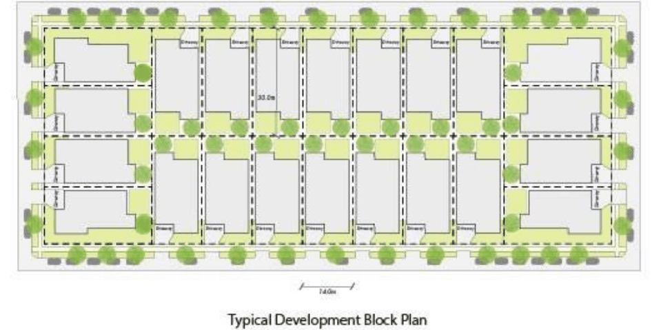
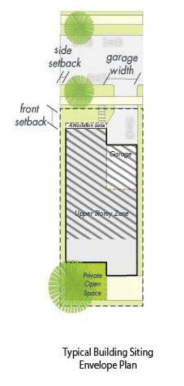

### 5.3. Subdivision Approval Process in the R2 and R3 Zones

Objectives

a. To facilitate a diversity of housing sizes and products.

b. To establish a concise process for the approval of certain dwelling and lot types.

c. To ensure that subdivision and development on smaller lots is undertaken in a coordinated manner.

d. To ensure that all residential lots achieve an appropriate level of amenity.

APP Corporation Pty Limited | ABN 29 003 764 770

app.com.au | 74

Controls

1\. The land subdivision approval process is to be consistent with the requirements of Table 5.3 below.

2\. Subdivision of land creating residential lots less than 420m² and/or less than 11.5m wide shall include a Development Lot Plan as part of the subdivision development application.

3\. Subdivision of land creating residential lots less than 375m² and/or lots less than 8m wide shall include a Building Sitting and Envelope Plan (BSEP) as part of the subdivision development application. The BSEP is to be included on the S88B instrument attached to the lot.

The Development Block Plan should be at a legible scale (suggested 1:500) and include the following elements: ► Location of street and site trees ► Location of driveways ► Indicative location of utility infrastructure services and sub stations ► Indicative location of waste bin collection zone ► Indicative location of dwelling

The BSEP should be at a legible scale (suggested 1:500) and include the following elements:

► Lot numbers, north point, scale, drawing title and site labels such as street names ► Maximum permissible building envelope (setbacks, storeys, articulation zones) ► Preferred principal private open space ► Designated landscape zones ► Garage size (single or double) and location ► Zero lot line boundaries

A BSEP should be fit for purpose and include only those elements that are necessary for that particular lot. Other elements that may be relevant to show include: ► Special fencing requirements ► Easements and sewer lines ► Retaining walls ► Preferred entry/frontage (e.g. corner lots) ► Access denied frontages ► Electricity kiosks or substations ► Indicative yield on residue or super lots

Table 5.3 Subdivision Approval Pathways

| DA for Subdivision Only | DA for Subdivision with Development Block Plan | DA for Subdivision with BSEP |
|---|---|---|
| Approval Pathway |  |  |
| Pathway A1 | Pathway A2 | Pathway A3 |
| Lots equal to or greater than 420m2 As part of future DA or CDC No Pre-construction of dwellings | Lots less than 420m2 but greater than 375m2 and/or with a width less than 11.5m but greater than 8m As part of future DA or CDC Yes Pre-construction of dwellings | Lots less than 375m² and/or with a width less than 8m As part of future DA or CDC Yes Pre-construction of dwellings |
| Application |  |  |
| Dwelling Plans Required |  |  |
| Dwelling Design 88B restriction required |  |  |
| Timing of subdivision (release of linen plan) |  |  |

> [Picture on page 78: a picture, saved as a picture (images/vol-2-part-08a-menangle-park-page-78-1.gif, 150 dpi).]

Figure 5.11 Development Block Plan

Figure 5.12 Building Sitting Envelope Plan

> [Picture on page 78: a picture, saved as a picture (images/vol-2-part-08a-menangle-park-page-78-4.gif, 150 dpi).]
