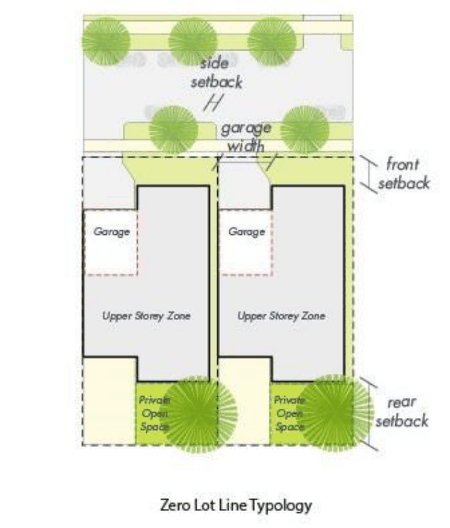

### 6.5. Zero Lot Lines

1\. The location of a zero-lot line is to be determined primarily by topography and should be on the low side of the lot to minimise water penetration and termite issues.

2\. Typically, zero lot lines should be provided on lots with a frontage of less than 11.5m.

3\. The maximum depth of a nominated zero lot line wall is 11m measured from the front building line of the dwelling. The zero lot wall lengths are to only consist of a garage and non-habitable area, or a tandem garage.

4\. On all lots where a zero-lot line is permitted, the side of the allotment that may have a zero lot alignment must be shown on the plan of subdivision.

5\. Where a zero-lot line is nominated on an allotment on the subdivision plan, the adjoining (burdened) allotment is to include a 900mm easement for single storey zero lot walls and 1200mm for two storey zero lot walls to enable servicing, construction and maintenance of the adjoining dwelling. No overhanging eaves, gutters or services (including rainwater tanks, hot water units, air-conditioning units or the like) of the dwelling on the benefited lot will be permitted within the easement.

> [Picture on page 84: a picture, saved as a picture (images/vol-2-part-08a-menangle-park-page-84-11.gif, 150 dpi).]

Figure 6.1 Zero Lot Line Typology
