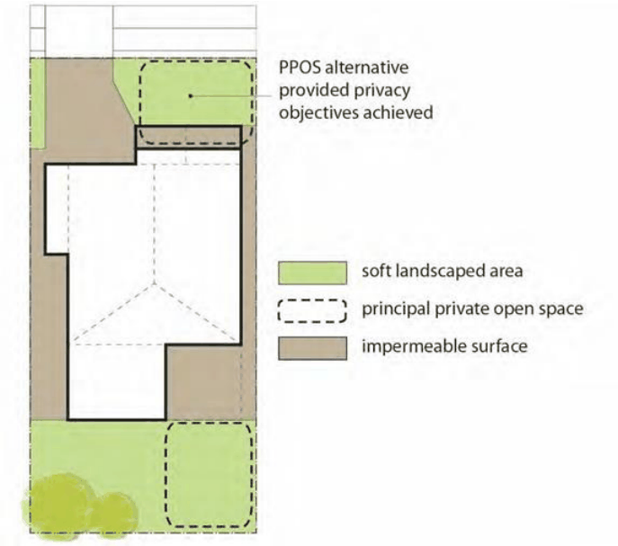
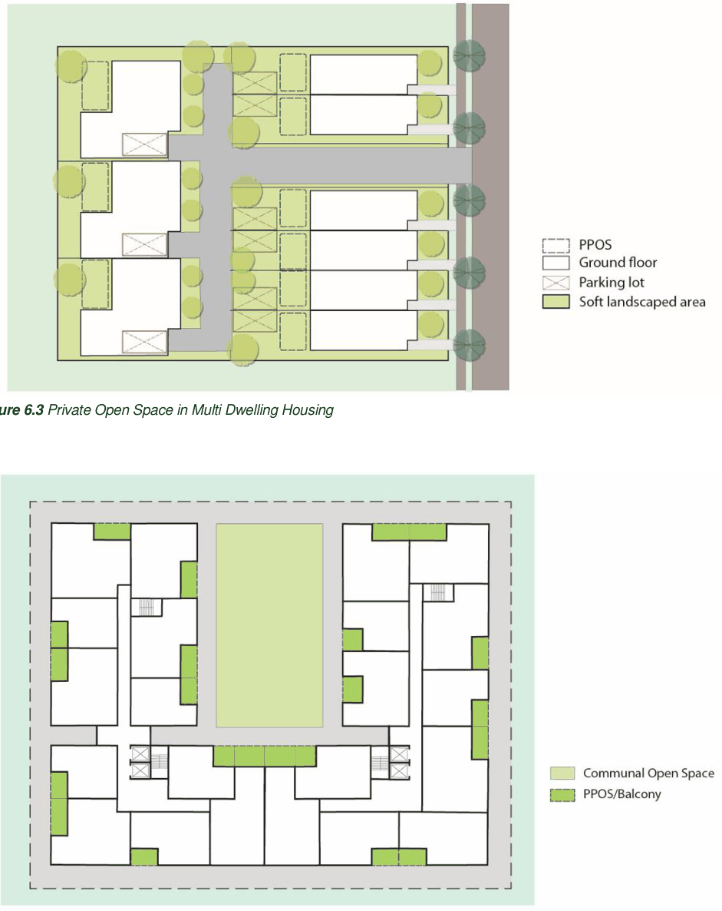

### 6.7. Private Open Space

Objectives

a. To provide a high level of residential amenity with opportunities for outdoor recreation and relaxation.

b. To enhance the spatial quality, outlook, and usability of private open space.

c. To facilitate solar access to the living areas and private open spaces of the dwelling.

Controls

1\. Each dwelling is to be provided with an area of Principal Private Open Space (PPOS) consistent with the requirements of the relevant Tables in Sections 6.12 and 6.13.

2\. The location of PPOS is to be determined having regard to dwelling type, design, allotment orientation, adjoining dwellings, landscape features and topography.

3\. The PPOS is required to be conveniently accessible from the main living area of a dwelling or alfresco and have a maximum gradient of 1:10. Where part or all of the PPOS is permitted as a semi- private patio, balcony or rooftop area, it must be directly accessible from a living area.

> [Picture on page 86: a picture, saved as a picture (images/vol-2-part-08a-menangle-park-page-86-9.gif, 150 dpi).]

Figure 6.2 Private Open Space in Low Density Residential Setting

> [Picture on page 87: a picture, saved as a picture (images/vol-2-part-08a-menangle-park-page-87-1.gif, 150 dpi).]

Figure 6.3 Private Open Space in Multi Dwelling Housing

Figure 6.4 Private Open Space in Residential Apartments
