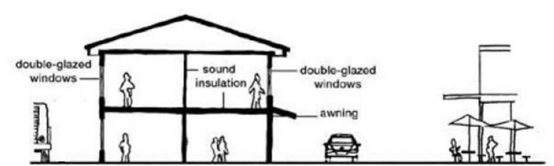

### 6.10. Visual and Acoustic Privacy

Objectives

a. To site and design dwellings to meet user requirements for visual and acoustic privacy, while minimising the visual and acoustic impacts of development on adjoining properties.

b. To minimise the impact of noise of other non-residential uses such as parking and sport areas, restaurants and cafes and waste collection and goods deliveries.

Controls

1\. Direct overlooking of main habitable areas and the private open spaces of adjoining dwellings should be minimised through building layout, window and balcony location and design, and the use of screening, including landscaping.

2\. Living area windows with a direct sightline to principal private open space or to habitable room windows in an adjacent dwelling within 5 metres are to:

► be obscured by fencing, screens or landscaping, or ► be offset from the edge of one window to the edge of the other by a distance sufficient to limit views into the adjacent window; or

► have sill height of 1.5 metres above floor level; or ► have fixed obscure glazing in any part of the window below 1.5 metres above floor level.

3\. Balconies are not permitted on the first floor of the side and / or rear portion of the dwelling except where the balcony faces a public road, or land zoned for public recreation. Such balconies will be considered on their merits provided:

a. Privacy and amenity impacts to adjoining properties are addressed, and

b. The balcony is setback at least 8m from the rear boundary, and

c. Has a maximum floor area of 15 sqm, and

d. The balcony is to be unenclosed on three of the four sides.

Unenclosed balconies are defined as balconies that have a wall height of less than 1.4m (on three external faces) and incorporate materials that are predominately transparent. i.e., timber slats, glass.

4\. The design of dwellings must minimize the opportunity for sound transmission through the building structure, with particular attention given to protecting bedrooms and living areas.

5\. In attached, semi-detached dwellings and multi dwelling developments, bedrooms of one dwelling are not to share walls with living spaces or garages of adjoining dwellings, unless it is demonstrated that the shared walls and floors meet the noise transmission and insulation requirements of the Building Code of Australia.

6\. No electrical, mechanical or hydraulic equipment or plant shall generate a noise level greater than 5dBA above background noise level measured at the property boundary during the hours 7.00am to 10.00pm and noise is not to exceed background levels during the hours 10.00pm to 7.00am.

7\. Dwellings along sub-arterial or arterial roads or any other noise source, should be designed to minimise the impact of traffic noise and, where possible, comply with the criteria in Table 6.4.

8\. The internal layout of residential buildings, window openings, the location of outdoor living areas (i.e., courtyards and balconies) and building plant should be designed to minimise noise impact and transmission.

9\. Balconies are only permitted on facades where they are facing streets or open space.

Table 6.1 Noise Criteria for Residential Premises impacted by traffic noise

| Sleeping areas Living areas |  |  |
|---|---|---|
| Naturally ventilated/ windows open to 5% of the floor area (Mechanical ventilation or air conditioning systems not operating) Doors and windows shut (Mechanical ventilation or air conditioning systems are operating) | LAeq 15 hours (day): 40dBA LAeq 9 hour (night): 35dBA Sleeping areas LAeq 15 hours (day): 43dBA LAeq 9 hour (night): 38dBA | LAeq 15 hours (day): 45dBA LAeq 9 hour (night): 40dBA Living areas LAeq 15 hours (day): 46dBA LAeq 9 hour (night): 43dBA |

#### Notes:

These levels correspond to the combined measured level of external sources and the ventilation system operating normally. Where a naturally ventilated/windows open condition cannot be achieved, it is necessary to incorporate mechanical ventilation compliant with AS1668 and the Building Code of Australia. LAeq 1 hour noise levels shall be determined by taking as the second highest LAeq 1 hour over the day and night period for each day and arithmetically averaging the results over a week for each period (5 or 7 day week, whichever is highest)

> [Picture on page 92: a picture, saved as a picture (images/vol-2-part-08a-menangle-park-page-92-9.gif, 150 dpi).]

Figure 6.5 Strategies for minimising noise transmission

10\. For residential development adjoining sub-arterial and collector roads, where external traffic noise level limits will be exceeded at the façade of the residential premises nearest to the noise source, the development will be deemed to comply if:

► the principal private open space area of the residential premises complies with the relevant noise limit; and ► the internal noise levels identified in Table 6.1.

11\. Architectural treatments are to be designed in accordance with AS3671 - Traffic Noise Intrusion Building Siting and Construction, the indoor sound criteria of AS2107 - Recommended Design Sound Levels and Reverberation Times for Building Interiors.
