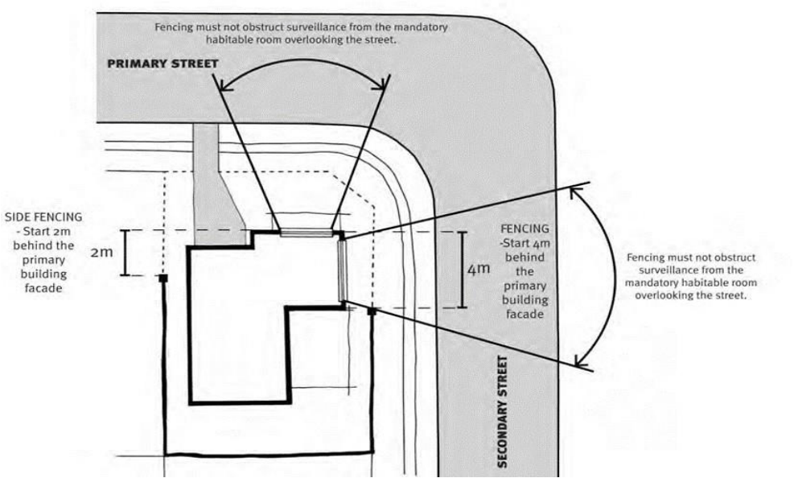

### 6.11. Fencing

Objectives

a. To ensure boundary fencing is of a high quality and does not detract from the streetscape,

b. To encourage the active use of front gardens through provision of a secure area,

c. To ensure that rear and side fencing will assist in providing privacy to private open space areas, and

d. To ensure that fence height, location and design will not affect traffic and pedestrian visibility at intersections. Controls

1\. Any fence forward of the building line to the primary street frontage or side boundaries is to be a maximum of 1.2m high and with a predominantly open character. The design of the fence is also to integrate a letterbox.

2\. Front fences and walls are not to impede safe sight lines for traffic.

3\. Side and rear fences are to be a maximum of 1.8m high. Fencing not visible from the street is required to be a maximum of 1.8m high and must finish 6.5m from the front boundary and return to the side wall of the home.

4\. On corner lots or lots that have side boundaries adjoining open space, drainage or a road; the front fencing style and height is to be continued along the secondary street or open space/drainage land frontage to at least 8.5m from the primary street boundary. Principles for corner lots are illustrated at Figure 5.10.

5\. On corner lots and boundaries that adjoin open space, fencing is to be of a high-quality material and finish. The design of the fencing is to permit casual surveillance of the public space by limiting fence height to 1.2m or by incorporating see through materials or have a transparency ratio of 3:1 transparent: solid for the portion of the fence above 1.2m high.

6\. Pre-painted steel or timber paling or lapped/capped boundary fencing is not permitted adjacent to open space or drainage land or on front boundaries.

7\. The height of a fence should be measured cumulatively as a combination of the retaining wall and fence atop.

8\. Consideration is to be given to potential loss of privacy and/or overshadowing to adjoining properties where side and/or rear boundary fences are to be located on top of retaining walls on the respective boundary.

Fencing Controls for C4 and RU2 Lots

1\. Fencing must:

► not be higher than 1.8m above ground level (existing) ► not include any masonry construction that extends more than 3m from either side of the entrance to the property from the primary road ► be constructed using post and wire or post and rail ► if it is constructed or installed on a flood control lot—not redirect or interrupt the flow of surface or ground water on that lot.

2\. Use of solid metal fencing (Colourbond) is prohibited

> [Picture on page 94: a picture, saved as a picture (images/vol-2-part-08a-menangle-park-page-94-2.gif, 150 dpi).]

Figure 6.6 Fencing design for corner lots
