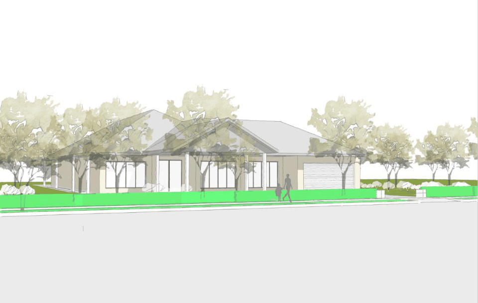

### 6.12. Dwelling Design Controls by Zone

#### 6.12.1. Environmental Living and Rural Lifestyle Lots

> [Picture on page 95: a picture, saved as a picture (images/vol-2-part-08a-menangle-park-page-95-3.gif, 150 dpi).]

Figure 6.7 Environmental Living

The following controls apply to residential development in the RU2 Rural Landscape and C4 Environmental Living zones.

Objectives

a. Deliver housing which is site responsive and sensitive to the natural and physical environmental characteristics of the landscape.

b. Encourage quality-designed dwelling houses that make a positive contribution to the streetscape and amenity of the neighbourhood.

c. Provide controls for larger rural lifestyle and estate housing in a manner that does not compromise sensitive environmental qualities, the capacity or affectations of the land.

Controls

1\. Dwellings in the RU2 Rural Landscape and C4 Environmental Living zones shall comply with the requirements set out in Table 6.5 below.

2\. All development is to be sited predominantly on the flattest part of lots to avoid the need for bulk earthworks.

3\. All development should be sited and designed to be clear of natural hazards, prominent landscape or landform features and any special biodiversity or wilderness conditions.

4\. The removal of native vegetation and trees is to be avoided.

5\. Rural boundary fencing to a height of 1.5m is encouraged comprising of open-style timber palings or similar.

6\. Impacts to prominent view lines or corridors across rural lands should be addressed as part of any Development Application for new residential development. Dwellings and all ancillary structures should be sited to preserve prominent views to ridgelines, scenic hills or the Nepean River.
