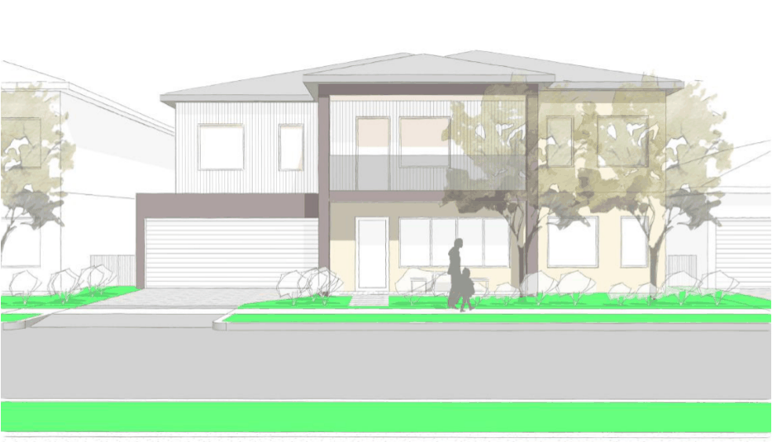

#### 6.12.2. Large Lot Residential

> [Picture on page 96: a picture, saved as a picture (images/vol-2-part-08a-menangle-park-page-96-7.gif, 150 dpi).]

Figure 6.8 Large Lot Residential

The following controls apply to residential development in the R5 Large Lot Residential zone.

Objectives

a. Provide housing in a rural setting which has a minimal environmental impact on its surrounds.

b. Provide housing on sites which is respectful to natural views and landscape forms.

c. Provide controls for Large Lot housing to ensure it achieves a high standard of urban design that is compatible with the Menangle Park precinct.

Controls

1\. Dwellings in the R5 Large Lot Residential zone shall comply with the controls set out in Table 6.6.

2\. The dwelling layout must be designed around site characteristics including elevation, vegetation, orientation and site constraints.

3\. A minimum of four trees must be provided to the front and rear setback. Tree species are to be a minimum pot size of 60L when planted and capable of growing between 6-10m in height at maturity.

4\. All dwelling houses are to be oriented towards the street.

Table 6.2 Dwelling Controls for the R5 zone

| Criteria 751 – ≤1,000sqm 1,000sqm + |  |
|---|---|
| Building Height Front Setback Side Setback Rear Setback Secondary Street Setback Maximum Site Coverage Minimum Landscaped Area Minimum Principal Private Open Space Garages and Car Parking Alfrescos (min) | Typically two storeys Typically two storeys 5m 5-10m 1.5m 3-5m 8m 10m 3m 5m 50% 40% 30% 40% 50sqm 100sqm Minimum 2 car spaces Triple garages permitted on sites over 1,500sqm (third garage to be setback 1m behind double garage). 6 x 6m |
