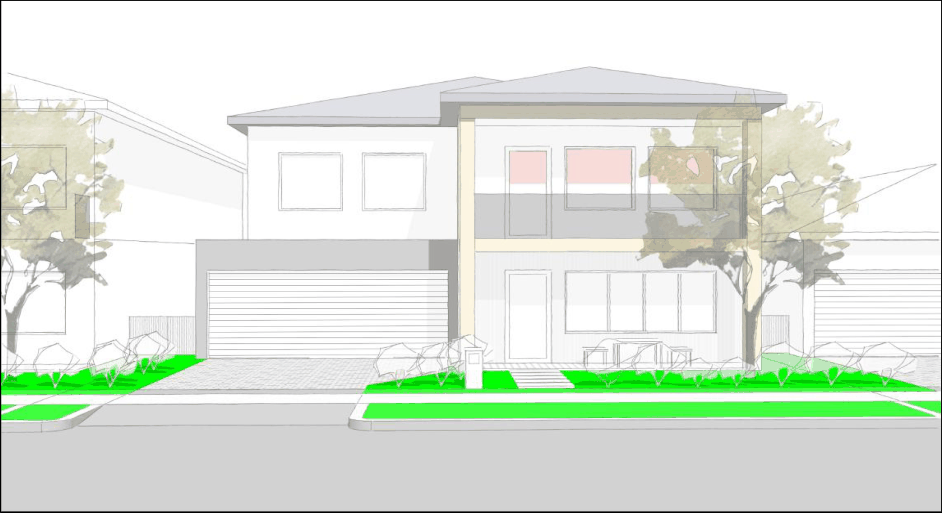

#### 6.12.3. Low Density Residential

> [Picture on page 98: a picture, saved as a picture (images/vol-2-part-08a-menangle-park-page-98-2.gif, 150 dpi).]

Figure 6.9 Low Density Residential

The following controls apply to residential development in the R2 Low Density Residential zone.

Objectives

a. Provide a genuine diversity of contemporary dwellings on traditional low density lots.

b. To provide affordable housing for the community that meets the needs of existing and future residents.

c. Encourage quality-designed dwelling houses that make a positive contribution to the streetscape and amenity of the neighbourhood.

Controls

1\. Dwellings in the R2 Low Density Residential zone shall comply with the requirements set out in Table 6.7 below.

2\. The primary street facade of a dwelling should address the street and must incorporate at least two of the following design features:

► entry feature or porch; ► awnings or other features over windows (excluding roller shutters); ► balcony treatment to any first-floor element; ► recessing or projecting architectural elements; ► open verandah; ► bay windows or similar features; or ► Verandas, pergolas or similar features above garage doors.

3\. At least 1 habitable window is to be provided to the front façade of the dwelling for lots with a frontage of less than 12 metres. At least 2 habitable windows are to be provided in the front façade for lots with a frontage exceeding 12 metres in width.

4\. The articulation zone is to occupy no more than 50% of the frontage, excluding any garage.

5\. Corner lot development should emphasise the corner. The secondary street facade for a dwelling on a corner lot should address the street and must incorporate at least two of the above design features. Landscaping in the front setback on the main street frontage should also continue around into the secondary setback.

6\. Modulation of the façade should be integral to the design of the building, rather than an unrelated attached element.

7\. Eaves are to provide sun shading and protect windows and doors and provide aesthetic interest. Except for walls built to the boundary, eaves should have a minimum of 450mm overhang (measured to the fascia board). Council will consider alternative solutions to eaves so long as appropriate sun shading is provided to windows and display a high level of architectural merit.

8\. Carports and garages are to be constructed of materials that complement the colour and finishes of the main dwelling.

9\. Streets should be fronted with a diversity of housing types and architectural styles to create an attractive street character.

10\. Minimum length of articulation from front building line for corner lots is 4m, the secondary setback articulation is to be 2m from the boundary.

11\. For lots equal to or less than 420m2, at least 2 hours of direct sunlight is to be received to 50% of the PPOS area of the proposed dwelling between 9am and 3pm on 21 June.

12\. For lots above 420m2, at least 3 hours of direct sunlight is to be received to 50% of the PPOS area of the proposed dwelling between 9am and 3pm on 21 June.

13\. A minimum of two trees must be provided to the front and rear setback. Tree species are to be a minimum pot size of 60L when planted and capable of growing between 6-10m in height at maturity.

Table 6.3 Dwelling Controls for the R2 zone

| Criteria 375-≤420sqm 421-≤600sqm 601 – ≤750sqm |  |
|---|---|
| Building Height Primary Front Articulation Encroachment Zone Garage to Primary (Front) | As per the CLEP 2015 4.5m 4.5m 4.5m 1m 1m 1m 5.5m 5.5m 5.5m |

| Criteria 375-≤420sqm 421-≤600sqm 601 – ≤750sqm |  |  |  |
|---|---|---|---|
| Side Setbacks Rear Setbacks Secondary Setbacks Maximum Site Coverage Maximum Upper Floor Area (% of Ground Floor Area) Minimum Landscaped Area Minimum Principal Private Open Space (PPOS) Minimum Width POS – directly accessible from internal living areas, can include alfrescos Minimum No. of Car Parking Spaces (on site) Maximum Garage Door Width Outbuilding Side and Rear Setbacks Outbuilding Maximum Height Storage | 900mm 4m (ground floor) 6m (second storey) 3m 65% 75% 25% 20sqm 4m 2 car spaces (at least one must covered) No more than 60% of building width N/A N/A Linen Press | 900mm 4m (ground floor) 8m (second storey) 3m 60% 70% 25% 25sqm 5m 2 car spaces (at least one must covered) No more than 50% of building width or 6m, whichever is the lesser 900mm 4.8m Linen Press + 2m3 | 1.5m 6m (ground floor) 8m (second storey) 3m 60% 50% 30% 30sqm 5m 2 car spaces (at least one must covered) No more than 50% of building width or 6m, whichever is the lesser 900mm 4.8m Linen Press + 4m3 |
