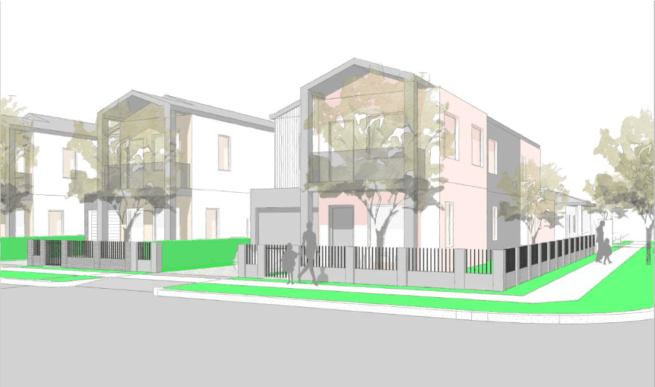

#### 6.12.4. Medium Density Residential the R3 Medium Density Zone

> [Picture on page 101: a picture, saved as a picture (images/vol-2-part-08a-menangle-park-page-101-2.gif, 150 dpi).]

Figure 6.10 R3 Medium Density

The following controls apply to Medium Density Residential development in the R3 Medium Density zone.

Objectives

a. Promote housing choice and affordability through the provision of innovative Medium Density Residential which benefits from direct access to local amenity and public transport.

b. Deliver Medium Density Residential which is site responsive and sensitive to natural and physical environments.

c. Encourage quality-designed Medium Density Residential that makes a positive contribution to the streetscape and amenity of the neighbourhood.

d. Avoid homogenous designs and promote a genuine diversity of small lot housing.

e. Locate the smallest lots on collector roads and bus routes, around parks and close to community facilities.

Controls

1\. Dwellings in the R3 Low Density Residential zone shall comply with the requirements set out in Table 6.8 below.

2\. The primary street facade of a dwelling should address the street and must incorporate at least two of the following design features:

► entry feature or porch; ► awnings or other features over windows;

► balcony treatment to any first-floor element; ► recessing or projecting architectural elements; ► open verandah; ► bay windows or similar features; or ► Verandas, pergolas or similar features above garage doors.

3\. At least 1 habitable window is to be provided to the front façade of the dwelling for lots with a frontage of less than 11.5 metres.

4\. Corner lot development should emphasise the corner. The secondary street facade for a dwelling on a corner lot should address the street and must incorporate at least two of the above design features.

5\. Applications for Medium Density Residential must demonstrate opportunities for landscaping within the front and rear setback areas. The planting of at least one site tree should be provided as part of the application for the dwelling unless it can be sufficiently demonstrated that tree planting is not feasible due to other site constraints.

6\. Modulation of the façade should be integral to the design of the building, rather than an unrelated attached element.

7\. Street facing upper level balconies and ground level courtyards are permitted for lots on the south-side of streets serving as principal private open space where they can demonstrate good residential amenity and control of visual and acoustic privacy impacts.

8\. Any private open space located within the front portion of the lots is to be located behind the primary street setback and must be obscured from view of the public domain by suitable landscape or articulated fencing treatments.

9\. Rear loaded open-stand car parking solutions should be designed to serve as a multi-purpose private open space.

10\. Eaves are to provide sun shading and protect windows and doors and provide aesthetic interest. Except for walls built to the boundary, eaves should have a minimum of 450mm overhang (measured to the fascia board). Council will consider alternative solutions to eaves so long as appropriate sun shading is provided to windows and display a high level of architectural merit.

11\. Carports and garages are to be constructed of materials that complement the colour and finishes of the main dwelling.

12\. Alfrescos are required to be within the building footprint/roofline and are to be demonstrated on the proposed floor plans.

Table 6.4 Dwelling Controls for the R3 zone

| Criteria Rear Loaded (6.5m-8m width) Front Loaded (8m+ width) |  |  |
|---|---|---|
| Building Height Primary Front Setback Articulation Encroachment Zone Garage to Primary (Front) Side Setbacks Rear Setbacks Secondary Setbacks Maximum Site Coverage Maximum Upper Floor Area (% of Ground Floor Area) Minimum Landscaped Area Minimum Principal Private Open Space (PPOS) Minimum Width POS – directly accessible from internal living areas, can include alfrescos Minimum No. of Car Parking Spaces (on site) Maximum Garage Door Width | 12m 3m 1m N/A 0-900mm 0.5m (rear access garage) 3m 75% 85% 25% 16sqm 4m 1-2 bedrooms = 1 car space 3+ bedrooms = 2 car spaces Subject to merit assessment | 12m 3m 1m 4m 900mm 4m (ground floor) (6m second storey) 3m 65% 80% 25% 20sqm 4m 1-2 bedrooms = 1 car space 3+ bedrooms = 2 car spaces (at least one must be covered) No more than 60% of building width |
