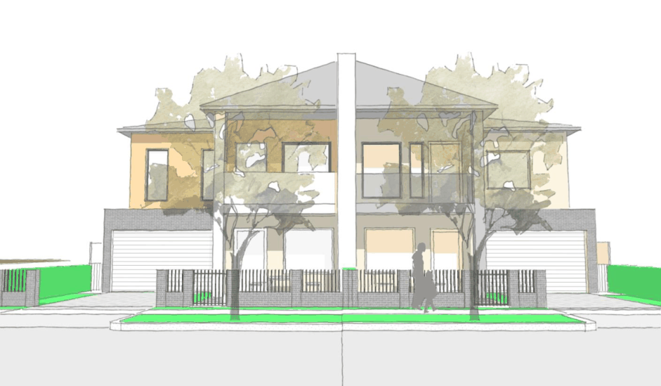

### 6.13. Additional Controls for Certain Dwelling Types

#### 6.13.1. Attached Dwellings

> [Picture on page 104: a picture, saved as a picture (images/vol-2-part-08a-menangle-park-page-104-3.gif, 150 dpi).]

Figure 6.11 Attached dwellings

The following controls apply to Attached Dwellings, that are a form of development permissible in the R2, R3 zones.

Objectives

a. To ensure that the development of attached dwellings creates an architecturally consistent street character.

Controls

1\. Attached Dwellings are to be designed in accordance with the controls in Table 6-5.

2\. Garages for attached dwellings are located at the rear of the lot, accessible from a rear lane or secondary street.

3\. Attached dwellings should have a pleasing rhythm and order when seen together as a group, rather than appear as a random arrangement of competing dwellings. Each dwelling should benefit from the unified design of the whole form, a co-ordinated style and base colour palette. Individuality can be added as small details or accent colours, rather than strikingly different forms.

4\. The maximum number of attached dwellings is six (6) in a set in the R3 zone and three in the R2 zone.

Table 6.5 Attached Dwelling Controls (R2 and R3 zones)

| Criteria 200sqm + |  |
|---|---|
| Building Height Front Setback Side Setback Rear Setback Secondary Street Setback Maximum Site Coverage (Ground Level) Minimum Landscaped Area Garages and Car Parking Minimum PPOS Minimum width of PPOS | 2 storeys (under Clause 4.3A Height restriction for Certain Development Accommodations the CELP 205 , Attached Dwellings are limited to 2 Storeys) 3m 900mm Ground Level 1.2m Upper Level 4m 2m 70% 30% Minimum 1 garage or basement space per dwelling 16sqm per dwelling 3m |
