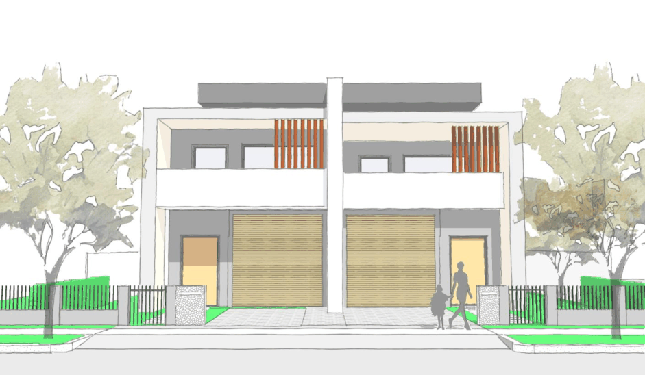

#### 6.13.2. Secondary Dwellings and Dual Occupancies

Controls for dual occupancies are in part determined by whether the secondary, principal or dual occupancy dwelling is proposed at the time of the application or at some point in the future to be strata subdivided. Strata subdivisions create the need for separate or common property dwelling entries, parking and open space to service each dwelling. Secondary dwellings are not permitted to be subdivided from the Principal Dwelling.

The controls that follow apply to secondary dwellings and dual occupancies.

Objectives

a. To enable the development of a diversity of dwelling types which assists in contributing to the availability of affordable housing.

b. To promote innovative housing solutions that are compatible with the surrounding residential environment.

c. To ensure that the development is designed to complement the design of the principal dwelling and be subservient to the principal dwelling in terms of visual bulk and scale.

d. To minimise the impacts of development on the principal development and neighbouring properties with regards to view, privacy and overshadowing.

e. Ensure that room sizes within secondary dwellings are functional, of sufficient size and cater for the intended use of the secondary dwelling.

f. To provide casual surveillance to rear lanes.

Controls - Secondary dwellings

1\. Secondary dwellings shall comply with the key controls in Table 6.6.

2\. The principal and secondary dwelling (and all ancillary structures) must not exceed site coverage stipulated in Tables 6.6 dependent on zone and lot size.

3\. The finishes, materials and colours of the secondary dwelling are to complement the principal dwelling in its construction features.

4\. Windows and private open spaces must not overlook the private open space of any adjacent dwellings. Windows that potentially overlook adjacent lots must either have obscured glazing, be screened or have a minimum sill height of 1.5m above floor level.

5\. Secondary dwellings and associated garages may have a zero-lot setback to one side boundary and may be attached to another garage/secondary dwelling on an adjoining lot, particularly where the secondary dwelling is associated with an attached or semi-detached dwelling.

6\. Where the secondary dwelling is built to a zero-lot line on a side boundary, windows are not to be located on the zero lot wall unless that wall adjoins a laneway, public road, public open space or drainage land.

7\. Rear garages with secondary dwellings may have first level balconies facing the lane provided the balcony remains within the lot boundary.

8\. Where a secondary dwelling is built over a rear garage and separated from the upper levels of the principal dwelling, there must be a minimum separation of 5m between the upper floor rear façade of the principal dwelling and the secondary dwelling.

Table 6.6 Controls for Secondary Dwellings

| Element Secondary Dwelling |  |
|---|---|
| On-site car parking Principal Private open space Subdivision Access Services and facilities | No additional car parking space required. No separate private open space required. Subdivision from principal dwelling not permitted. Clear line of access of minimum 900mm to street or laneways is to be provided to the Secondary Dwelling. No separate services or facilities required. |

Controls – Dual occupancies & Semi-Detached Housing

> [Picture on page 108: a picture, saved as a picture (images/vol-2-part-08a-menangle-park-page-108-2.gif, 150 dpi).]

Figure 6.12 Dual Occupancies

1\. Dual occupancies are to comply with the controls in Section 6 – Residential Controls, Tables 6.3 and 6.4 except where the controls in this clause differ, in which case the controls in this clause take precedence.

2\. Dual Occupancies must not exceed site coverage stipulated in Tables 6.3 and 6.4 and are to be calculated as prior to subdivision (existing lot).

3\. The design of both dwellings in a dual occupancy development is to be consistent in finishes, materials and colours, however, should differentiate on construction façade features.

4\. Dual occupancy development is not permitted on a lot that contains an attached dwelling, or on a battle-axe lot.

5\. Dual occupancy dwellings are permitted at the rear of lots (i.e. behind a dwelling that has frontage to a principal street, whether attached or detached to that dwelling) only where:

► Each dwelling has direct pedestrian and vehicle access to a public road; and ► Garbage and mail facilities are accessible by service vehicles and by the occupants of the dwellings.

6\. Where the dual occupancy dwellings are to be strata subdivided:

► Private open space is to be provided for each dwelling in accordance with the relevant controls. ► Shared private open space is to be provided equivalent to 15% of the site area and shown as communal space on the strata plan, and a minimum area of private open space of 10m² with a minimum dimension of 2.5m is to be provided for each dwelling.

7\. The minimum landscaped area on a lot containing a dual occupancy development is to be 25% of the site area.

8\. Where practical for front loaded driveway access, shared driveway crossings of the nature strip are to be provided to service both dwellings.

9\. Dual Occupancy development in large lot, rural and environmental zones must ensure that the dwellings are physically attached by way of a common wall under the same roofline and have the general appearance of a single dwelling-house (rather than two individual dwellings) when viewed from the primary street frontage. Structures such as carports, breezeways, pergolas, covered awnings and the like are not acceptable as a mode of attachment.
