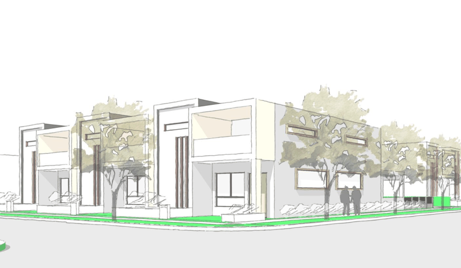
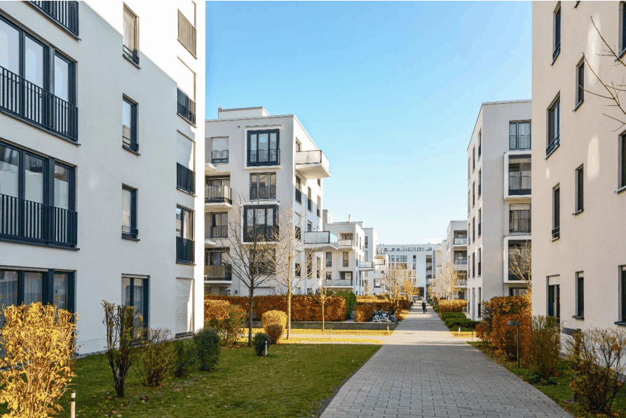

#### 6.13.3. Multi Dwelling Housing

> [Picture on page 109: a picture, saved as a picture (images/vol-2-part-08a-menangle-park-page-109-11.gif, 150 dpi).]

Figure 6.13 Multi Dwelling Housing

The following controls apply to Multi Dwelling Housing developments in the R3 Zone. Multi dwelling housing is defined under the Campbelltown Local Environmental Plan 2015 as “3 or more dwellings (whether attached or detached) on one lot of land, each with access at ground level, but does not include a residential flat building.”

Area 3 Lot Size Map, CLEP 2015: The minimum lot size for multi dwelling housing (within Area 3, under the CLEP 2015) in the R3 zone is 1,500m². Multi dwelling housing development may be subdivided under a Strata title only with consent. Further Torrens title subdivision is not permitted.

Objectives

a. To ensure that the design of multi-dwelling housing is consistent with the character of other Medium Density Residential and other permissible residential development in the R3 zone.

b. To ensure the quality of multi-dwelling housing is of a high quality and contributes to the amenity of residents.

c. To ensure that each dwelling within a multi dwelling housing development is afforded equal access to open space and amenity.

Controls

1\. Multi-dwelling housing sites are to have direct frontage to a public road (i.e., not on battle-axe lots) and are encouraged on corner sites.

2\. Multi-dwelling housing is to consider dwelling design, adjoining dwellings, landscape features, street trees, vehicle crossovers and lot orientation.

3\. The design of each dwelling in a multi dwelling housing development is to be slightly differentiated to avoid the presentation of homogenous built form presenting in a streetscape.

4\. The primary street frontages of multi dwelling housing developments are to be densely landscaped to soften the visual appearance of the built form and control massing and bulk.

5\. Each dwelling in a multi dwelling housing development must be provided with its own: ► PPOS area ► Separate access to the street from the front pedestrian entrance ► At least 1 car parking space and storage for at least 1 bicycle and 10m³ for general household items ► Private facilities for clothes drying ► Internal primary living area of a minimum 4m x 4m clear of obstructions and hallway spaces

6\. Multi-dwelling housing is to comply with the controls in Table 6.7.

Table 6.7 Key controls for multi dwelling housing

| Criteria Controls |  |
|---|---|
| Min Lot Size Min Lot Width Min internal site area per dwelling Site coverage (max) Minimum building envelope (ground floor) per dwelling Minimum no. of bedrooms per dwelling (Applies only to Area 3 on the Lot Size Map of the CLEP2013) Landscape Area Minimum area of primary and secondary road frontage to be landscaped Communal Open Space (Applies only to Area 3 on the Lot Size Map of the CLEP2013) Front Setback (minimum) | 1,500sqm only for Area 3 under the CLEP 2015 30m 200sqm 55% 95sqm internal 2 x bedrooms Min 1 x master bedroom comprising an area of 4m x 4m with an ensuite and walk-in-robe 30% of site area 35% Min area per 1,500m² block = 80sqm 3m to building façade line; 1.0m to articulation encroachment zone |

| Criteria Controls |  |
|---|---|
| Corner lots secondary street setback (min) Site Setback (min) Rear Setback (min) Internal Building Separation Distance Car Parking Spaces Garages and Carparking Dimensions (minimum) | 2m Ground floor 0.9m. Upper floor 1.2m 4m (excluding rear lane garages) 0.5m to rear lane (garages) 5m (unless dwellings are attached by a common wall) 1 car parking space per dwelling, plus 0.5 spaces per 3 or more bedroom dwelling, plus 1 visitor space per 5 dwellings. Basement parking is encouraged for multi dwelling housing. 3m x 5.5m Aisle widths must comply with AS 2890.1 1-2 bedroom dwellings will provide at least 1 car space. 3 bedroom or more dwellings will provide at least 2 car spaces. |

6.13.4. High Density Housing (Residential Flat Building and Shop Top Housing)

> [Picture on page 112: a picture, saved as a picture (images/vol-2-part-08a-menangle-park-page-112-2.gif, 150 dpi).]

Figure 6.14 Residential Flat Building (illustrative purposes only – not to be taken as a control)

Objectives

a. To enable the development of a diversity of dwelling types which assists in contributing to the availability of affordable housing.

b. To promote innovative housing solutions that are compatible with the surrounding residential environment.

c. To promote high-density living environments in that encourage walkability and healthy communities.

Controls

Table 6.8 Key controls for residential flat buildings

| Criteria | Controls |
|---|---|
| Floor Space Ratio | 2.5:1 |

| Criteria Controls |  |
|---|---|
| Setbacks Building Height (Max) Building separation (Min) Landscaped Area (min) Car Parking (minimum) Bicycle Parking Balcony Area Minimum Floor Space by dwelling type Criteria | 3.5 m from any street boundary Refer to the CLEP 2015 (Height of Buildings Map - Sheet HOB_003) In accordance with the ADG 20% 1 space per studio or 1 bedroom unit 1.5 spaces per 2 bedroom unit 2 spaces per 3 bedroom unit +1 space per 5 units (visitor parking) 1 space per 4 dwellings within common property In accordance with ADG 1 bedroom = 50sqm 2 bedrooms = 70sqm 3 bedrooms = 90sqm Any additional bedroom should increase the minimum internal area by at least 12sqm Controls |

Development for residential flat buildings is to take place in accordance with the above Table 6.8.

1\. Sites should have a minimum frontage of 30m and a minimum depth of 30m.

2\. Common open space must comply with SEPP 65 – Design Quality of Residential Apartments, where the minimum total area is equal to 25% of the site.

3\. Apartments should receive a minimum of 50% direct sunlight for a minimum of 2 hours between 9:00am and 3:00pm on the 21st of June.

4\. Residential flat buildings should be orientated towards open space.

5\. A minimum of 2 electric vehicle charging spaces are to be provided per building, or 2% of total spaces (whichever is greater).

6\. Vehicle entrances to RFBs should not front open space areas. Rather, vehicle entry driveways should be accessed from a secondary street.

7\. Each apartment building shall include a study/nook area that is capable of accommodating a desk for working/ studying from home purposes. Such area shall be shown furnished on the proposed plans and shall have a minimum width of 1.6 m.

8\. Apartments are to be designed to avoid overlooking into adjoining private open space areas.

9\. Ground floor dwellings shall address and have direct entry points from the street whilst maintaining privacy to private open spaces. A maximum 1 metre grade can separate ground floor from the street.

10\. Cross ventilation shall be achieved for at least 50% of each building.

11\. Communication devices, solar collectors etc. are to be integrated into the design of the building.

12\. Building materials must be selected to provide a contextual fit with the character of the surrounding area, both in regard to the natural environment and the existing built form.

13\. Deep Soil zones are to be provided in accordance with ADG requirements.

14\. Deep soil zones are to be furnished with large trees, as appropriate for the site, providing a high degree of canopy cover.

15\. The principals of WSUD are to be considered and implemented in all designs.
