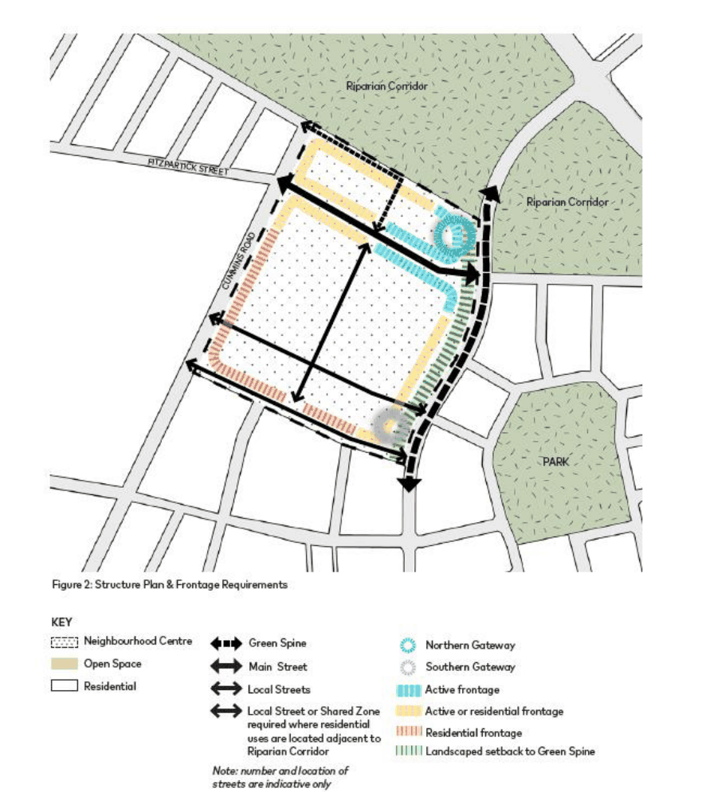

### 7.2. Indicative Town Centre Layout

The layout of the Menangle Park Town Centre is to be delivered in accordance with Figure 7.1.

> [Picture on page 121: a picture, saved as a picture (images/vol-2-part-08a-menangle-park-page-121-1.gif, 150 dpi).]

Figure 7.1 Illustrative Town Centre Master Plan
