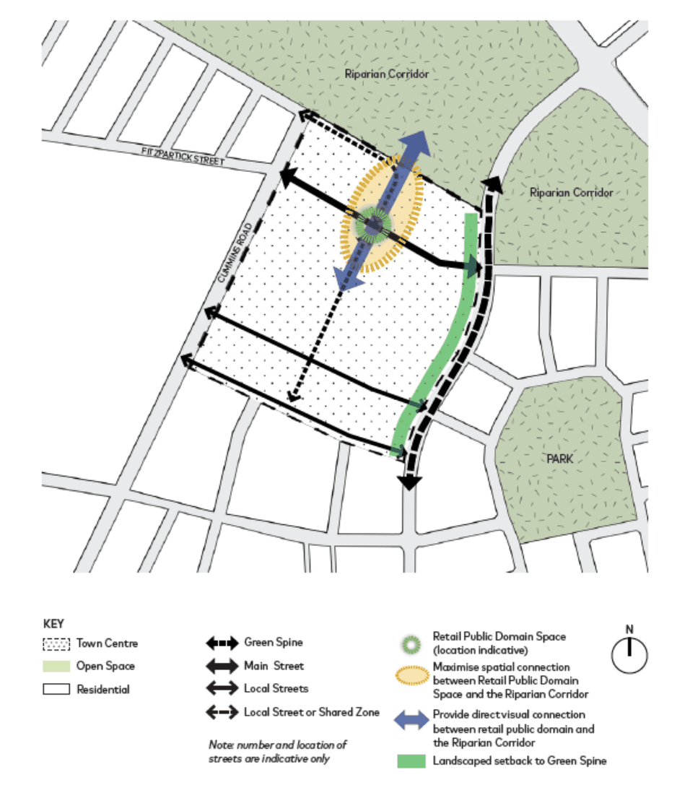
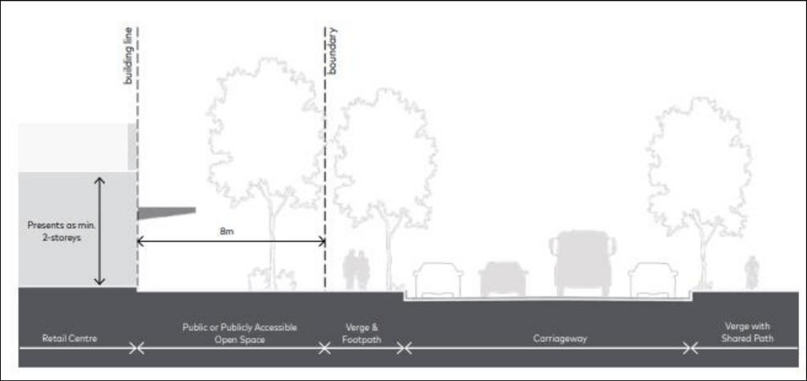

### 7.4. Public Domain

> [Picture on page 124: a picture, saved as a picture (images/vol-2-part-08a-menangle-park-page-124-2.gif, 150 dpi).]

Figure 7.2 Public Domain Plan

The public domain of the Town Centre is defined by:

► Main Street - a pedestrian friendly environment that accommodates a mix of uses that interact at the street level. ► The centre’s integration with the adjacent Howes Creek – providing pedestrian connection and a sensitive design interface.

► A street network that supports walkability and cycling. ► A high-quality streetscape and embellished public places that encourage utilisation and regular visitations.

Objectives

a. To provide a network of integrated and connected open space and public domain areas that strengthen the primary function of the Town Centre to serve its local community.

b. To ensure that parks and plazas act as a focal point for the Town Centre and community activities.

c. To provide high pedestrian amenity, ensuring walking and cycling within the Town Centre takes priority over traffic circulation and vehicle servicing.

d. To encourage a healthy mix of retail, commercial, community and residential uses throughout the Town Centre.

e. To incorporate a town square / civic plaza, adjacent to the Main Street, which provides an urban landscape setting and a civic focus for the community.

f. To ensure service infrastructure does not adversely impact public domain amenity.

Controls

1\. Design the landscaped setback to the Green Spine as public space (refer to Figures 7.2 and Figure 7.3).

2\. Main Street is to have active street frontages with ground level retail and dining spilling into footpaths.

3\. Footpaths are to be provided of an appropriate width to encourage active uses.

4\. Land uses are to achieve a level of street interaction as specified in Figure 7.2.

5\. Ground uses are to incorporate clear glass frontages to facilitate casual surveillance of street activity.

6\. Landscaping and its ongoing protection and maintenance is to be integrated into the Town Centre’s street network and shall include appropriate shade species to enhance the civic environment.

7\. The public domain shall incorporate ‘stopping places’ such as small plazas and seating areas throughout the centre.

8\. Stopping spaces and other public domain areas shall incorporate street furniture that is accessible and is located to encourage community interaction and active and/or public transport choices.

9\. Provide co-ordinated street furniture and lighting that enhances the character of the Town Centre.

10\. Provide street tree and open space planting that establishes generous shade for pedestrians.

11\. Design all signage and advertising in a coordinated manner.

12\. Crime Prevention Through Environmental Design principles are to be considered for all developments and public domain embellishments.

13\. Ensure site servicing, loading facilities, waste storage and other infrastructure is designed to minimise adverse amenity and visual impacts on the public domain and on neighbours.

14\. Maximise capture, storage and reuse of greywater, including the provision of stormwater detention and retention on-site.

> [Picture on page 126: a picture, saved as a picture (images/vol-2-part-08a-menangle-park-page-126-5.gif, 150 dpi).]

Figure 7.3 – Green Spine Interface
