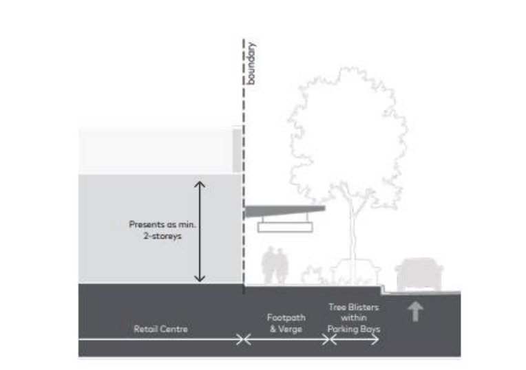
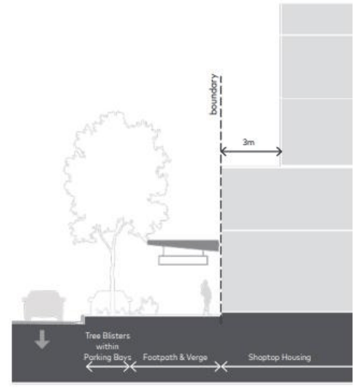
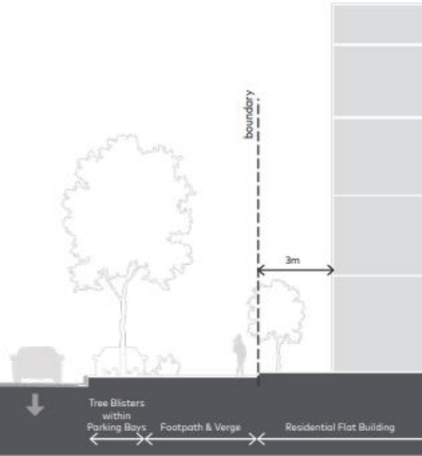
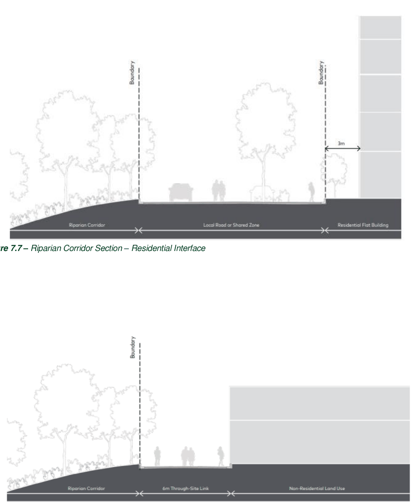

### 7.5. Built Form

Objectives

a. To provide distinctive gateway buildings for the purpose of welcoming and marking the entry into the Town Centre.

b. To establish a clearly defined Town Centre, differentiated from the rest of Menangle Park through the scale and intensity of development.

c. To define streets and open spaces with buildings.

d. To relate building heights to street functions and a comfortable urban scale of development.

e. To provide a continuous street frontage along all key streets.

f. To promote diversity and activity along the Main Street with a variety of frontage widths for retail shops.

g. To integrate with framework tree planting in the public domain.

Controls

1\. Building heights are to be provided in accordance with clause ‘4.3 – Height of Buildings’ of the Campbelltown LEP.

2\. Active street fronts, aligned with the street, are required on the ground level of all retail and commercial development. Active frontage uses can be defined as one of a combination of the following provisions at street level: ► Entrance to retail ► Shop front ► Glazed or transparent entries to commercial and residential lobbies ► Cafes or restaurant if accompanied by an entry from the street ► Active office uses, such as reception, if visible from the street ► Public buildings if accompanied by an entry

3\. Corner buildings and frontages within the Town Centre are to be defined and are to be articulated by a verandah, balcony or transparent windows to encourage passive surveillance.

4\. On corner sites, shop fronts are to wrap around the corner to maintain activation.

5\. Weather protection for pedestrians is to be provided along Town Centre streets. Weather protection can take the form of awnings, shade sails and/or similar and is to maintain a feeling of openness.

6\. Building services such as mechanical ventilation, roof plants and lift overruns should be screened from the public domain.

7\. Position landmark buildings at the northern and southern gateways into the Town Centre, with a preference for non-residential uses at the northern gateway (refer to Figure 7.1).

8\. Provide a range of building heights, up to a maximum of 6 storeys with a transition in heights to surrounding residential areas.

9\. Building heights are to take into account view lines and solar access to the public domain.

10\. All buildings in the Town Centre should be multiple storeys wherever possible.

11\. Where non-residential buildings are required to be single-storey by function or feasibility, they should be designed to present as a being minimum two-storeys in apparent height (refer to Figures 7.3 & 7.4).

12\. Residential uses are to be set back a minimum 3m from an adjoining street or public open space (refer to Figures 7.5 & 7.7).

13\. Ground level non-residential uses are to be built to  a maximum 0.5m setback from an adjoining street, except where a different setback is required by this DCP (refer to Figures 7.4 & 7.5).

14\. The first level above ground shall follow the same setback as the ground level, regardless of its use (refer to Figure 7.5).

15\. Provide a minimum 8m landscaped setback along the Green Spine (refer to Figures 7.1, 7.2 & 7.3).

16\. A continuous awning shall be provided along all non-residential frontages along Main Street.

17\. Where residential frontages are positioned on the same block as non-residential frontages on Main Street, they shall also provide a continuous awning. Ground floor setbacks may be reduced to accommodate this.

18\. Provide the main pedestrian access into the retail centre directly from Main Street, without needing to cross a car park.

19\. Retail entrances are to be fully accessible from bounding streets, without the use of a lift.

20\. Waste storage and collection areas are to be accommodated within buildings where possible, and designed appropriately to minimise adverse impacts, in particular within mixed use developments.

21\. All buildings shall integrate with framework planting provided in the public domain.

22\. The creation of Through Site Linkages is encouraged where appropriate.

23\. Where suitable, large format retail destinations are to be sleeved with premises for specialty shops or other uses.

24\. Where deemed necessary by Council, developments in the Town Centre may require environmental assessments to guard against wind tunnel effects and adverse conditions resulting from prevailing wind strength.

> [Picture on page 128: a picture, saved as a picture (images/vol-2-part-08a-menangle-park-page-128-13.gif, 150 dpi).]

Figure 7.4 – Main Street Section – Retail Interface

> [Picture on page 129: a picture, saved as a picture (images/vol-2-part-08a-menangle-park-page-129-1.gif, 150 dpi).]

Figure 7.5 – Main Street Section – Non-Residential Interface

> [Picture on page 129: a picture, saved as a picture (images/vol-2-part-08a-menangle-park-page-129-3.gif, 150 dpi).]

Figure 7.6 – Main Street Section – Residential Flat Building Interface

> [Picture on page 130: a picture, saved as a picture (images/vol-2-part-08a-menangle-park-page-130-1.gif, 150 dpi).]

Figure 7.7 – Riparian Corridor Section – Residential Interface

Figure 7.8 – Riparian Corridor Section – Non-Residential Interface
