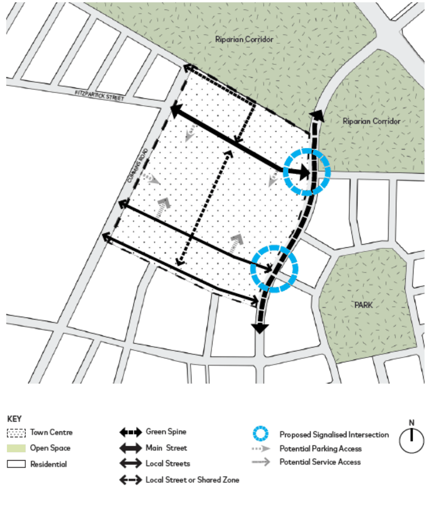
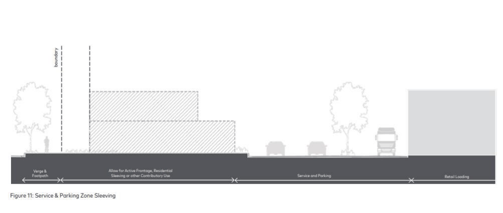
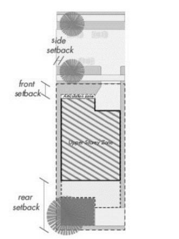
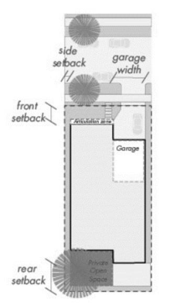

### 7.9. Mobility and Access

Objectives

a. To facilitate active transport and support healthy communities.

b. To create a slow-speed environment which prioritises pedestrians and provides for traffic calming measures.

c. To provide a suitable parking mix and opportunity for alternative modes of transport such as car share and bicycle.

d. To enhance the connectivity of the neighbourhood’s pedestrian movement.

e. To reduce car dependency and encourage the use alternative modes of transport, especially for trips to the centre by the local community it serves.

Controls

5\. Vehicle movements and intersections are to be provided in accordance with the Vehicle Movement and Intersection Plan at Figure 7.9.

6\. Service access shall be positioned as close to directly off the collector road (adjacent the Green Spine) as possible (refer to Figure 7.9).

7\. Dedicated laneways should be used to provide access to parking areas, loading docks and waste collection areas while minimising traffic along the Main Street and/or surrounding local roads.

8\. Laneways are to be designed to accommodate heavy vehicles where access to loading areas and waste collection is required.

9\. Carparking rates for the Town Centre are to be provided in accordance with Part 5 of the Campbelltown (Sustainable City Development Control Plan) 2015.

10\. Limited on street carparking may be provided on Main Street, Cummins Road, and streets bordering the Town Centre to enhance street life and surveillance.

11\. At-grade parking areas are to be minimised and generally located behind building lines and within the centre of street blocks. At-grade parking areas are to have an integrated planting and shading strategy.

12\. Council may evaluate temporary/transitional parking solutions if an application includes a staged plan demonstrating adherence to the specified parking location principles.

13\. Conceal loading, parking and blank walls with active uses or contributory residential sleeving where possible (refer to Figures 7.1 & 7.10). Where such concealment is not possible, provide landscaped buffers for interim screening and show that adequate site dimensions have been provided for sleeving to be incorporated in future.

14\. Opportunities for shared parking provision for complementary uses within the Town Centre are to be considered.

15\. Provision for on-demand / rideshare transport options (e.g., nominated drop-off and pick-up locations) are to be incorporated into the street network.

> [Picture on page 135: a picture, saved as a picture (images/vol-2-part-08a-menangle-park-page-135-1.gif, 150 dpi).]

Figure 7.9 Vehicle Movement and Intersection Plan

> [Picture on page 136: a picture, saved as a picture (images/vol-2-part-08a-menangle-park-page-136-1.gif, 150 dpi).]

Figure 7.10 Service and Parking zone sleeving

### Appendices

### Appendix A Glossary

“Access Streets and Laneways” provide local residential access to a small number of dwellings and serve a shared vehicular-pedestrian-cyclist use. They are intended to encourage a safe, low vehicle speed environment in which the residential function is dominant. Access streets function at the lowest level of the road hierarchy. They generally have development on one side and are located along drainage or open space reserves or along access-denied roads. The construction and dedication of access streets is the responsibility of the developer. “Articulation zone” includes verandahs, porches, awnings, shading devices, bay windows, pergolas and the like. A carport is not considered part of the articulation zone.

“Active Frontages” are defined as one or a combination of the following:

► entrance to retail; ► shop front; ► glazed entries to commercial and residential lobbies; ► café or restaurant if accompanied by an entry from the street;  active office uses, such as reception, if visible from the street; and ► Public building if accompanied by an entry.

“Attic” means a room within the main roof space of a building that has a 1.5m minimum wall height at edge of the room, a minimum 30-degree ceiling slope and does not incorporate or access a balcony.

“Arterial roads” are major roads that carry the majority of inter-regional traffic. Vehicular access from adjacent land is denied ensuring both the efficiency of the road and the safety of road users.

“Building footprint” means the area of land measured at finished ground level that is enclosed by the external walls of a building.

“Collector roads” are roads marked as such on the Precinct Road Hierarchy figure in the relevant Precinct Schedule. They are the main internal roads that carry local traffic through the residential neighbourhoods to the sub-arterial and arterial roads, and provide access to major attractors within the precinct such as retail, commercial and educational facilities.

“Flood Planning Levels (FPLs)” are the combinations of flood levels (derived from significant historical flood events or floods of specific AEPs) and freeboards selected for floodplain risk management purposes, as determined in management studies and incorporated in management plans. Flood planning area is the area of land below the FPL and thus subject to flood related development controls. The concept of flood planning area generally supersedes the ‘flood liable land” concept in the 1986 Manual. Flood Prone Land is land susceptible to flooding by the PMF event. Flood Prone Land is synonymous with flood liable land.

“Floor Area” for a dwelling house means the sum of the areas of each storey of the dwelling house and any carport, garage, balcony, deck, patio, pergola, terrace or veranda measured at a height of 1.4m above each floor level that is within the outer face of –

► the external walls of the dwelling house, and ► the walls of the carport, garage, balcony, deck, patio, pergola, terrace or veranda But does not include the following – ► any part of an awning, blind or canopy that is outside the outer wall of a building, the eaves.

> [Picture on page 139: a picture, saved as a picture (images/vol-2-part-08a-menangle-park-page-139-5.gif, 150 dpi).]

Figure 5: Floor Area

“Landscaped area” means any part of a site, at ground level, that is permeable and consists of soft landscaping, turf or planted areas and the like. It does not include driveways, parking areas, hard paved drying yards or other service areas, swimming pools, tennis courts, undercroft areas, roofed areas (excluding eaves <450mm to fascia board), outdoor rooms, balconies, rooftop gardens, terraces, decks, verandahs and the like.

“Outbuilding” means any of the following:

a. Balcony, deck, patio, pergola, terrace or veranda detached from a dwelling,

b. Cabana, gazebo, cubby house, garden shed, greenhouse, shed

c. Carport, detached garage,

d. Shade structure that is detached from dwelling,

e. Detached studio.

“Pervious area” means the parts of the site where water is able to permeate the soil, and excludes any areas that are paved, roofed or otherwise covered with impervious materials.

“Principal dwelling” means the largest dwelling house on a lot, measured by gross floor area.

“Principal private open space” means the portion of private open space which is conveniently accessible from a living zone of the dwelling, and which receives the required amount of solar access.

“Private open space” means the portion of private land which serves as an extension of the dwelling to provide space for relaxation, dining, entertainment and recreation. It includes an outdoor room.

“Riparian Corridor” means the riparian protection area as shown on the Riparian Protection Areas map within your Local Environmental Plan or applicable SEPP.

“Site coverage” means the proportion of a site area covered by buildings. However, the following are not included for the purpose of calculating site coverage:

► Any basement (that is not above existing ground level), ► Any part of an awning that is outside the outer walls of a building and that adjoins the street frontage or other site boundary, ► Eaves, ► Unenclosed balconies, decks, alfresco, pergola and the like

> [Picture on page 140: a picture, saved as a picture (images/vol-2-part-08a-menangle-park-page-140-12.gif, 150 dpi).]

Figure 10 Site Coverage

“Sub-arterial roads” are roads marked as such on the Precinct Road Hierarchy figure in the relevant Precinct Schedule. Sub-arterial roads link regional and local traffic routes. Access from private properties is generally denied to these roads (except in special circumstances) for reasons of traffic safety and to maintain the capacity and efficiency of the road system. Council is normally responsible for the acquisition and construction of sub-arterial roads.

“Town Centre Streets” are roads marked as such on the Precinct Road Hierarchy figure in the relevant Precinct Schedule. They are specially designed to create a pleasant and comfortable pedestrian environment. Amenity and safety is to be maintained through wide shaded footpaths, traffic calming measures and pedestrian crossings.

“Walking Distance” is typically 400m or a 5-minute walk from a local destination or bus stop, or 800m or a 10 minute walk from a train station.

### Appendix B. Riparian Protection Area Control

Introduction This precinct immediately adjoins the riparian corridor to the south separated by, and benefitting from, the Spring Farm Parkway. This precinct is characterised by the vegetation communities and native habitats found naturally along Howes Creek. The riparian corridor connects the community with healthy, natural recreation opportunities.

Approximately 540 residents (160- 200 dwellings) within a slightly lower density environment than the Town Centre precinct will benefit from close proximity to natural amenity and daily conveniences. This is the most diverse of the precincts delivering larger lots on slope, through to medium density product along the centrally located Green Spine and local parks. Key worker and affordable housing can be accommodated near the convergence of Spring Farm Parkway and the Green Spine.

A diverse mix of passive and active recreation spaces include district level play areas, walking and cycling trails and places to observe nature. Bridges, walkways and lookouts connect the areas of amenity whilst controlling access to water bodies, ensuring preservation of the natural environment.

This precinct provides critical north/south connectivity for pedestrians and cyclists. The Green Spine and Spring Farm Parkway park to riparian underpass create safe, attractive movement corridors celebrating the natural feature of this precinct. A commitment to best practice riparian corridor management will see the implementation of a vegetated buffer to protect, restore and maintain ecological functions.
