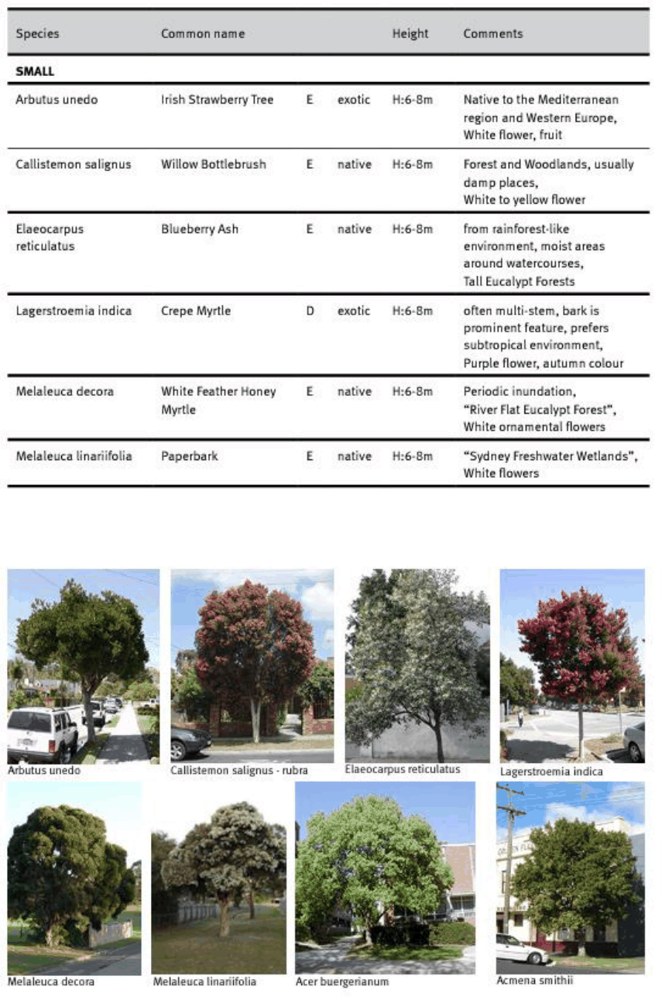
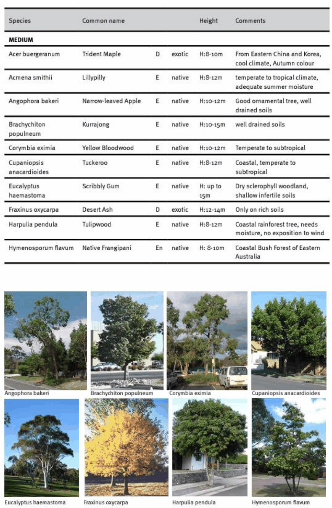
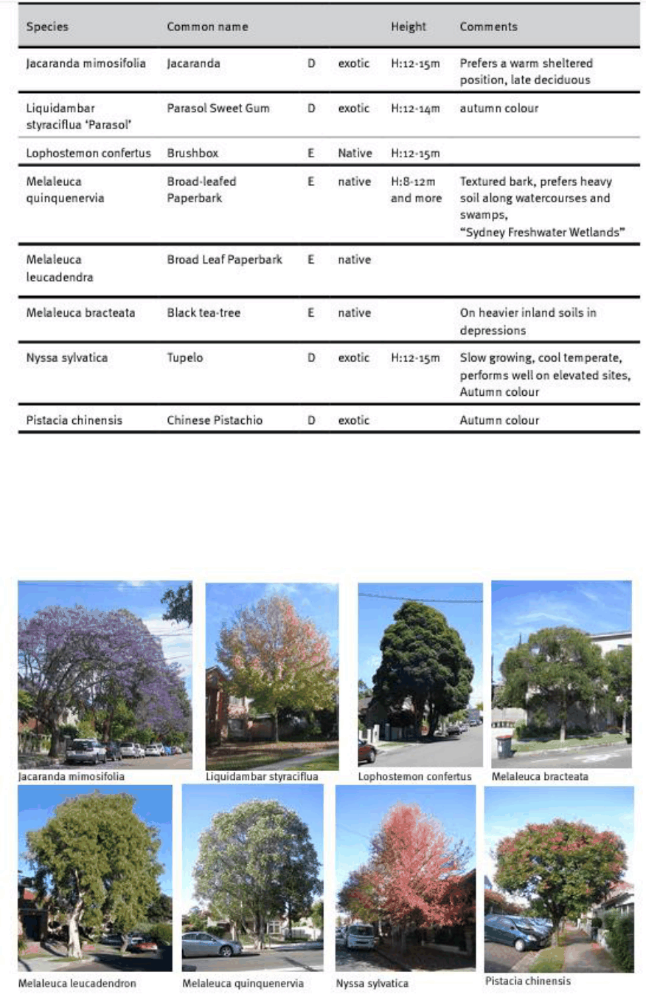
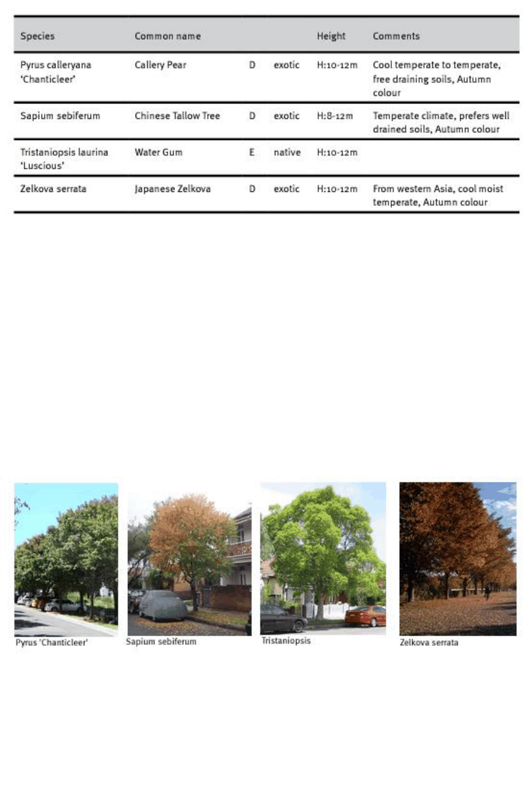
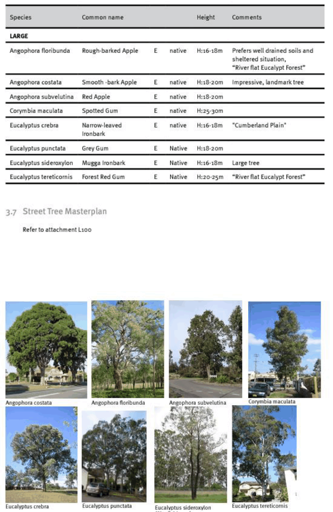

### 7.10. Land to which these Controls Apply

This Appendix applies to the land that contains, or is adjacent to, a riparian corridor, as defined in this DCP.

Controls Applications are to refer to the Guidelines for Riparian Corridors prepared by the NSW Office of Water, July

2012\. These guidelines contain the outcomes and requirements for development on land containing a riparian protection area in the South West Growth Centre Precincts, to which the Menangle Park DCP applies.

### Appendix C. Indicative Species List

> [Picture on page 143: a picture, saved as a picture (images/vol-2-part-08a-menangle-park-page-143-2.gif, 150 dpi).]

> [Picture on page 144: a picture, saved as a picture (images/vol-2-part-08a-menangle-park-page-144-1.gif, 150 dpi).]

> [Picture on page 145: a picture, saved as a picture (images/vol-2-part-08a-menangle-park-page-145-1.gif, 150 dpi).]

> [Picture on page 146: a picture, saved as a picture (images/vol-2-part-08a-menangle-park-page-146-1.gif, 150 dpi).]

> [Picture on page 147: a picture, saved as a picture (images/vol-2-part-08a-menangle-park-page-147-1.gif, 150 dpi).]

> [Picture on page 148: a picture, saved as a picture (images/vol-2-part-08a-menangle-park-page-148-1.gif, 150 dpi).]

#### Campbelltown City Council, PO Box 57, Campbelltown, NSW 2560
