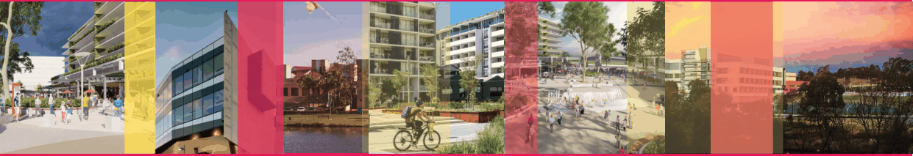

# Campbelltown Sustainable City Development Control Plan 2015 - Part 8A Menangle Park

> This chapter is split into 72 section file(s), one per numbered heading, in the order they appear in the PDF.

Source PDF: [part8amenanglepark.pdf](part8amenanglepark.pdf)

### Campbelltown

### (Sustainable City)

### Development Control

### Plan 2015

> [Picture on page 1: a picture, saved as a picture (images/vol-2-part-08a-menangle-park-page-1-5.gif, 150 dpi).]

### VOLUME 2

### VOLUME 2

### Site Specific DCPs

## Part 8A:  Menangle Park

### Creating Campbelltown's Future 2025

### Development Control Plan

> The PDF's contents list (page numbers of the printed document) is not repeated here - see Sections below.

<!-- sections -->
## Sections

1. [1.1 Name and Application of this Plan](01-1-1-name-and-application-of-this-plan.md)
2. [1.2 Projects Overview](02-1-2-projects-overview.md)
3. [1.3 Compliance with the LEP](03-1-3-compliance-with-the-lep.md)
4. [1.4 Staging](04-1-4-staging.md)
5. [1.5.1 Campbelltown Council Planning Documents](05-1-5-1-campbelltown-council-planning-documents.md)
6. [1.6.1 Information to be submitted with Development Applications](06-1-6-1-information-to-be-submitted-with.md)
7. [1.6.2 Variations to Development Controls and DCP Amendments](07-1-6-2-variations-to-development-controls-and.md)
8. [2.1 Menangle Park Vision, Desired Future Character Statement and Principles Desired Future Character Statement](08-2-1-menangle-park-vision-desired-future.md)
9. [2.2 The Indicative Layout Plan](09-2-2-the-indicative-layout-plan.md)
10. [3.1 Riparian Corridors](10-3-1-riparian-corridors.md)
11. [3.2 Flora and Fauna Conservation](11-3-2-flora-and-fauna-conservation.md)
12. [3.3 Bushfire Hazard Management](12-3-3-bushfire-hazard-management.md)
13. [3.4 Air Quality](13-3-4-air-quality.md)
14. [3.5 Stormwater, Water Cycle Management and Flooding](14-3-5-stormwater-water-cycle-management-and.md)
15. [3.6 Noise Management](15-3-6-noise-management.md)
16. [3.7 Salinity and Soil Management](16-3-7-salinity-and-soil-management.md)
17. [3.8 Night Sky Protection](17-3-8-night-sky-protection.md)
18. [3.9 Site Contamination](18-3-9-site-contamination.md)
19. [3.10 Development on and Adjacent to Electricity and Gas Easements](19-3-10-development-on-and-adjacent-to.md)
20. [3.11 Aboriginal Heritage](20-3-11-aboriginal-heritage.md)
21. [3.12 Non-Indigenous Heritage](21-3-12-non-indigenous-heritage.md)
22. [4.1 Menangle Park - Urban Structure](22-4-1-menangle-park-urban-structure.md)
23. [4.2.1 Street layout and design](23-4-2-1-street-layout-and-design.md)
24. [4.2.2 Green Spine](24-4-2-2-green-spine.md)
25. [4.2.3 Laneways](25-4-2-3-laneways.md)
26. [4.2.4 Pedestrian and Cycle Network](26-4-2-4-pedestrian-and-cycle-network.md)
27. [4.3 Public Domain, Parks and Community Infrastructure](27-4-3-public-domain-parks-and-community.md)
28. [4.4 Crime Prevention through Environmental Design](28-4-4-crime-prevention-through-environmental.md)
29. [5.1 Residential Density](29-5-1-residential-density.md)
30. [5.2 Block and Lot Layout](30-5-2-block-and-lot-layout.md)
31. [5.2.1 Block Layout](31-5-2-1-block-layout.md)
32. [5.2.2 Lot Layout](32-5-2-2-lot-layout.md)
33. [5.2.3 Battle-Axe Lots](33-5-2-3-battle-axe-lots.md)
34. [5.2.4 Corner Lots](34-5-2-4-corner-lots.md)
35. [5.2.5 Dual (Parallel) Street Frontages](35-5-2-5-dual-parallel-street-frontages.md)
36. [5.3 Subdivision Approval Process in the R2 and R3 Zones](36-5-3-subdivision-approval-process-in-the-r2.md)
37. [6.1.1 Site Analysis](37-6-1-1-site-analysis.md)
38. [6.2 Sustainable Building Design](38-6-2-sustainable-building-design.md)
39. [6.3 Cut, Fill and Retaining Walls](39-6-3-cut-fill-and-retaining-walls.md)
40. [6.3.1 Cut and Fill Controls](40-6-3-1-cut-and-fill-controls.md)
41. [6.3.2 Retaining Wall Controls](41-6-3-2-retaining-wall-controls.md)
42. [6.3.3 Retaining Wall Setback Controls](42-6-3-3-retaining-wall-setback-controls.md)
43. [6.4 Dwelling Height, Massing and Siting](43-6-4-dwelling-height-massing-and-siting.md)
44. [6.5 Zero Lot Lines](44-6-5-zero-lot-lines.md)
45. [6.6 Landscaped Area](45-6-6-landscaped-area.md)
46. [6.7 Private Open Space](46-6-7-private-open-space.md)
47. [6.8 Communal Open Space](47-6-8-communal-open-space.md)
48. [6.9 Garages, Site Access and Parking](48-6-9-garages-site-access-and-parking.md)
49. [6.10 Visual and Acoustic Privacy](49-6-10-visual-and-acoustic-privacy.md)
50. [6.11 Fencing](50-6-11-fencing.md)
51. [6.12.1 Environmental Living and Rural Lifestyle Lots](51-6-12-1-environmental-living-and-rural-lifestyle.md)
52. [6.12.2 Large Lot Residential](52-6-12-2-large-lot-residential.md)
53. [6.12.3 Low Density Residential](53-6-12-3-low-density-residential.md)
54. [6.12.4 Medium Density Residential the R3 Medium Density Zone](54-6-12-4-medium-density-residential-the-r3-medium.md)
55. [6.13.1 Attached Dwellings](55-6-13-1-attached-dwellings.md)
56. [6.13.2 Secondary Dwellings and Dual Occupancies](56-6-13-2-secondary-dwellings-and-dual-occupancies.md)
57. [6.13.3 Multi Dwelling Housing](57-6-13-3-multi-dwelling-housing.md)
58. [6.14.1 Exhibition Homes and Exhibition Villages](58-6-14-1-exhibition-homes-and-exhibition-villages.md)
59. [7.1 Vision and Objectives for the Town Centre](59-7-1-vision-and-objectives-for-the-town.md)
60. [7.2 Indicative Town Centre Layout](60-7-2-indicative-town-centre-layout.md)
61. [7.3 Land Uses](61-7-3-land-uses.md)
62. [7.3.1 Retail](62-7-3-1-retail.md)
63. [7.3.2 Commercial](63-7-3-2-commercial.md)
64. [7.3.3 Residential](64-7-3-3-residential.md)
65. [7.3.4 Service Infrastructure](65-7-3-4-service-infrastructure.md)
66. [7.4 Public Domain](66-7-4-public-domain.md)
67. [7.5 Built Form](67-7-5-built-form.md)
68. [7.6 Setbacks and Street Activation](68-7-6-setbacks-and-street-activation.md)
69. [7.7 Active Edges Types of ‘Active’ Edges in Urban Design](69-7-7-active-edges-types-of-active-edges-in.md)
70. [7.8 Solar Access and Shading](70-7-8-solar-access-and-shading.md)
71. [7.9 Mobility and Access](71-7-9-mobility-and-access.md)
72. [7.10 Land to which these Controls Apply](72-7-10-land-to-which-these-controls-apply.md)
