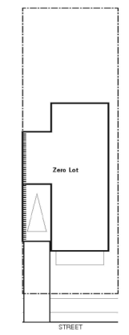
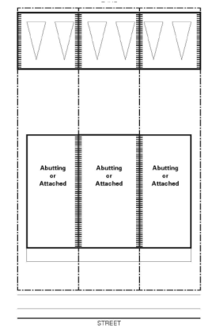

## 4. Desired Future Character for Urban Renewal Areas

5\. Dwellings and Ancillary Structures

6\. Residential Development.

#### Relationship

#### to other Plans

#### and Documents

### 1.7 Relationship to other Plans and Documents

The provisions of this URADCP are site specific and apply only to certain Urban Renewal Areas within Campbelltown LGA .The URADCP forms Part xxx of Volume 2 of the SCDCP

2015\.  The provisions of the SCDCP 2015 apply to the land to which URADCP applies. However, the URADCP prevails to the extent of any consistency with the SCDCP 2015. Where a site specific DCP does not include specific development controls for a certain type of development, the development controls under Volume 1 of the SCDCP shall be used to assess the development applications received by Council. Airds/Bradbury and Claymore urban renewal areas are subject to a Concept Plan approval under the former Part 3A of the EP&A Act received in 2012 and 2013 respectively.  In approving the concept plans, the Minister for Planning determined that subsequent development is to be subject to Part 4 of the Act . The determinations of the Minister for Planning in approving the concept plans and the provisions of Schedule 6A of the Act are relevant and include a provision to the effect that the provisions of any environmental planning instrument or any development control plan do not have effect to the extent to which they are inconsistent with the terms of the approval of the Concept Plan. The term of approval of the concept plans requires development to be carried out generally in accordance with the Airds Bradbury Urban Renewal Development Control Guidelines dated October 2011 and the Claymore Urban Renewal Development Control Guidelines dated May 2012.  This URADCP incorporates these guidelines and the controls in this DCP have been prepared so as to be generally consistent with the terms of approval of the concept plans. Consideration is to be given to the provisions of the CLEP 2015 and the SCDCP 2015. It is intended that the provisions of CLEP 2015 will be amended to delete clause 4.1A relating to yield restrictions on the basis of the certainty provided by the URADCP.

### 1.8 AIMS AND OBJECTIVES OF THE URADCP

The aims of this URADCP are to:

• 	Ensure that the intentions of the Airds Bradbury and Claymore concept plan approvals are met;

• 	Ensure that controls and guidelines are in place for dwellings on lots created by subdivision of land within the urban renewal areas;

• 	Ensure that the principles of ecological sustainability are incorporated into the design, construction and ongoing operation of development;

• 	Facilitate innovative development of high quality design and construction in the urban renewal areas;

• 	 Encourage the creation of safe, secure and liveable environments; and

• 	Provide for a variety of high quality housing choices within the City of Campbelltown. The objectives of the URADCP are:

#### Social:

Aims and Objectives of

#### the URADCP

1\. Provide for a mixture of housing types;

2\.	Provide housing that responds to the network of open spaces, focal points and community facilities;

3\.	Ensure safety and security through passive surveillance of streets and open space areas by following the principles of ‘safety by design’.

#### Environmental:

1\. Establish quality streetscapes which add to the visual and environmental amenity of the site;

2\.	Encourage environmentally responsible building practices including solar passive design solutions for all housing;

3\. Encourage built form consistent with the Desired Future Character.

#### Economic

1\. Ensure that the future development enhances the surrounding suburbs and positively impacts upon market values in the area;

2\. Create variety in housing types and tenure mix which is marketable and feasible;

3\.	Provide appropriate housing for low income earners, the aged and people with disabilities.

### 1.9 Definitions

Terms in this URADCP are defined in the CLEP 2015  and the SCDCP 2015.  Additional terms include: Abutting dwelling is a building containing one dwelling, on a single block of land that is designed and constructed on a zero lot line immediately adjacent to another dwelling on a different lot that is also built to the zero lot line and is structurally independent of any other dwelling.  An abutting dwelling is a form of dwelling house. Building Envelope Plan (BEP) means a plan that shows the location and number of storeys of a building on a site.  The BEP should be at a legible scale (suggested 1:200) and include the following elements:

•	 Lot numbers, north point, scale, drawing title and site labels such as street names;

•	 Maximum permissible building envelope (setbacks, storeys, articulation zones)

•	 Preferred principal private open space;

•	 Garage size (single or double) and location;

•	 Zero lot line boundaries. A BEP should be fit for purpose and include only those elements that are necessary for that particular lot.

#### Definitions

Manor home is a form of multi-dwelling housing and means a 2-storey building containing 4 dwellings, where:

(a) each storey contains 2 dwellings, and

(b) each dwelling is on its own lot (being a lot within a lot within a strata scheme or community title scheme), and

(c) access to each dwelling is provided through an individual entry at ground level. Manor homes are not residential flat buildings.

> [Picture on page 7: a picture, saved as a picture (images/vol-2-part-09-urban-renewal-areas-airds-claymore-dcp-page-7-12.gif, 150 dpi).]

Illustration 1: Zero Lot Line

> [Picture on page 7: a picture, saved as a picture (images/vol-2-part-09-urban-renewal-areas-airds-claymore-dcp-page-7-14.gif, 150 dpi).]

Principal private open space area means the area of private open space that is directly outside the living areas of the dwellings, consisting of an appropriately dimensioned square.  The PPOS can include an outdoor leisure / alfresco dining areas that are covered either by the main roof structure or by another lightweight material. Studio Dwelling means a room or suite of rooms occupied or used, or so constructed or adapted as to be capable of being occupied or used as a separate secondary domicile on the land, which is located above a garage, car port or the like.

Illustration 2: Abutting Dwelling

Zero Lot Line Dwelling is a building containing one dwelling, on a single block of land, that is constructed with an exterior wall on one of its side boundaries but is not attached to any other dwelling.  A zero lot line dwelling is a type of dwelling house.

### 2.1-2.4
