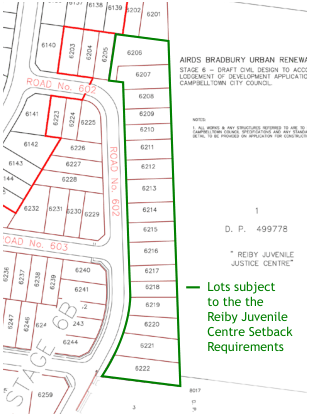

## 2. Requirements Applying to all Types of Development

#### Introductions

### 2.1	 Introduction

The provisions of Part 2 of the SCDCP 2015 apply to development in the urban renewal areas.

### 2.2	 Additional Controls regarding Noise

In addition to the requirements under Section 3.4.3 Acoustic and Visual Privacy of the SCDCP 2015 any future development application for residential lots or seniors living development fronting Badgally Road must refer to the document entitled Environmental Criteria for Road Noise (EPA 2010), to enable Council to properly consider potential impacts on that residential development that may arise from the developments proximity to potential road noise and to determine if there are any particular conditions of consent that should be imposed upon that development.

### 2.3	 Additional Controls regarding Retaining Walls

Section 2.12 of the SCDCP 2015 does not apply to neighbourhood subdivision.

### 2.4	 Future Development Applications

Pursuant to the terms of the concept plan approvals for Airds Bradbury and Claymore, any future applications for dwellings (that are not defined as exempt or complying development) within the sites shall:

1\. include an assessment of construction impacts, including noise, traffic, soil and erosion (including acid sulphate soils where relevant), waste, and dust, and identify the mitigation and management measures that would be implemented to address these impacts;

2\. demonstrate that habitable floor levels are located above the 100 year ARI flood level plus 500mm freeboard, and that appropriate flood evacuation can be provided for dwellings located below the probable maximum flood level;

3\. demonstrate compliance with the Planning for Bushfire Protection 2006; and

4\. demonstrate that ESD measures have been incorporated into the design of the buildings to reduce water and energy consumption in accordance with State Environmental Planning Policy (Building Sustainability Index: BASIX) 2004. These requirements are included generally in Part 2 of the SCDCP 2015.

### 2.5	 Reiby Juvenile Justice Centre

#### Reiby Juvenile

#### Justice Centre

Dwellings on properties that adjoin the Reiby Juvenile Justice Centre are to have a 6 metre rear building setback.

> [Picture on page 9: a picture, saved as a picture (images/vol-2-part-09-urban-renewal-areas-airds-claymore-dcp-page-9-7.gif, 150 dpi).]
> Words printed on the picture (title and legend, copied from the PDF):
> Lots subject
> to the the
> Reiby Juvenile
> Centre Setback
> Requirements

Illustration 3: Land to which Section 2.5 applies
