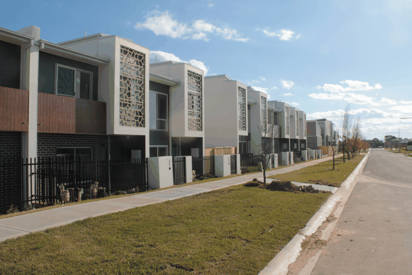

## 4. Desired Future Character for Urban Renewal Areas

#### Desired Future

The desired future character of the urban renewal areas is one that:

Character for

#### Urban Renewal

• 	 Provides a range of dwelling types in response to market demands;

#### Areas

• 	 Provides new dwellings that address and reinforce the street through appropriate building siting and orientation;

• 	 Provides buildings that can be constructed to enhance safety through design, by providing casual surveillance over areas of public open space, including streets and paths;

• 	 Provides medium density housing types, such as attached dwellings and manor homes in appropriate locations such as near shopping centres and parks;

• 	 Encourages more active and inviting streetscapes by designing car parking structures and hardstand areas to complement the built form of dwellings and to avoid dominating the streetscape.

#### Note:

For the purpose of the URADCP part Zero Lot Line Dwelling and abutting dwellings are a type of dwelling house and studio apartments are a type of dual occupancies.

> [Picture on page 11: a picture, saved as a picture (images/vol-2-part-09-urban-renewal-areas-airds-claymore-dcp-page-11-21.gif, 150 dpi).]

Illustration 4: Residential streetscapes
