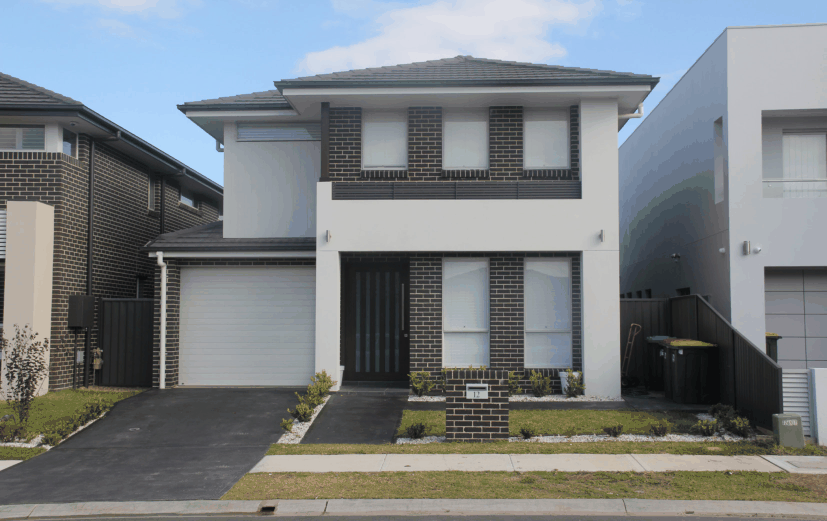

## 5. General Requirements for Residential Development

#### Building Form

#### and Character

This Section provides general development controls for residential development within the areas where the URADCP applies.

#### Car Parking and Access

Section 3.4.2 of Volume 1 of the SCDCP shall apply.

#### Car Parking Rates

a)	 Each dwelling house or a dwelling that is part of a dual occupancy, semi detached dwellings, manor home or attached dwellings shall be provided with a minimum of one (1) single garage.

#### Visual and Acoustic Privacy

Section 3.4.3 of Volume 1 of the SCDCP shall apply.

### 5.1 Building Form and Character

#### Objectives:

■

■ To ensure that buildings are designed to enhance the existing and future desired built form and character of the urban renewal areas by encouraging innovative and quality housing designs which are distinctive and contemporary and fits harmoniously with their surroundings.

#### Design Requirements

#### 5.1.1 Streetscape

a)	 Building design (including façade treatment, massing, roof design and entrance features), setbacks and landscaping shall complement the scale of development, character and qualities of the adjoining streetscape.

b)	 Articulate building frontages facing the street to add visual interest. Use of step-ping, material combinations, verandahs, porches and balconies, canopies and blade walls shall be encouraged.

c)	 Development on corner sites shall incorporate facade treatments that address both street frontages and achieve articulation in the building design.

d)	 The built form shall relate to the natural landform and setting, particularly when viewed from a public place, building entrance ways and recognised vantage points outside the immediate locality. A sites natural slope should be used to create visual interest and generate innovative housing forms while minimising cut and fill requirements.

e)	 All dwellings shall be designed with a contemporary architectural character

f) Outbuildings and ancillary structures shall be located to the rear of the site.

g)	 The pitch of hipped and gable roof forms on the main dwelling house have a maximum

#### Building Form

#### and Character

slope of 36 degrees. Skillion roofs, roofs hidden from view by parapet walls, roofs on detached garages, studios and ancillary buildings on the allotment are excluded from this control.

h)	 Eaves are to provide sun shading to protect windows and doors and provide aesthetic interest and are permitted to extend up to 450mm from the side boundary, except for zero lot line, attached dwellings and semi-detached dwellings and parapet walls.

i) No blank walls shall be presented to any street frontage.  Any continuous wall of more than one storey in height shall be no more than 10m in length.  Walls over 10m long shall have a minimum off- set of 500mm wherein the wall can either pursue a new alignment or return to the original alignment after a minimum distance of 2 metres.  Where a ‘cut away’ is pursued, the roofline must reflect the cutaway and not extent straight past the cut away.  This requirement does not apply to party walls of attached dwellings or zero lot line dwellings.

j) When determining appropriate external building materials for residential development, the following guidelines shall be observed:

a. External wall materials shall be predominantly masonry (i.e. brick) and finished in either face brickwork, coloured/painted render or coloured bagging;

b. 	Lightweight materials can be utilised to provide variety in textures or profile on dwelling facades (e.g. timber, feature fibre cement sheeting or pre-finished metal sheeting);

c.	No galvanised iron, plain cement sheeting or plain concrete blocks shall be utilised;

d. 	Low profile concrete, terracotta or slate roof tiles or pre-finished and pre-coloured corrugated metal roofing shall be utilised

11\.	The colour palette to be used in all dwellings is to consist largely of neutral, natural tones. Feature colours may be utilised for selected elements to create interest and highlights.

12\. A detailed schedule of the proposed external finishes, materials and colours shall be submitted for Council’s approval as part of the development application.

#### 5.1.2 Building Height

a) Residential development other than seniors housing provided by NSW Land & Housing Corporation shall be a maximum of 9.5 metres in height.

b) The height of development shall not result in any significant loss of amenity (including loss of solar access and visual and acoustic privacy) to adjacent properties and public places.

c) All dwellings shall have a least one habitable room window at ground and first floor level addressing the primary street (and secondary street frontage for corner lots).

#### Building Form

#### and Character

> [Picture on page 14: a picture, saved as a picture (images/vol-2-part-09-urban-renewal-areas-airds-claymore-dcp-page-14-3.gif, 150 dpi).]

Illustration 5: Single garage

#### 5.1.3 Garages

a)	Council will consider proposals for garages under dwellings on sloping sites if satisfied that the garage would not result in a building that exceeds 9.5m in height at any point.

b)	A single garage only shall be provided within the front elevation of a dwelling with a lot frontage of less than 12 metres.

c)	The garage door element fronting onto a street shall be no wider than 50% of the total dwelling width.

d)	The width of the garage door where it has a rear access shall be a maximum of 6.0 metres.

e)	Sites with lot sizes of 300sqm or less shall be limited to a single garage only at the primary street frontage.

f)	 A garage shall be setback a minimum of:

(i)	 1.0 metre from the rear boundary where it has a  rear vehicle access;

(ii)	 3.0 metres from the rear boundary where it does not have rear vehicle access.

(iii) 	4 metres from the primary setback for a site with an area of 300 sqm or less;

(iv) 	5 metres from the primary setback for a site with an area of greater than 300sqm

### 5.2 Private Open Space

#### Private Open

#### Objectives:

#### Space

■

■ To ensure that dwellings are provided with sufficient area of private open space for the use of the occupants.

a)	 A dwelling located on a site with a lot area of 300sqm or less shall be provided with an area of private open space that:

i)	 is located behind the primary street building setback;

ii)	 has a minimum area of 16 sqm for sites;

iii)	Includes a minimum levelled area of  (4x4)sqm;

iv)	has an internal living room directly accessible to the outdoor private open space areas; and

v)	 satisfies solar access requirements contained in  5.3.

b)	 A dwelling located on a site area of more than 300sqm shall be provided with an area of private open space that:

i)	 is located behind the primary street building setback;

ii)	 has a minimum area of 24sqm;

iii)	Includes a minimum levelled area of  (4x6)sqm;

iv)	has an internal living room directly accessible to the outdoor private open space areas; and

v)	 satisfies solar access requirements contained in Solar Access in Section 5.3.

### 5.3 Solar Access

#### Solar Access

#### Objectives:

■

■ Encourage building design and siting to take advantage of climatic factors and reduce household energy consumption.

■

■ Encourage features to be incorporated into site and building design to optimise passive solar access to internal and external spaces.

#### Design Requirements

1\. Living areas shall generally have a northern orientation and be directly accessible to private open space areas.

2\. New dwellings shall be designed to maximise solar access to all private open space areas.  Suitable shadow diagrams shall be required for all house designs greater than one storey in height.

3\. At least 3 hours of sunlight between 9am and 3pm at the winter solstice (21 June) to at least 50% of the required private open space principal of both the proposed development and the neighbouring properties.

4\. Development shall have appropriate regard to the impact on solar access to usable private open space, solar collectors and clothes drying areas of adjoining residential development.

5\. New dwellings shall be designed to reduce the need for artificial lighting during daylight hours.

6\. Windows and glazed doors shall be protected from direct summer sun with appropriate hoods, eaves or louvres or adjustable shading devices wherever possible. Living areas shall generally have a northerly orientation.

### 5.4 Landscaping

#### Landscaping

#### Objectives:

■

■ Maintain and rehabilitate the natural environment and assist in the conservation of Campbelltown’s landscape character;

■

■ Enhance the sustainability of the development by minimising water usage, contributing to biodiversity and enhancing passive energy systems for dwellings.

#### Design Requirements

1\. Front gardens are to include one tree that will reach a height of 5m to 8 metres on maturity;

2\. Rear gardens are to include at least one tree that will reach a height of 10 to 15 metres on maturity;

3\. Retaining walls shall be stepped / terraced at a maximum height of 900mm and incorporate a minimum step of 900mm face to face;

4\. No more than 30% of the area forward of any building line shall be surfaced with impervious materials;

5\. A minimum of 15% of the total site area shall be available for deep soil planting.

### 5.5 Location and Treatment of Services

#### Objectives:

Location and Treatment of

#### Services

■

■ To minimise the visual and acoustic impact of onsite services.

#### Design Requirements

1\. All metre boxes and services plant shall be treated to reduce their visual prominence from the public domain by screening, recessing or colour treatments.

2\. TV aerials shall be located to the rear of the dwelling, whilst satellite dishes may only be erected if they are suitably screened from view of the public and neighbours.

3\. 	Letter boxes shall be located visible from the street and accessible from the public footpath.  If no footpath is present access shall be provided accessible from outside the front boundary of the property.

4\. 	Air-conditioning units shall be located a minimum of 4 metres from the site boundary or screened for visual and acoustic privacy.  They shall not be located along the front site boundary.

### 5.6 Waste Storage Provisions

#### Waste Storage

#### Objectives:

#### Provisions

■

■ Ensure waste systems are easy to use and are accessible by collection vehicles;

• 	Ensure healthy and safe practices for the storage, handling and collection of waste and recycling materials;

• 	Promote the principles of ESD through appropriate resource recovery and recycling, leading to a reduction in the consumption of finite natural resources.

#### Design Requirements

1\. Provision shall be made for all waste and recycling storage containers to be located behind the primary and secondary building alignment and out of public view.

2\. Space shall be allocated behind the primary and secondary building alignments and out of public view to store the following bins:

a) a 140 litre bin;

b) two (2) 240 litre bins;

3\. Any area for storing garbage and recycling shall be located in a position that is convenient for occupants.

4\. The path for wheeling bins between waste storage area(s) and the collection vehicle shall be free of steps or kerbs and have a maximum gradient of 1:8 where possible.

5\. Rear loaded, battle axe and car court dwellings shall make provision for bin collection on a public street accessible by collection vehicles.

6\. The location of bin storage areas is to be shown on dwelling plans.
