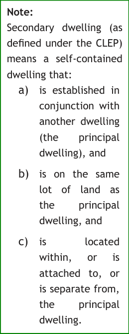
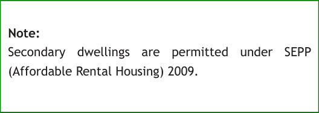
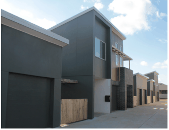
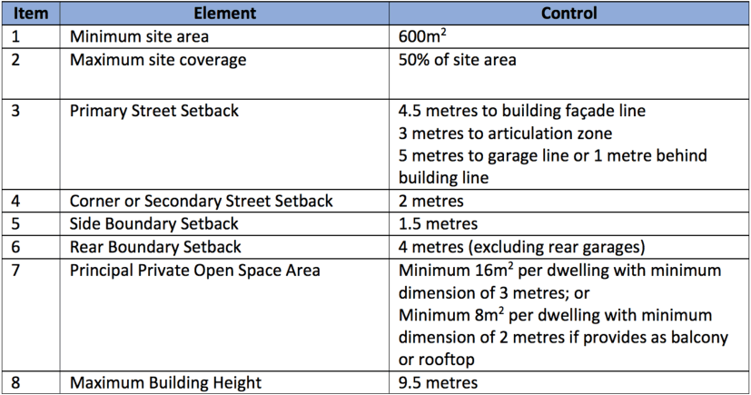
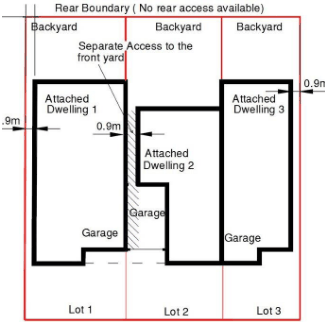

## 7.  Residential Development

#### Introduction

### 7.1  Introduction

This section sets out controls for various dwelling types expected in the renewal areas such as:

• 	 Dwelling houses (including abutting dwellings, zero lot line dwellings;

• 	 Attached dwellings;

• 	 Semi-detached dwellings;

• 	 Dual occupancies (attached and detached);

• 	 Multi dwelling housing (including manor homes) Development shall be in accordance with the key development controls summary table (Table 1) and as described in Sections 7.2 to 7.8.

#### Table 1:  Key Housing Development Controls

Item Lot Size

200-250m2 251-300m2 301-450m2 451-600m2 601-900m2

| 1 | Maximum site cover | 70% | 65% | 60% 55% | 55% |
|---|---|---|---|---|---|
| 2 | Primary street setback | 3.0m | 3.0m | 4.0m 4.0m | 4.0m |
| 3 | Secondary street setback | 1.0m | 1.0m | 2.0m 2.0m | 2.0m |
| 4 | Rear boundary setback | 1.0m from rear access garage or 3 metres where no garage |  | 3.0m 4.0m | 4.0m |
| 5 | Side setback | 0.9m for detached dwellings or refer to items 6 & 7 |  | 0.9m 0.9m | 0.9m |
| 6 | Build to boundary (attached dwellings and abutting dwellings) | Lot width 6.0-7.9 metres: both sides lot width 8.0-10.0 metres: one side and 0.9m on the other |  | Does not Does apply apply | not Does not apply |
| 7 | Build to boundary (zero lot line walls and semi-detached dwellings) | Build to boundary one side and 0.9m on the other |  | Does not Does apply apply | not Does not apply |
| 8 | Garage setback | 1.0m for rear access garage: 4.0m to primary street |  | 5.0m 5.0m | 5.0m |
| 9 | Garage dominance | Rear access garage (6.0m max door width) or single garage only to primary street frontage. The garage door element fronting onto a street shall be no wider than 50% of the total dwelling width |  | The garage door element fronting onto a street shall be no wider than 50% of the total dwelling width. |  |
| 10 | Principal private open space area | Minimum of 16 sqm (provision of 4m x 4m square) |  | Minimum of 24 sqm (provision of 6m x 4m square) |  |
| 11 | Maximum building height | 9.5m |  |  |  |

### 7.2  Dwelling Houses

#### Dwelling

#### Objectives:

#### Houses

■

■ Encourage quality-designed dwelling houses that make a positive contribution to the streetscape and amenity of the neighbourhood.

■

■ To provide definition of the public domain by ensuring development addresses the streets and open spaces;

■

■ To ensure that all residential lots achieve an appropriate level of amenity;

■

■ To ensure that subdivision and development on smaller lots is undertaken in a co-ordinated manner;

■

■ To promote housing choice / variety / affordability; and

■

■ To provide higher density dwellings around parks and close to community facilities, increasing casual surveillance and activity to improve safety and security in public areas.

#### 7.2.1 Site Coverage

a)	 A dwelling house shall have a maximum site coverage of:

ii)	 70% for a lot with an area between 200- 250sqm;

iii)	65% for a lot with an area between 251-

Illustration 6: 14m frontage

300sqm

iv)	60% for a lot with an area between 301- 450sqm;

v)	 55% for a lot with an area larger than 451sqm.

#### 7.2.2 Setbacks

Illustration 7: 10m frontage

a)	 A dwelling house shall be setback a minimum of:

i)	 3.0 metres from the primary street boundary for a site with a lot  area of 300sqm or less;

ii)	 4.0 metres from the primary street

Illustration 8: Dwelling house -

boundary for a site with a lot area greater than 300sqm;

Corner Lot

iii)	1 metre from the secondary street boundary for a site with a lot area  of 300sqm or less;

#### Dwelling

iv)	2 metres from the secondary street boundary for

#### Houses

a site with a lot  area greater than 300sqm;

v)	 0.9 metres from any side boundary, other than zero Lot Line Dwelling; and

vi)	3 metres from the rear boundary for a site with a lot  area of 450sqm or less;

vii)	4 metres from the rear boundary for a site with a lot  area of more than 450sqm.

#### 7.2.3 Dwelling houses with zero side setback

a)	 Dwelling houses shall only be permitted to be located on the side boundary where the lot is nominated on the subdivision plan.

b)	 Where a zero lot line is nominated on a lot on the subdivision plan, the adjoining (burdened) allotment is to include a 900mm easement for single storey zero lot walls and 1200mm for two storey zero lot walls to enable servicing, construction and maintenance of the adjoining dwelling. No overhanging eaves, gutters or services (including rainwater tanks, hot water units, air-conditioning units or the like) of the dwelling on the benefited lot will be permitted within the easement.

c)	 The S88B instrument for the subject (benefited)

> [Picture on page 23: a map, saved as a picture (images/vol-2-part-09-urban-renewal-areas-airds-claymore-dcp-page-23-28.gif, 150 dpi); the street names and other small labels are on the picture.]
> Words printed on the picture (title and legend, copied from the PDF):
> Secondary dwelling (as
> defined under the CLEP)
> means a self-contained
> a)	 is established in
> b)	 is on the same
> lot of land as
> c)	 is located
> within, or is
> attached to, or
> is separate from,

#### Note:

lot and the adjoining (burdened) lot shall include a note identifying the potential for a building to have a zero lot line.

### 7.3 Secondary Dwellings

#### Design Requirements:

a)	 Secondary Dwelling shall  comply with Section

3.6.2 of Volume of the SCDCP 2015.

> [Picture on page 23: a picture, saved as a picture (images/vol-2-part-09-urban-renewal-areas-airds-claymore-dcp-page-23-37.gif, 150 dpi).]

#### Note:

Secondary dwellings are permitted under SEPP (Affordable Rental Housing) 2009.

### 7.4 Semi-Detached Dwellings

#### Objectives:

#### Semi-Detached

#### Dwellings

■

■ Encourage quality-designed semi-detached that make a positive contribution to the streetscape and amenity of the neighbourhood.

■

■ To provide definition of the public domain by ensuring development addresses the streets and open spaces;

■

■ To ensure that all residential lots achieve an appropriate level of amenity;

■

■ To promote housing choice / variety / affordability.

#### 7.4.1 Site Coverage

#### Note:

a)	 A semi-detached Dwelling shall have a maximum site coverage of:

ii)	 70% for a lot with an area between 200- 250sqm;

iii)	65% for a lot with an area greater than

Semi-detached dwellings (as defined under the CLEP)  means a dwelling that is on its own lot of land and is attached to only one other dwelling.

251sqm.

#### 7.4.2 Setbacks

a)	 A semi-detached dwelling shall be setback a minimum of:

i)	 3.0 metres from the primary street boundary;

ii)	 1.0 metre from the secondary street boundary;

iii)	0.9 metres from the side that is not attached to the other dwelling;

iv)	3 metres from the rear boundary for a site with a lot  area of 450sqm or less

### 7.5 Dual Occupancies

#### Design Requirements:

#### Dual

#### Occupancies

a)	 Site coverage and setbacks for dual occupancies shall be simillar to the site coverage and setback for semi-detached dwellings under this part.

b)	 Dual occupancies (attached or detached) may be constructed on corner lots where the lot has an area of not less than 500sqm.  Each dwelling is to address a street frontage.

c)	 Any other dual occupancy development is to comply with the provisions of Clause 4.1B of CLEP 2015 and Section 3.6.3 of SCDCP 2015.

### 7.6 Studio Dwelling

#### Objectives:

■

■ E 1. To provide housing choice / diversity for families;

■

■ To provide the opportunity for rental accommodation for single occupants; and

> [Picture on page 25: a picture, saved as a picture (images/vol-2-part-09-urban-renewal-areas-airds-claymore-dcp-page-25-18.gif, 150 dpi).]

■

■ To provide casual surveillance over rear access points.

#### Design Requirements:

1\. Studio apartments are to be located only on top of detached garages accessible from rear lanes.

2\. Studio apartments are not to be subdivided into a separate allotment.

3\. The maximum gross floor area of a studio dwelling is 75sqm.

Illustration 9: Studio apartment

#### Note:

4\. Where the studio apartment is built to a zero lot line on a side boundary, windows are not to be located on the zero lot wall unless that wall adjoins a laneway, public road, public open space or drainage land.

For the purpose of the URADCP part, studio apartments are a type of dual occupancy.

5\. Studio apartments are to have balconies or living areas that overlook laneways for casual surveillance.

6\. Where studio dwelling is built over a rear garage and separated from the upper levels of the principal dwelling, there must be a minimum separation of 5m between the upper floor rear façade of the principal dwelling and studio dwelling.

#### Note:

Studio Apartment means a room or suite of rooms occupied or used, or so constructed or adapted as to be capable of being occupied or used as a separate secondary domicile on the land, which is located above a garage, car port or the like.

### 7.7 Multi Dwelling Housing

#### Multi Dwelling

a)	 The provisions of CLEP 2015 and SCD2015 apply with respect to multi dwelling housing

#### Housing

on land within the urban renewal areas except for multi dwelling housing for, or on behalf of, NSW L&HC and manor homes which are a form of multi dwelling housing.

b)	 manor homes are permitted in areas shown as future development lots on Figures 3 and 4 and shall comply with the controls contained in the following table:

#### Table 2:  Manor Homes Development Controls

> [Picture on page 26: a picture, saved as a picture (images/vol-2-part-09-urban-renewal-areas-airds-claymore-dcp-page-26-10.gif, 150 dpi).]

#### Note:

Multi-dwelling housing may be built by or on behalf of NSW L&HC under SEPP (Affordable Rental Housing) 2009. Manor homes may be built by any person on land identified as future development lots on Figure 3 and 4.

### 7.8 Attached Dwellings

#### Objectives:

■

■ Encourage quality-designed attached that make a positive contribution to the streetscape and amenity of the neighbourhood.

■

■ To provide definition of the public domain by ensuring development addresses the streets and open spaces;

■

■ To ensure that all residential lots achieve an appropriate level of amenity;

■

■ To promote housing choice / variety / affordability.

#### 7.8.1 Site Coverage

a)	 An attached Dwelling shall have a maximum site coverage of:

i)	 70% for a lot with an area between 200- 250sqm;

ii)	 65% for a lot with an area greater than 251sqm.

#### Attached

#### Dwellings

#### 7.8.2 Setbacks

a)	 An attached dwelling shall be setback a

Illustration 10: Manor homes

minimum of:

i)	 3.0 metres from the primary street boundary;

ii)	 1.0 metre from the secondary street boundary;

iii)	0.9 metres from the side that is not attached to another dwelling;

Illustration 11: Attached dwellings

> [Picture on page 27: a picture, saved as a picture (images/vol-2-part-09-urban-renewal-areas-airds-claymore-dcp-page-27-16.gif, 150 dpi).]

iv)	3 metres from the rear boundary.

b)	 Combined applications for subdivision of land and the construction of a dwelling on each lot shall contain a minimum of three and a maximum of six attached dwellings in any continuous row.

3\. Where a side dwelling wall is not attached (i.e. located on a corner allotment or midblock) that building line wall shall be setback a minimum distance of 2 metres for a corner lot and 0.9 metres from a midblock property boundary.

Figure 12 – Illustration of an

#### 7.8.3 Rear Access for Attached Dwellings

a)	 Where there is no access to a rear lane or rear

example of a design solution for ‘rear to front’ access requirement for attached dwellings at ground level.

#### Note:

street  directly available from the back  of attached dwellings, each dwelling shall be provided with a separate and direct access from the backyard to the front yard that does not pass through any habitable area of the dwelling (Refer to Figure 11 for a suggested design solution).

b)	 For the purpose above, the direct access from the rear to the front of the dwelling shall have a minimum width of 0.9 metres and shall not be obstructed by hot water systems, air conditioning units, gardens or anything that may result in the obstruction of the access way.

The requirement for the rear-to front access is to enable occupants of an attached dwelling to move organic waste bins, lawnmowers and the like from the backyard to the front of the building without the need to pass through the main living areas.
