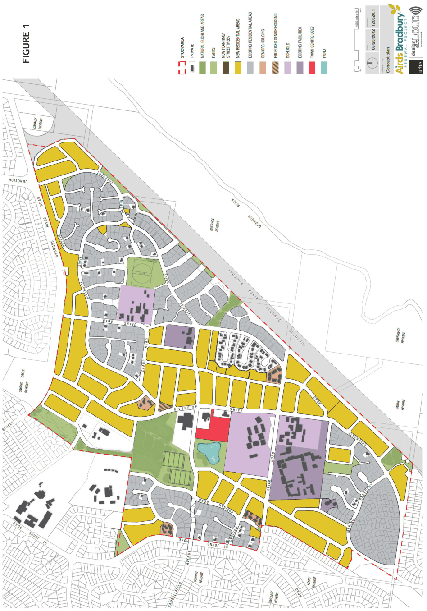
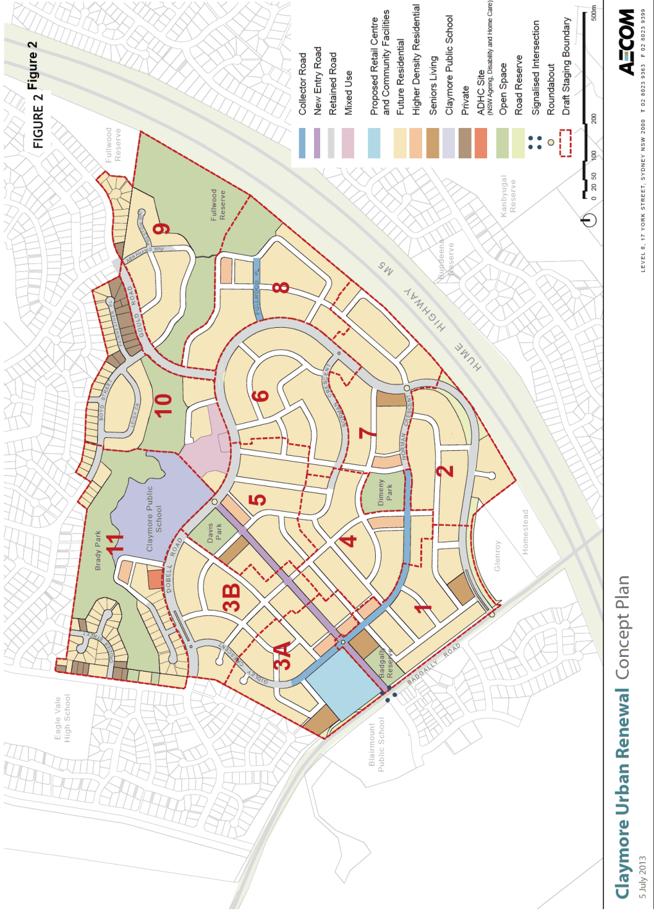
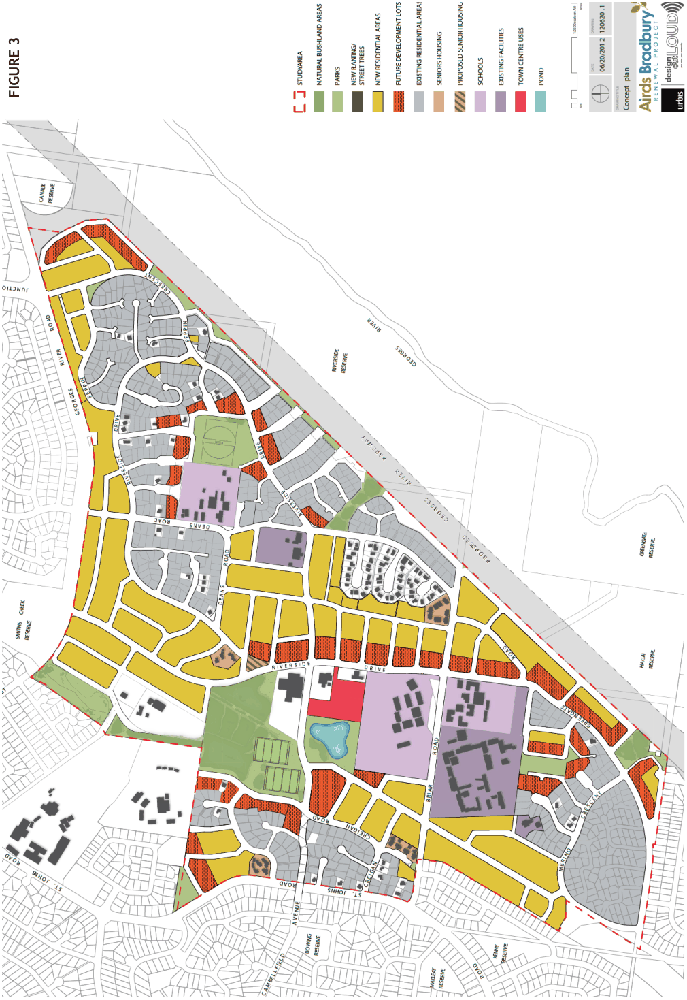
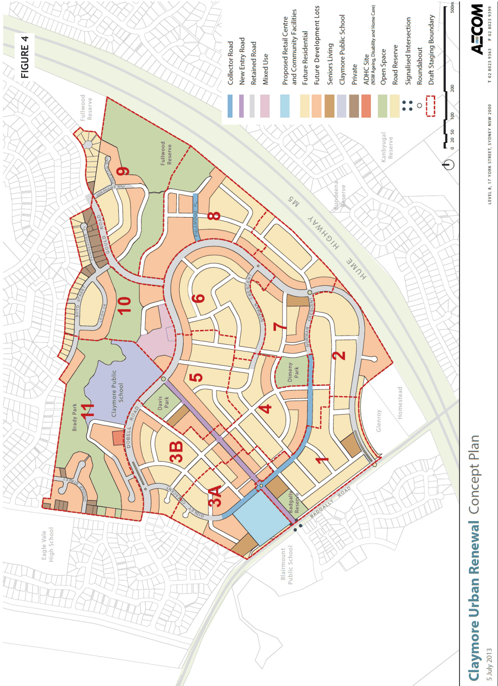

## 8. Neighbourhood Subdivision

#### Introduction

Important Note:  The term neighbourhood subdivision refers to subdivision of land undertaken by UrbanGrowth NSW or NSW Land and Housing Corporation as a means of implementing urban renewal projects at Claymore and Airds Bradbury.

#### Objectives:

■

■ Provide a range of lot sizes with the more intensive development located closer to the town centre and around parks.

■

■ Provide lot dimensions capable of accommodating a range of affordable house types.

■

■ Create efficient layouts that respond to existing site conditions and context.

■

■ Ensure that subdivision provides safe connections with an extension of existing street patterns, as well as any pedestrian, cycleway and public open space networks.

■

■ Promote walking and cycling as the primary mode of travel within a residential neighbourhood.

■

■ Provide a network of bus, pedestrian and cycle routes within the public domain which connect open space areas and community facilities and encourage alternative modes of transport.

### 8.1 Introduction

Neighbourhood subdivision applications can indicate lots intended for further subdivision. Not all lots created by Neighbourhood subdivsions are suitable for further subdivsion.

### 8.2 Neighbourhood Subdivision

The urban design intent for subdivision in the renewal areas is to create an urban structure based on:

#### Important Note:

• 	 a more inter-connective street system focussing movement onto streets;

• 	 reconfigured open spaces responding to community needs and providing safe and accessible spaces linked to the pedestrian and cycle network;

Neighbourhood Subdivision to create lots smaller than permitted under CLEP 2015 is proposed but only in accordance with this section.

• 	 improved community safety by introducing

street edges to open spaces and fronting housing towards open spaces;

• 	 establishing new roads to create new blocks of a size suitable for a variety of lot sizes and to improve vehicle and pedestrian accessibility and safety.

#### Design

#### Requirements

Lot sizes range predominantly from 200 square metres to 600 square metres.  Some variation to this might occur in localised areas constrained by the road layout and existing development.  Battle axe type lots shall be avoided and only entertained where a street frontage cannot otherwise be provided due to levels, existing development constraints or residual land issues.

### 8.3 Design Requirements

1\. All neighbourhood subdivisions shall be generally consistent with the Concept Plan approval for Claymore and Airds Bradbury and generally as shown in Figures 1 and 2 regarding the location of open space areas, public roads and proposed residential development.

2\. 	No further subdivision of allotments following the neighbourhood subdivision, shall be permitted unless:

a)	the allotment is located in an area identified in Figures 3 and 4 as future development lots or seniors living; or

b)	The land is located in an area identified in Figure 3 as existing residential areas and the subdivision is a re-subdivision of existing lots in the ownership of NSW Land and Housing Corporation; or

c)	The land is located on any of the following streets within the Claymore Urban Renewal Area (Figure 4) and the subdivision is a re-subdivision of existing lots in the ownership of NSW Land and Housing Corporation:

i.	 Carter Place;

ii.	 Drysdale Street;

iii.	Crozier Street, Blake Place and Auld Place;

iv.	Boyd Street;

v.	 Fairweather Place;

vi.	Gould Road; or

d)	The size of any lot resulting from a subdivision of land is not to be less than the minimum size allowed for that land under CLEP 2015.

e)	The subdivision is a strata subdivision or community title subdivision.

### 8.4 Neighbourhood Subdivision - Allotment Size and Design

1\. Design of residential allotments shall have regard for the impact of orientation, slope, and aspect to facilitate solar access to future dwelling development.

2\. All proposed allotments shall have a street frontage.

3\. Battle axe lots shall only be permitted where a street frontage cannot otherwise be

provided because of existing conditions including the size and shape of a residual parcel.

#### Subdivision

4\. All allotments intended for dwellings will have a minimum site area of 200m2 with a minimum width measured at the building line of 6 metres.

5\. Any allotment with a width to the street frontage of less than 9 metres is to have the garage located to the rear of the property accessed from a rear lane or accessway.

#### Approval

Process for Housing on

#### Smaller Lots

6\. Allotments are to have a minimum depth of 25 metres.

### 8.5 Subdivision Approval Process for Housing on Smaller Lots

The land subdivision approval process is to be consistent with the following provisions:

1\. For lots equal to or greater than 300m2:

a. 	Dwelling plans required as part of future development application of complying development certificate application;

b. 	No restrictions on title;

c. 	Subdivision can be completed (plan registered) prior to dwelling construction.

2\. For lots less than 300m2 and equal to or greater than 225m2 in area, and with a width equal to or greater than 9m:

a.  Dwelling plans are required as part of future development application or complying development certificate application;

b. 	A Building Envelope Plan is to accompany the development application for subdivision;

c. 	Dwelling design restriction to be registered on title via a S88B instrument to reflect the Building Envelope Plan;

d. 	Subdivision can be completed (plan registered) prior to dwelling construction.

3\. Dwelling construction involving detached dwellings on lots less than 225m2, or lots with a width less than 9m:

a)	 Dwelling plans required as part of subdivision application (the development application seeks approval for subdivision of land and construction of a dwelling on each lot in the subdivision);

b)	 Subdivision can be completed (plan registered) following construction of dwellings.

4\. Dwelling construction involving common walls (i.e. attached dwellings, semi-detached dwellings, dual occupancies and multi dwelling housing):

a. 	Dwelling plans required as part of subdivision application (the development application seeks approval for subdivision of land and construction of a dwelling on each lot in the subdivision);

b. 	Subdivision can be completed (plan registered) following construction of dwellings.

The Building Envelope Plan is to be at a legible scale (suggested 1:200) and include the

following elements:

a. 	Lot numbers, north point, scale, drawing title and site labels such as street

#### Subdivision

names;

b. 	Maximum permissible building envelope (setbacks, storeys, articulation zones);

c. 	Preferred principal private open space;

#### Approval

Process for Housing on

#### Smaller Lots

d. 	Garage size (single or double) and location; and

e. 	Zero lot line boundaries (if any).

#### APPENDIX 1

> [Picture on page 32: a picture, saved as a picture (images/vol-2-part-09-urban-renewal-areas-airds-claymore-dcp-page-32-2.gif, 150 dpi).]

#### FIGURE 1

Draft Campbelltown (Sustainable City) Development Control Plan 2015      Effective:xx

> [Picture on page 33: a picture, saved as a picture (images/vol-2-part-09-urban-renewal-areas-airds-claymore-dcp-page-33-1.gif, 150 dpi).]

#### FIGURE 2

> [Picture on page 34: a picture, saved as a picture (images/vol-2-part-09-urban-renewal-areas-airds-claymore-dcp-page-34-1.gif, 150 dpi).]

#### FIGURE 3

Draft Campbelltown (Sustainable City) Development Control Plan 2015      Effective:xx

> [Picture on page 35: a picture, saved as a picture (images/vol-2-part-09-urban-renewal-areas-airds-claymore-dcp-page-35-1.gif, 150 dpi).]

#### FIGURE 4

> [Picture on page 37, not reproduced as text; see the original PDF.]
> Words on this picture, read by OCR (may contain errors): campbelltown.nsw.gov.au Campbelltown City Council, PO Box 5/7, Campbelltown, NSW 2560
