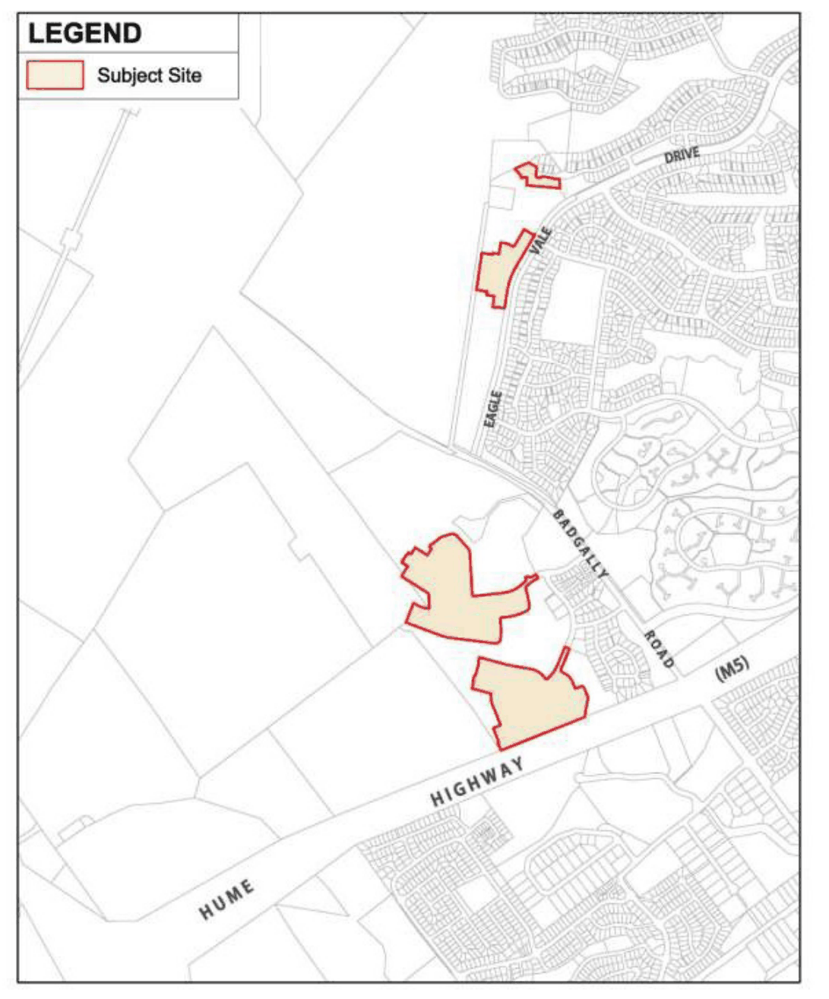

#### 10.1 .2  The Site

The subject site to which Part 10 under Volume 2 applies, is identified in Figure 1.

Note:

The DCP DCP came into effect on  25 April 2018 as part of Amendment No 5 to the SCDCP 2015)

#### Application

> [Picture on page 3: a picture, saved as a picture (images/vol-2-part-10-blairmount-and-badgally-road-dcp-page-3-2.gif, 150 dpi).]

Figure 1: Land to  where Part 10 under Volume 2 applies
