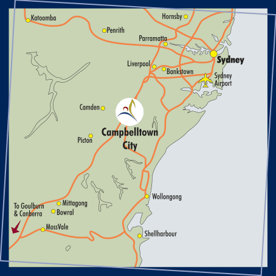

#### 10.2 .2.1 Dwelling Houses

#### Subdivision

Objectives:

■

■ Encourage quality-designed dwelling houses that make a positive contribution to the streetscape and amenity of the neighbourhood.

■

■ Provide definition of the public domain by ensuring development addresses the streets and open spaces.

#### Design Requirements:

a)	 Dwellings shall comply with the controls provided in Table 10.1 and 10.2.

#### Table 10.1: Controls for detached (front-loaded) dwellings

| Element | Control |
|---|---|
| Front setback (min) | 4m to building facade line and 3m to articulation zone |
| Side setback (min) | 0.9m |
| Rear Setback (min) | 4m 6m second storey (except where the rear property boundary adjoins public open space, a riparian corridor or the Hume Highway, where the second storey setback can be reduced to 4m subject to achieving the required solar access controls) |
| Garage setback (min) | 5.5m front-loaded garages |
| Corner lots secondary street setback (min) | 2.0m |
| Building height, massing and siting | 2 storeys maximum |
| Site coverage | Single storey dwelling: 60% Upper level no more than 40% of lot area |
| Soft landscaped area | Minimum 25% lot area. |
| Principal Private Open Space (PPOS) | Minimum 24m² with minimum dimension of 4.0m. The PPO is to receive at least 3 hours of sunlight between 9am and 3pm at the winter solstice (21 June) to 50% of the required area, including both the proposed development and neighbouring property. |
| Garages and car parking | Minimum one single garage |

#### Table 10.2: Controls for detached (rear-loaded) dwellings

| Element | Control |
|---|---|
| Front setback (min) | 3.5m to building facade line and 2.5m to articulation zone |
| Side setback (min) | 0.9m |
| Garage setback (min) | 0.5m to the rear boundary and 0.9m to the side boundary |
| Corner lots secondary street setback (min) | 2.0m |
| Building height, massing 2 and siting | storeys maximum |
| Site coverage | Upper level no more than 40% of lot area |
| Soft landscaped area | Minimum 15% lot area. |
| Principal Private Open Space (PPOS) The 9am and | Minimum 16m² with minimum dimension of 4m. PPO is to receive at least 3 hours of sunlight between and 3pm at the winter solstice (21 June) to 50% of the required area, including both the proposed development neighbouring property. |
| Garages and car parking | Minimum one single garage |

#### Subdivision

#### 10.2.3 Other Forms of Residential Development

a)	 Controls for other forms of residential development contained in Volume 3, Part 2 of the Campbelltown (Sustainability) Development Control Plan 2015 shall apply.

Note: where minimum lot widths and building setbacks differ between this Part and Volume 3, Part 3 of the DCP, the minimum standards contained in this Part apply.

> [Picture on page 8: a picture, saved as a picture (images/vol-2-part-10-blairmount-and-badgally-road-dcp-page-8-1.gif, 150 dpi).]

#### campbelltown.nsw.gov.au

#### Campbelltown City Council, PO Box 57, Campbelltown, NSW 2560
