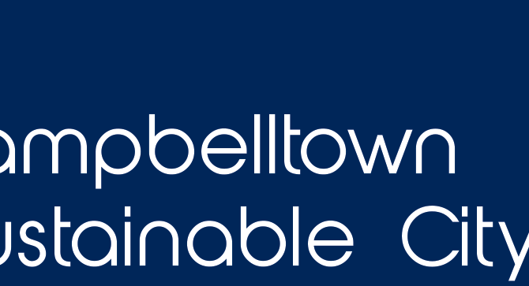
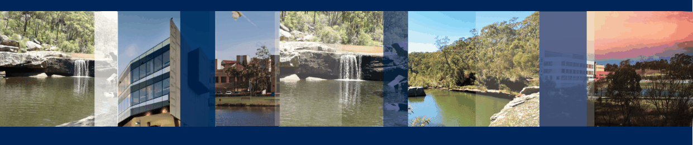

# Campbelltown Sustainable City Development Control Plan 2015 - Part 10 Blairmount and Badgally Road DCP

> This chapter is split into 6 section file(s), one per numbered heading, in the order they appear in the PDF.

Source PDF: [volume-2-part-10blairmountandbadgallyroaddcp.pdf](volume-2-part-10blairmountandbadgallyroaddcp.pdf)

> [Picture on page 1: a picture, saved as a picture (images/vol-2-part-10-blairmount-and-badgally-road-dcp-page-1-1.gif, 150 dpi).]

### Campbelltown (Sustainable City) Development Control Plan 2015

> [Picture on page 1: a picture, saved as a picture (images/vol-2-part-10-blairmount-and-badgally-road-dcp-page-1-6.gif, 150 dpi).]

### VOLUME 2

### Site Specific DCPs

## Part 10: Blairmount and Badgally Road  DCP

### Creating Campbelltown's Future 2025

<!-- sections -->
## Sections

1. [10.1 10.1 Application](01-10-1-10-1-application.md)
2. [10.1 .1  Definitions](02-10-1-1-definitions.md)
3. [10.1 .2  The Site](03-10-1-2-the-site.md)
4. [10.2 .1  Subdivision](04-10-2-1-subdivision.md)
5. [10.2 .2 Residential Development](05-10-2-2-residential-development.md)
6. [10.2 .2.1 Dwelling Houses](06-10-2-2-1-dwelling-houses.md)
