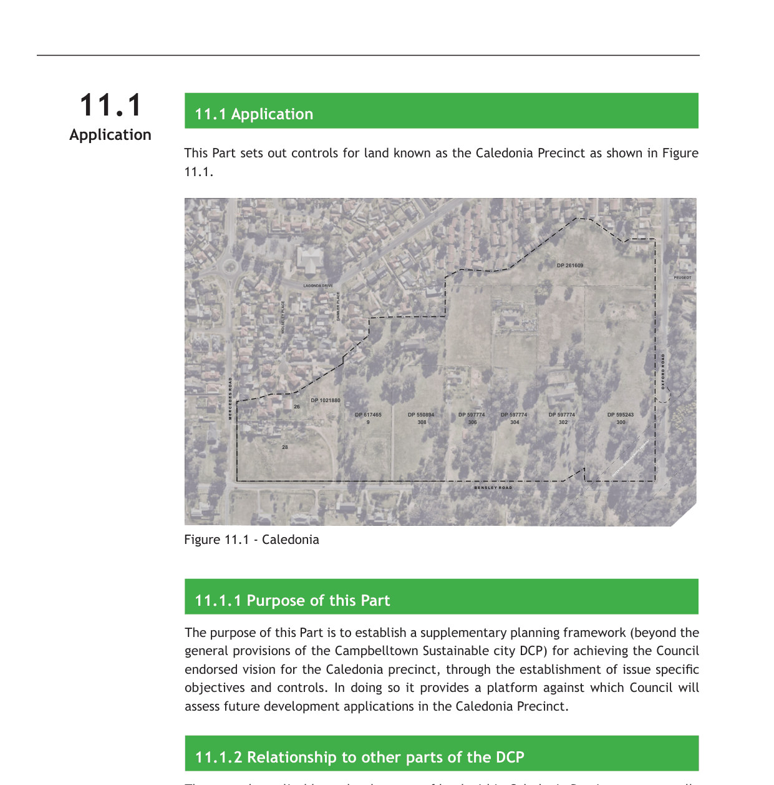

### 11.1 Application

#### 4

#### 11.1.1 Purpose of this Part

#### 11.1.2 Relationship to other parts of the DCP

#### 11.1.3 The Vision

### 11.2 Key Development Objectives

#### 6

#### 11.2.1 Staging

### 11.3 Street and Public Transport Network

#### 9

### 11.4 Public Open Space and Landscaping

#### 11

### 11.5 Building Setbacks

#### 12

### 11.6 Private Property Vegetation Management

#### 13

### 11.7 Heritage

#### 13

### 11.8 Asset Protection Zone

#### 15

### 11.9 Stormwater Management and Water Quality

#### 18

> [Picture on page 3: a map, saved as a picture (images/vol-2-part-11-caledonia-dcp-page-3-1.gif, 150 dpi); the street names and other small labels are on the picture.]
> Words printed on the picture (title and legend, copied from the PDF):
> DP 550894 DP 597774 DP 597774
> 9 308 306 304 302 300
> POTENTIAL GEORGES RIVER PARKWAY
> BILLBERGIA 8/3/19 A 1:2000@A3

Figure 11.1 - Caledonia
