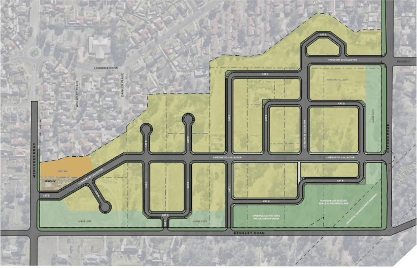

### 11.2 11.2 Key Development Objectives

#### Key Development

Objective:

#### Objectives

■	 To create a transition between the rural/woodland known as the Edgelands to the east of the precinct and the low to medium density urban environment of Ingleburn.

■

■ To develop the precinct in a way that respects and builds on the existing landscape character of the site and surrounds.

■

■ To provide a mix of lot sizes, ranging from 2,000 to 500 sqm, to provide for a diverse residential community.

■

■ To encourage walking and cycling through the precinct and to create a safe and walkable neighbourhood.

■

■ To provide a highly permeable road network that creates a clear road hierarchy and provides convenient and safe links throughout the precinct.

■

■ To encourage the use of public transport, allowing for the extension of bus services into the precinct.

■

■ To protect areas of significant vegetation located within the precinct including the woodland area on the corner of Oxford Road and Mercedes Road and the large trees on Oxford Road.

■

■ To provide areas of open space that all well connected and provide opportunities for passive and active recreation.

■

■ To create a safe and secure environment with high levels of passive surveillance of the public domain.

■

■ To preserve and respect the heritage values of the stone cottage fronting Mercedes Road.

Controls

1\) All development is to be undertaken generally in accordance with the Structure Plan at Figure 11.2 and the objectives and development controls set out in this Part.

2\) Where variation from the Structure Plan is proposed, the applicant is to demonstrate that the proposed development is consistent with the Vision and Development Objectives for the precinct set out in Section 11.1.3 and 11.2 of this part.

#### Key Development

3\) Lower density housing is to be located on large ‘rural style’ lots fronting Oxford and Mercedes Road.

#### Objectives

4\) Typical housing is to be located on 500sqm lots, some with dual frontage on primary streets enabling garage-free frontages.

e)	 The Woodland area on the corner of Oxford Road and Mercedes Road is to be preserved.

> [Picture on page 6: a picture, saved as a picture (images/vol-2-part-11-caledonia-dcp-page-6-13.gif, 150 dpi).]

Figure 11.2 - Structure Plan
