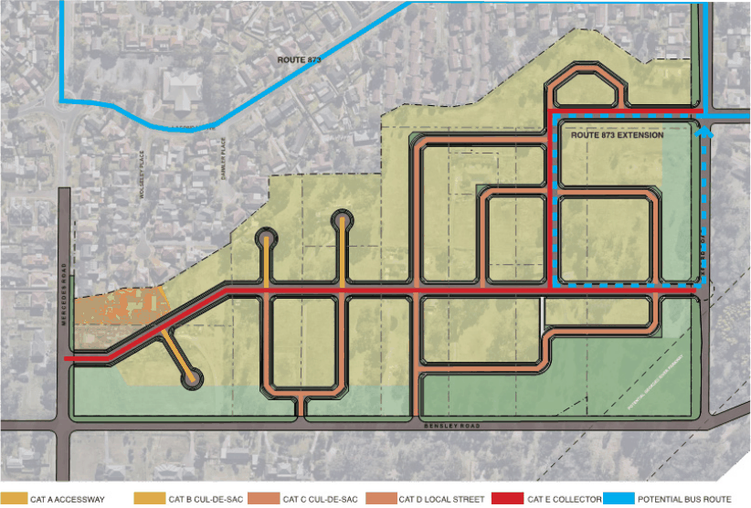

### 11.3 Street and Public Transport Network

#### Street and Public

#### Transport Network

Objectives

■

■ Provide a highly permeable road network that creates a clear road hierarchy and facilitates safe, convenient and legible access.

■

■ Provide safe and accessible connections to the existing road network.

■

■ Provide access to a bus route to service the precinct.

■

■ Ensure carriageways and verges match the function of the road.

■

■ Provide adequate land within verges for infrastructure, landscaping and pathways.

Controls

1\. Development of the street network and access to the existing road network is to be undertaken generally in accordance with the Street Network Plan at Figure 11.3.

2\. Each street type shall be designed and constructed according to Campbelltown (Sustainable City) Development Control Plan 2009 Volume 2 Engineering Design for Development.

3\. Alternative street designs may be permitted on a case-by-case basis if the functional objectives and requirements of the street design are maintained and the outcome is in accordance with the Campbelltown City Council Engineering Design Guide for Development.

4\. The design of the local street network is to:

a.	 Create a safe environment for walking and cycling with safe crossing points;

b.	 Encourage a low-speed traffic environment;

c.	 Optimise solar access opportunities for dwellings;

d.	 Take into account the site’s topography and view lines;

#### Street and Public

#### Transport Network e.	 Provide frontage to maximise

surveillance of open space;

f.	 Facilitate wayfinding and place making opportunities by taking into account streetscape features; and

g.	 Be characterised by a street tree canopy

h.	 Retain existing trees, where appropriate, within the road reserve.

i.	 Make provision for the integration of WSUD where appropriate.

5\.	 An extension of Bus Route 873 is to be investigated and integrated with the Structure Plan.

> [Picture on page 9: a picture, saved as a picture (images/vol-2-part-11-caledonia-dcp-page-9-18.gif, 150 dpi).]

Figure 11.3 - Street Network Plan
