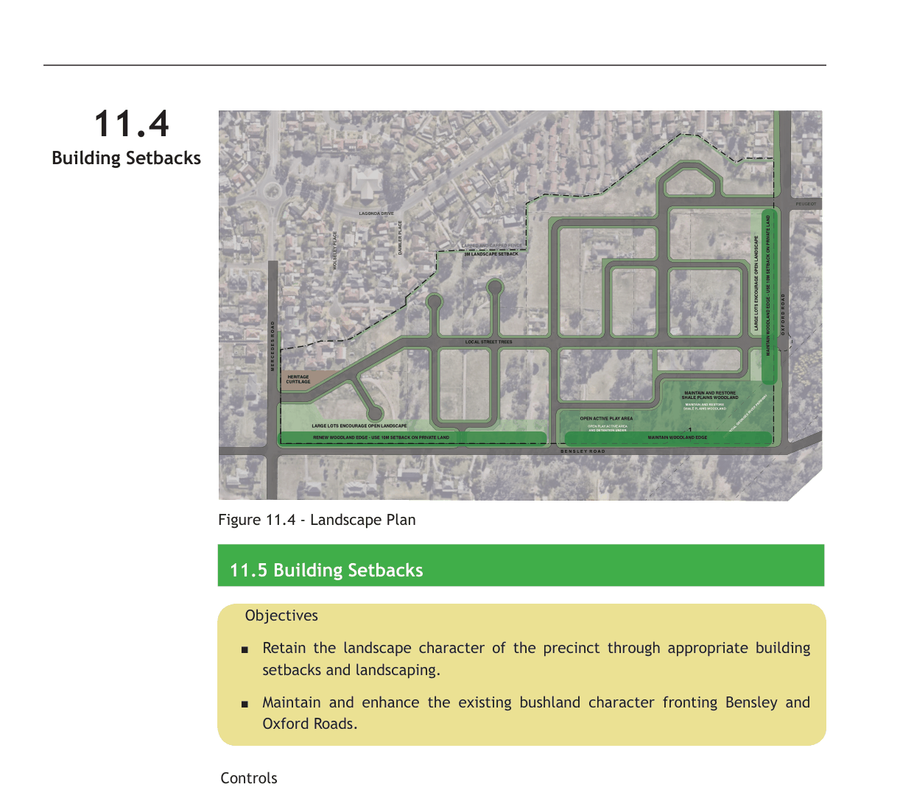

### 11.4 Public Open Space and Landscaping

#### Public Open Space

Objectives

#### and Landscaping

■

■ Maintain the landscape character of the precinct through retention of significant trees and planting.

■

■ Position and design open space areas to retain areas of significant vegetation.

■

■ Provide open space that is accessible, useable and safe for a range of users.

■

■ Incorporate an open active play area within the precinct.

■

■ Provide a landscape transition between the existing development of Ingleburn and the bushland of Georges River.

■

■ Optimise Koala Habitat retention.

Controls

1\. Provision of open space areas is to be undertaken generally in accordance with the Landscape Plan at Figure 11.4.

2\. The minimum area for the public open space within the development of the Caledonia Precinct shall be 17,786sqm.

3\. Public open space should accommodate an active play area to encourage active lifestyles.

4\. A Vegetation Management Plan and Landscape Concept Plan outlining the management and design of public open space areas is to be submitted and implementation commenced with the first subdivision application for land within the precinct.

5\. The Vegetation Management Plan must outline:

a.	 How the Shale Plains Woodland area located within the precinct will    be preserved and maintained; and

b.	 How any areas of potential koala habitat shall be protected and enhanced.

> [Picture on page 11: a map, saved as a picture (images/vol-2-part-11-caledonia-dcp-page-11-1.gif, 150 dpi); the street names and other small labels are on the picture.]
> Words printed on the picture (title and legend, copied from the PDF):
> LAPPED AND CAPPED FENCE
> DAIMLER PLACE 3M LANDSCAPE SETBACK
> LARGE LOTS ENCOURAGE OPEN LANDSCAPE
> LOCAL STREET TREES
> MAINTAIN WOODLAND EDGE - USE 10M SETBACK ON PRIVATE LAND
> MAINTAIN AND RESTORE
> SHALE PLAINS WOODLAND
> MAINTAIN AND RESTORE
> SHALE PLAINS WOODLAND
> OPEN ACTIVE PLAY AREA
> LARGE LOTS ENCOURAGE OPEN LANDSCAPE
> OPEN PLAY ACTIVE AREA
> AND DETENTION UNDER
> POTENTIAL GEORGES RIVER PARKWAY
> RENEW WOODLAND EDGE - USE 10M SETBACK ON PRIVATE LAND
> MAINTAIN WOODLAND EDGE
> BILLBERGIA 8/3/19 A 1:2000@A3
> ■ Retain the landscape character of the precinct through appropriate building
> setbacks and landscaping.
> ■ Maintain and enhance the existing bushland character fronting Bensley and

Figure 11.4 - Landscape Plan

#### Building Setbacks
