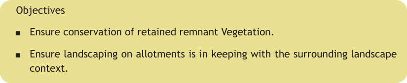

### 11.6 Private Property Vegetation Management

> [Picture on page 12: a picture, saved as a picture (images/vol-2-part-11-caledonia-dcp-page-12-2.gif, 150 dpi).]
> Words printed on the picture (title and legend, copied from the PDF):
> Objectives
> ■
> ■ Ensure conservation of retained remnant Vegetation.
> ■
> ■ Ensure landscaping on allotments is in keeping with the surrounding landscape
> context.

#### Private Property

#### Vegetation

#### Management

Controls

1\. A Vegetation Management Plan for properties facing Bensley and Oxford Road shall be prepared and submitted with the first subdivision application that relates to these lots. Subdivision of these lots shall include Section 88b Covenants to reflect the plan.

2\. The Vegetation Management Plan must outline measures to maintain and enhance the existing bushland character fronting Bensley and Oxford Roads and balance the Asset Protection Zone requirements.

3\. Significant trees within each allotment are to be retained where possible.
