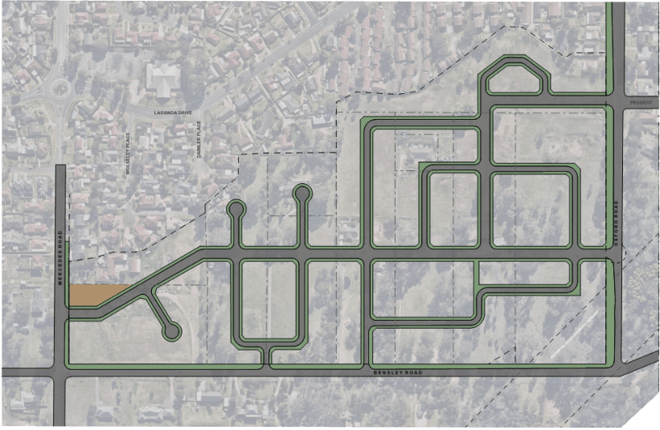

### 11.7 Heritage

Objectives

■

■ Ensure areas identified as archaeologically or culturally significant are managed appropriately.

■

■ Protect heritage values associated with the Caledonia Stone Cottage.

■

■ Establish a public domain and urban character that respects and interprets the cultural heritage of the site and context.

Controls

1\. The original Caledonia stone cottage fronting Mercedes Road is to be protected by a curtilage as shown on Figure 11.5.

2\. An Aboriginal Cultural Heritage assessment is to be submitted

#### Heritage

with development applications for subdivision or resulting in land modification within the precinct.

3\. The curtilage and development parameters contained in “Heritage Assessment and Statement of Heritage Impact” prepared by GBA Heritage shall be addressed in respect of the local heritage item and development in the vicinity.

> [Picture on page 13: a picture, saved as a picture (images/vol-2-part-11-caledonia-dcp-page-13-12.gif, 150 dpi).]

Figure 11.5 -Heritage Curtilage
