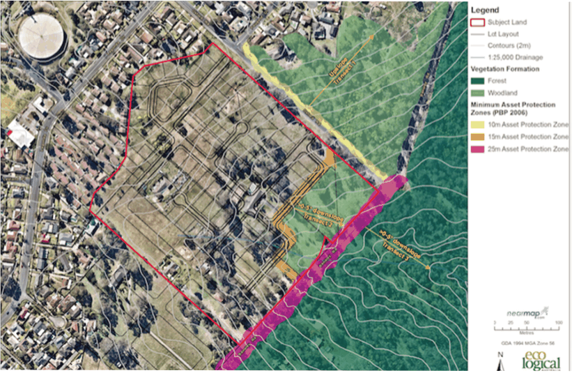

### 11.8 Asset Protection Zones

#### Asset Protection

#### Zones

Objectives

■

■ To prevent loss of life and property due to bushfires by providing for development compatible with bushfire hazard.

■

■ To encourage sound management of bushfire-prone areas.

■

■ To manage bush fire risks while maintaining the character of Shale Plain Woodlands and potential Koala Habitat particularly near the corner of Oxford and Bensley Roads.

Controls

1\. The location and width of Asset Protection Zones (APZs) are to be provided generally in accordance with the Figure 11.6.

2\. Where Asset Protection Zones are required, a Section 88B Instrument on the affected lot is to be included to require the use of ‘Private Property Vegetation Management Plan.’

3\. Public Open Space Asset Protection Zones shall be managed according to ‘Public Open Space Vegetation Management Plan.’

4\. Reference is to be made to the current enforced version of Planning for Bushfire Protection in subdivision planning and design and development.

5\. APZs and construction standards are to be accurately mapped and detailed for each affected lot on plans submitted with the development application.

6\. APZs:

#### Asset Protection

#### Zones

a.	 Are to be located wholly within the Precinct or within Bensley or Oxford 	Road;

b.	 May incorporate roads and flood prone land;

c. May be used for open space and recreation subject to appropriate fuel management;

d.	 Are to be maintained in accordance with the guidelines of the current enforced version of Planning for Bushfire Protection; and

e.	 may incorporate private residential land, but only within the building setback (no dwellings are to be located within the APZ).

7\. Where an allotment fronts and partially incorporates an APZ, it shall have an appropriate depth to accommodate a dwelling with private open space and the minimum required APZ. The APZ will be identified through a Section 88B instrument.

8\. Temporary APZs, identified through a Section 88B instrument, will be required where development is proposed on allotments next to undeveloped land that presents a bushfire hazard. Once the adjacent stage of development is undertaken, the temporary APZ will no longer be required and shall cease.

9\. Reticulated water is to meet the standards contained within the current enforce version of Planning for Bushfire Protection. Water supply is to be via a ring main system, engineered to the requirements of Australian Standard 2419.1-1994 Fire Hydrant Installations.

#### Asset Protection

#### Zones

10\.	 Buildings adjacent to APZs are to be constructed in accordance with the requirements of the current version of Planning for Bushfire Protection and Australian Standard 3959-1999-Construction of Building in Bushfire Prone Areas.

> [Picture on page 16: a picture, saved as a picture (images/vol-2-part-11-caledonia-dcp-page-16-10.gif, 150 dpi).]

Figure 11.6 -Asset Protection Zones
