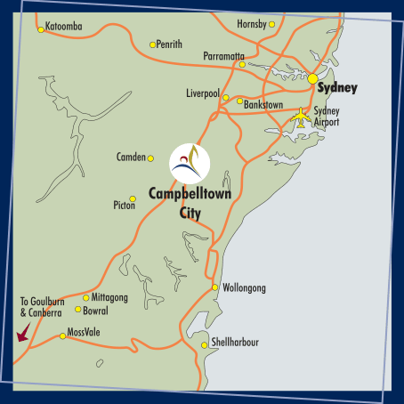

### 11.8 11.9 Stormwater Management and Water Quality

Objective:

#### Stormwater

Management and

#### Water Quality

■

■ To avoid adverse impacts from stormwater runoff on other properties as a result of development in the catchment.

■

■ To minimise potable water consumption and maximise re-use of stormwater within urban areas.

■

■ To maintain and enhance the quality of natural water bodies.

■

■ To incorporate principles of Water Sensitive Urban Design (WSUD).

Controls

1\. A WSUD Strategy is to be prepared for the precinct and submitted with the first development application for subdivision within the Precinct.

2\. The WSUD Strategy is to incorporate use of the following:

a.	 On lot rainwater tanks with allocated stormwater retention

b.	 Subterranean detention through oversized stormwater infrastructure within road reserves

c.	 Gross pollutant traps

d.	 Provision for a constructed wetland or rain garden (capable of servicing entire precinct catchment).

3\. The integrated stormwater management system shall aim to achieve the “Landcom Water Quality Stretch Target.”

### This page is intentionally

### left blank.

> [Picture on page 19: a picture, saved as a picture (images/vol-2-part-11-caledonia-dcp-page-19-1.gif, 150 dpi).]

#### campbelltown.nsw.gov.au

#### Campbelltown City Council, PO Box 57, Campbelltown, NSW 2560
