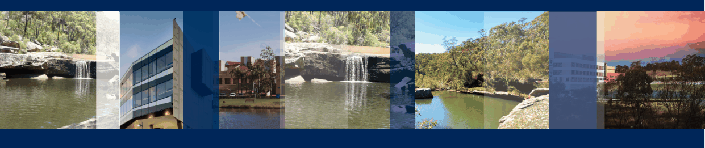

# Campbelltown Sustainable City Development Control Plan 2015 - Part 11 Caledonia DCP

> This chapter is split into 11 section file(s), one per numbered heading, in the order they appear in the PDF.

Source PDF: [volume2part11caledoniadcpversion5effectivedate.pdf](https://planfortomorrow.sharepoint.com/sites/Planfortomorrow/Shared%20Documents/00%20NSW-Planning-Resources/dcp/campbelltown-sustainable-city-development-control-plan-2015/vol-2-part-11-caledonia-dcp/volume2part11caledoniadcpversion5effectivedate.pdf)

### Campbelltown (Sustainable City) Development Control Plan 2015

> [Picture on page 1: a picture, saved as a picture (images/vol-2-part-11-caledonia-dcp-page-1-5.gif, 150 dpi).]

### VOLUME 2

### Site Specific DCPs

## Part 11: Caledonia  DCP

### Creating Campbelltown's Future 2025

#### Table of Contents

<!-- sections -->
## Sections

1. [11.9 Stormwater Management and Water Quality](01-11-9-stormwater-management-and-water-quality.md)
2. [11.1 Application](02-11-1-application.md)
3. [11.2 11.2 Key Development Objectives](03-11-2-11-2-key-development-objectives.md)
4. [11.2 11.2.1 Staging](04-11-2-11-2-1-staging.md)
5. [11.3 Street and Public Transport Network](05-11-3-street-and-public-transport-network.md)
6. [11.4 Public Open Space and Landscaping](06-11-4-public-open-space-and-landscaping.md)
7. [11.5 Building Setbacks](07-11-5-building-setbacks.md)
8. [11.6 Private Property Vegetation Management](08-11-6-private-property-vegetation-management.md)
9. [11.7 Heritage](09-11-7-heritage.md)
10. [11.8 Asset Protection Zones](10-11-8-asset-protection-zones.md)
11. [11.8 11.9 Stormwater Management and Water Quality](11-11-8-11-9-stormwater-management-and-water.md)
