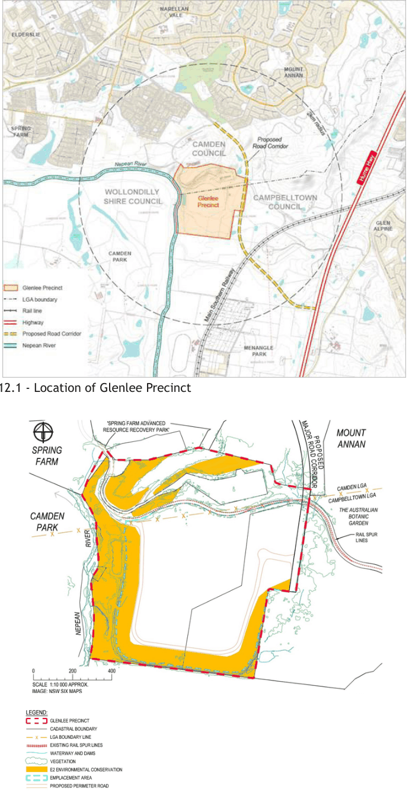

### 12.2 Vision and Development Objectives

#### 6

### 12.3 Development Objectives and Controls

#### 7

#### 12.3.1 Building Design and Setting

#### 13.3.2 Activities Outside Buildings

#### 13.3.3 Subdivison and Lot Design

#### 13.3.4 Landscaping

### 12.4 Visual Impact

#### 13

### 12.5 Environmental Protection Works

#### 14

### 12.6 Transport Network, Access and Car Parking

#### 19

### 12.7 Geotechnical Works

#### 21

### 12.8 Contamination

#### 22

### 12.9 Related Studies

#### 23

### 12.1 12.1 Application

#### Application

The following parts of the Campbelltown (Sustainable City) Development Control Plan apply to the land shown in Figure 1:

Volume 1: Part 2  Requirements applying to all Types of Development;

Volume 1: Part 7 Industrial Development; and

Volume 1: Part 12 Glenlee Precinct.

Where the provisions of Part 12 differ from the requirements of the other parts, the controls in Part 12 will prevail.

Campbelltown City Council Engineering Design Guide for Development also applies to development specified in this Part.

#### 12.1.2 Development in the vicinity of the local government boundary

#### Objectives

■

■ Provide flexibility in circumstances where sites fall within both Campbelltown and Camden local government areas; and

■

■ Ensure that a logical layout of development is achieved that can be managed adequately.

#### Controls

Architectural Design

a) Buildings are to be articulated to reduce the apparent height and scale of external walls;

b)	 Plant and mechanical equipment, including exhausts are to be screened or located appropriately so that they are not prominent features from the existing and likely future public domain;

c) Materials and colours of buildings, utility and ancillary structures must adopt darker, recessive toned colours such as earth tones (stone, browns, muted greens, sand, dark red/plums) or cool tones (soft greys, grey/blues).  All materials must be constructed of non-reflective materials; and

Page 4- Vol 2

Campbelltown (Sustainable City) Development Control Plan 2015    Effective: 04/06/19

#### Application

> [Picture on page 4: a picture, saved as a picture (images/vol-2-part-12-glenlee-precinct-dcp-page-4-2.gif, 150 dpi).]

Figure 12.1 - Location of Glenlee Precinct

Figure 12.2 - Location of Important Precinct Features
