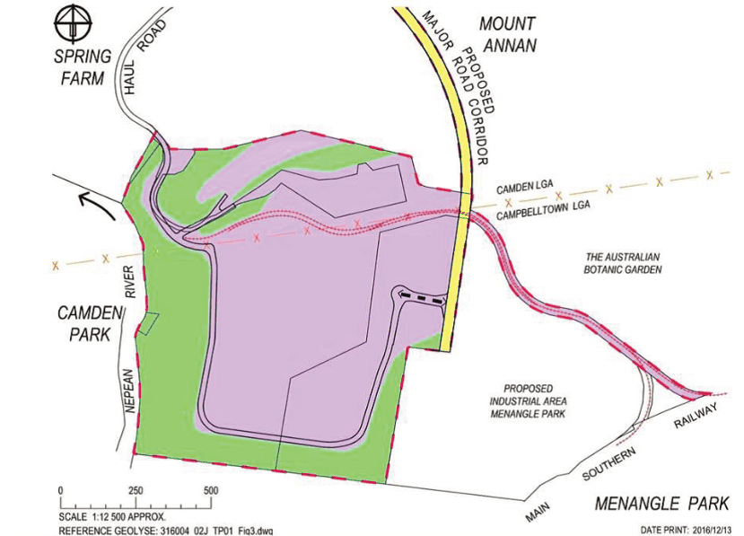

### 12.2 12.2 Vision and Development Objectives

Vision and

#### Development

#### Objectives

Glenlee provides an opportunity to create an employment precinct with a balanced mix of sustainable land uses within the landscape context of its elevated position at the southern end of the Scenic Hills and adjacent to both the Nepean River and the Australian Botanic Gardens.  Glenlee will be a significant destination and employment precinct to complement the new residential areas currently being developed in nearby areas.

The existing development of the site does not complement the surrounding landscape setting.  Council seeks to ensure that any new development can take place in a way that is sustainable and is compatible with the surrounding cultural landscape.

Further, the precinct it located in an important distant backdrop when viewed from the

M31 Hume Motorway.  It shall therefore consist of a variety of low elevation industrial, warehouse and logistic development in a landscaped setting that ensures no detrimental visual impact on the surrounding cultural heritage and residential areas.

Development of the land may take several forms over a period of time given its existing circumstances.  It may involve new buildings, structures and / or outside storage of materials within the existing or adjusted lots or may eventually involve subdivision of land and the creation of new public streets with subsequent development.

Objective:

■

■ Facilitate new development such as industrial, warehousing and logistic activities;

■

■ Ensure a high standard of development encouraging local employment and creating an area which is pleasant, safe and efficient to work in;Provide access to a bus route to service the precinct.

■

■ Ensure that development takes account of the physical nature of the local environment, particularly the Nepean River, ridgelines and the natural landscape;

■

■ Ensure that development does not result in pollution of waterways particularly the Nepean River and protects, restores and enhances riparian corridors;

■

■ Ensure that development does not adversely affect the amenity of surrounding areas, such as Menangle Park, Glenlee House the Australian Botanic Garden and Camden Park;

■

■ Ensure stability of the emplacement site and re-vegetation of the embankments;

■

■ Ensure suitable transport and pedestrian connectivity to and from the precinct including the Macarthur Recreational Trail;

■

■ Ensure provision of infrastructure to facilitate development of the precinct;

■

■ Establish environmental criteria and controls for development within the area to ensure that the environmental quality of adjoining areas is not compromised;

Page 6- Vol 2

Campbelltown (Sustainable City) Development Control Plan 2015    Effective: 04/06/19

■

■ Preservation of existing bushland and establish or upgrade a continuous fully vegetated corridor to allow for the movement of fauna between the Nepean River corridor and the Australian Botanic Garden; and

#### Development

Objectives and

#### Controls

■

■ Minimise the impact of development on areas of native vegetation including areas of high biodiversity, archaeological and heritage significance.

#### Controls

1\. Development of the Glenlee Precinct is to be generally consistent with the Indicative Concept Plan shown in Figure 3.

> [Picture on page 6: a picture, saved as a picture (images/vol-2-part-12-glenlee-precinct-dcp-page-6-16.gif, 150 dpi).]

Figure 12.3 - Location of Important Precinct Features
