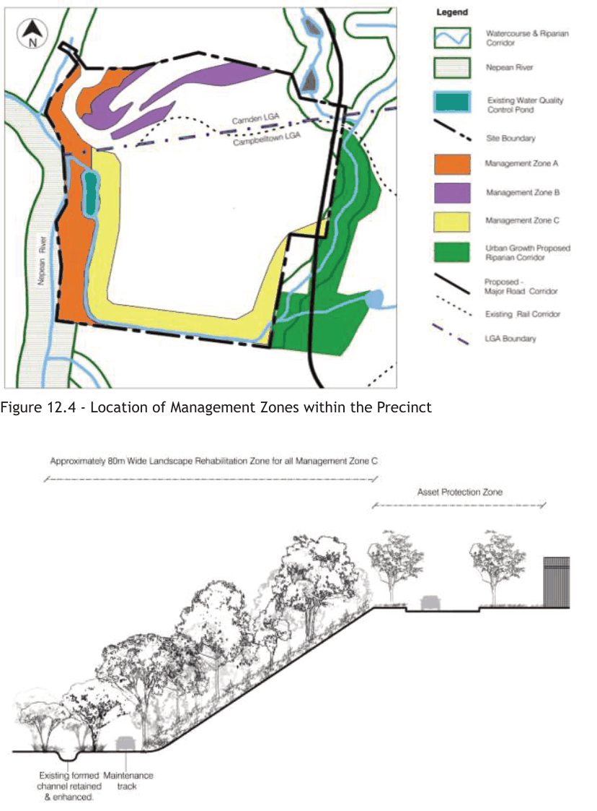

### 12.5 Environmental Protection Works

Objectives

■

■ Protect, restore and enhance the environmental qualities of water courses, in particular the Nepean River;

■

■ Promote the conservation of urban bushland and establish continuous and a fully vegetated corridor to allow for the movement of fauna;

■

■ Protect and preserve native vegetation and biological diversity in the Glenlee Precinct in accordance with the principles of ecologically sustainable development including the removal of weed infestations and to avoid first impacts to native vegetation by using prevention and where impacts are unavoidable biodiversity offsets must be used;

■

■ Maintain and, where appropriate, enhance the ecological values within the Precinct and corridors for fauna and flora through re-vegetation and restoration work;

■

■ Ensure that the all development is stabilised with vegetation and bush regeneration; and

#### Environmental

#### Protection Works

■

■ Ensure that adequate soil is provided to support landscaping required by the Section 3.1.4.

Controls

1\. A VMP shall be submitted with the first development application for the development or subdivision of an allotment of land within the area to which Part 12 applies.  The VMP will apply to land identified as Management Zones A and C within Campbelltown local government area in Figure 4.

2\. The environmental protection works shall be carried out in accordance with the VMP either:

a.	 On the portion of land identified in the VMP on the lot where a development is proposed; or

b.	 On all of the land identified in the VMP where a comprehensive subdivision, including public roads is proposed.

3\. The VMP must:

a.	 Be prepared in accordance with the Ecological Assessment prepared by Ecological Australia dated 29 April 2016;

b.	 Specify what soil works are to be undertaken to support landscaping required to stabilise the embankment and to provide a screen the site from views from the surrounding area;

c.	 Specify a vegetation landscape buffer along the boundaries of the precinct in accordance with Control (b) under ‘Visual Impact’ ; and

d.	 Show areas of vegetation that are to be fenced off and protected when earthworks and civil works are to 	 be undertaken in close proximity.

4\. Compliance with the VMP shall be undertaken within the relevant stages of the development application;

#### Environmental

#### Protection Works

5\. The re-alignment and / or construction of road networks in the E2 Environmental Conservation Zone must consider options for fauna overpass and underpasses;

6\. Management Zone A (within the E2 Environmental Conservation Zone) shall be provided with vegetation in accordance with the following requirements:

a.	 Asset protection zones must not be located within vegetation retained for conservation in this zone;

b.	 Weed control and re-vegetation measures are to be implemented to improve the ecological value of this corridor;

c.	 Planting mix is to comprise both upper (tree) and lower storey using locally endemic species;

d.	 Best practice soil erosion control shall be implemented during construction and maintained as required, to prevent sediment flow into this zone;

e.	 Spray grass, hydro seeding, geo fabrics or jute weed matting shall be provided to minimise the loss of top soil while plant establishment takes place should be considered during construction.  These management measures shall be detailed in the Construction Certificate plans; and

f.	 With the exception of the existing sedimentation traps, water storage dams and related pumping infrastructure in this zone, stormwater structures shall be located outside the conservation area, where possible.

#### Environmental

#### Protection Works

7\. Management Zone C (within the E2 Environmental Conservation Zone) shall be provided with vegetation in accordance with the following requirements:

a. A riparian corridor must be applied from the Caley’s Creek watercourse to the top of the emplacement batter, where the creek is present (see Figure 5);

b.	 Soil remediation shall be undertaken to encourage growth of Cumberland Plain flora and fauna, or River-Flat Eucalypt Forest community;

c. Restoration planting adjacent to the watercourse shall comprise plants in association with characteristics of the River-flat Eucalypt Forest community with the batter slopes being planted to a modified, site specific community comprising of a vegetation community reflective of the locality and be able to be adapted to the soil conditions, land fill strata and slope;

d.	 The vegetation on the top of the emplacement batter must comply with Bushfire APZ requirements; and

e.	 An ongoing weed controls program in perpetuity and re-vegetation measures are to be implemented to improve the ecological value of the corridor.

8\. Any new ground levels resulting from these and any other geotechnical works must be detailed as part of any subdivision development application plans and considered as part of any visual impact assessment;

9\. A covenant (under 88B of the Conveyancing Act 1919) will be required to be registered on the title of the development lots, requiring compliance with the VMP; and

#### Environmental

#### Protection Works

10\.	 Where land in E2 Environmental Conservation Zone becomes separated by the future perimeter road from lots created for development, the land shall be required to be identified as common property under a Community Title scheme unless an alternate scheme can be provided.

> [Picture on page 17: a picture, saved as a picture (images/vol-2-part-12-glenlee-precinct-dcp-page-17-11.gif, 150 dpi).]

Figure 12.4 - Location of Management Zones within the Precinct

Figure 12.5 - Indicative Section for Management Zone C
