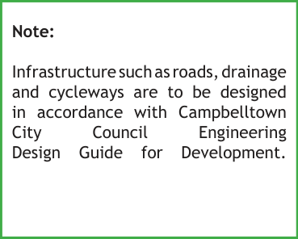

### 12.6 Transport Network, Access and Car Parking

Transport Network,

#### Access and Car

This section outlines the objectives and controls to achieve the desired network planning and site access outcomes.

#### Parking

#### 12.6.1 Network

Objectives

■

■ Provide for diverse integrated means of accessing the Precinct;

■

■ Ensure the movement network accommodates a range of uses and functions;

■

■ Optimise access without compromising the safety and efficiency of the surrounding network;

■

■ Develop a legible, safe and convenient pedestrian and cycle network, connecting with networks external to the Precinct;

■

■ Provide safe, efficient access and maneuvering; and

■

■ To ensure that adequate consideration has been given to any potential routes to

> [Picture on page 18: a picture, saved as a picture (images/vol-2-part-12-glenlee-precinct-dcp-page-18-23.gif, 150 dpi).]
> Words printed on the picture (title and legend, copied from the PDF):
> in accordance with Campbelltown
> City Council Engineering
> Design Guide for Development.

and from the Macarthur Recreational Trail.

Controls

1\. A clear road hierarchy must be reinforced through landscape treatment including street trees;

#### Note:

2\. Road design must consider all modes of transport;

3\. All roads shall have a minimum carriageway width of 13m;

Infrastructure such as roads, drainage and cycleways are to be designed

4\. Pedestrian and transport routes must have consideration to potential impacts on the Macarthur Recreational Trail;

5\. Where public roads are provided in the site, the proposed future road link to the future Spring Farm Parkway shall be constructed up to the boundary of this future road link; and
