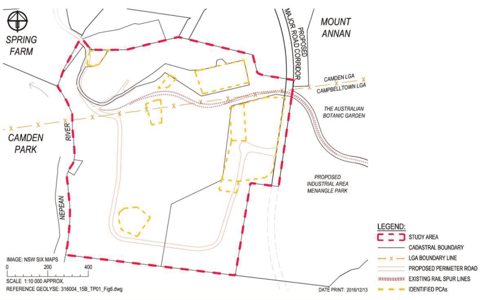

### 12.8 Contamination

Objective

■	 Protect the environment by ensuring that potentially contaminated areas within the Glenlee Precinct are remediated.

Controls

1\. Development applications for development in potentially contaminated areas as identified at Figure 6 must be accompanied by a Stage 2 Detailed Site Investigation prepared in accordance with State Environmental Planning Policy 55 – Remediation of Land and where relevant, Council’s contamination policies; and

2\. Where remediation is required, a remediation action plan, prepared by a certified consultant must be lodged with the development application.

> [Picture on page 21: a picture, saved as a picture (images/vol-2-part-12-glenlee-precinct-dcp-page-21-24.gif, 150 dpi).]

Figure 12.6 - Potentially Contaminated Areas

#### Related Studies
