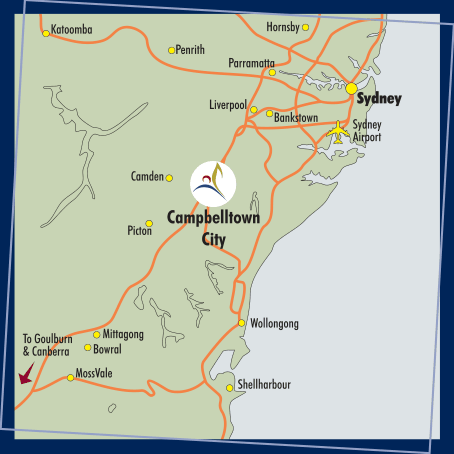

### 12.9 Related Studies

This section must be read in conjunction with the following supporting documents. These are additional to those set out in this subsection and must be considered when submitting a development application:

1\. Visual and Landscape Assessment prepared by Musecape dated 24 February 2015 and revised October 2016;

2\. Riparian Corridor Study prepared by AECOM dated 16 May 2016;

3\. Water Cycle Management Strategy prepared by AECOM dated 13 May 2015;

4\. Ecological Assessment prepared by Ecological Australia dated 29 April 2016;

5\. Bushfire Assessment prepared by Ecological Australia dated 24 February 2014 and revised 29 April 2016;

6\. Geotechnical Report prepared by AECOM dated 20 May 2016;

7\. Traffic Impact Assessment prepared by AECOM dated 20 May 2016;

8\. Aboriginal Heritage Due Diligence Assessment prepared by Cultural Heritage Connections dated July 2014;

9\. Non-Indigenous Heritage Assessment prepared by Musecape dated 24 July 2014;

10\.	 Air Quality Assessment prepared by AECOM dated 13 May 2016;

11\.	 Civil Infrastructure Report prepared by AECOM dated 13 May 2016;

12\.	 Revised Remediation Strategy prepared by AECOM dated 13 May 2016;

13\.	 Revised Consolidated Phase 1 Contamination Assessment prepared by AECOM dated 13 May 2016;

14\.	 Revised Consolidated Sampling, Analysis and Quality Plan for Phase 2 Contamination Assessment prepared by AECOM dated 13 May 2016; and

15\.	 Noise and Vibration Impact Assessment prepared by AECOM dated 6 May 2015.

### This page is intentionally

### left blank.

> [Picture on page 24: a picture, saved as a picture (images/vol-2-part-12-glenlee-precinct-dcp-page-24-1.gif, 150 dpi).]

#### campbelltown.nsw.gov.au

#### Campbelltown City Council, PO Box 57, Campbelltown, NSW 2560
