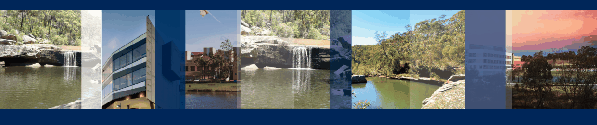

# Campbelltown Sustainable City Development Control Plan 2015 - Part 12 Glenlee Precinct DCP

> This chapter is split into 13 section file(s), one per numbered heading, in the order they appear in the PDF.

Source PDF: [volume2sitespecificdcps-part12glenleedcp.pdf](https://planfortomorrow.sharepoint.com/sites/Planfortomorrow/Shared%20Documents/00%20NSW-Planning-Resources/dcp/campbelltown-sustainable-city-development-control-plan-2015/vol-2-part-12-glenlee-precinct-dcp/volume2sitespecificdcps-part12glenleedcp.pdf)

### Campbelltown (Sustainable City) Development Control Plan 2015

> [Picture on page 1: a picture, saved as a picture (images/vol-2-part-12-glenlee-precinct-dcp-page-1-5.gif, 150 dpi).]

### VOLUME 2

### Site Specific DCPs

## Part 12: Glenlee Precinct DCP

### Creating Campbelltown's Future 2025

#### Table of Contents

<!-- sections -->
## Sections

1. [12.1 Application](01-12-1-application.md)
2. [12.1 12.1 Application](02-12-1-12-1-application.md)
3. [12.2 12.2 Vision and Development Objectives](03-12-2-12-2-vision-and-development-objectives.md)
4. [12.3 Development Objectives and Controls](04-12-3-development-objectives-and-controls.md)
5. [12.3 12.3.1 Building Design and Setting](05-12-3-12-3-1-building-design-and-setting.md)
6. [12.3 12.3.3 Subdivison and Lot Design](06-12-3-12-3-3-subdivison-and-lot-design.md)
7. [12.4 Visual Impact](07-12-4-visual-impact.md)
8. [12.5 Environmental Protection Works](08-12-5-environmental-protection-works.md)
9. [12.6 Transport Network, Access and Car Parking](09-12-6-transport-network-access-and-car-parking.md)
10. [12.6 12.6.2 Access to the Precinct within Campbelltown LGA](10-12-6-12-6-2-access-to-the-precinct-within.md)
11. [12.7 Geotechnical Works](11-12-7-geotechnical-works.md)
12. [12.8 Contamination](12-12-8-contamination.md)
13. [12.9 Related Studies](13-12-9-related-studies.md)
