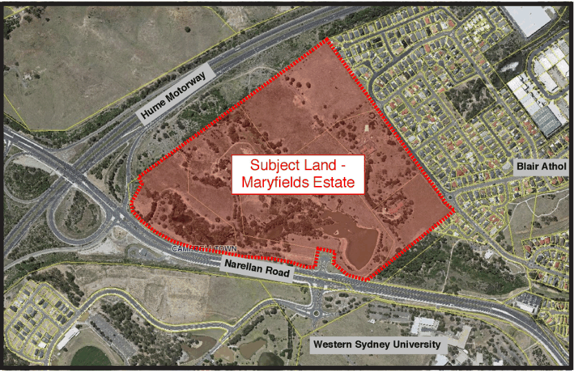

### 13.8 Appendix 1 - Indicative Street tree Planting Plan

#### 48

### 13.9 Appendix 2 - Indicative Intersection Upgrade Works

#### 50

### 13.1 13.1 Application

#### Application

This Development Control Plan (DCP) applies to ‘Maryfields Estate’ being the land identified in Figure 13.1. The land is situated in the suburb of Campbelltown and is bounded by Maryfields Drive to the north-east, Narellan Road to the south, John Kidd Reserve and Blair Athol housing to the east and Hume Motorway to the

west. Maryfields Estate has an aggregate site area of 43.554 hectares.

> [Picture on page 4: a picture, saved as a picture (images/vol-2-part-13-maryfields-development-control-plan-page-4-8.gif, 150 dpi).]

Figure 13.1 - Land to which this DCP Applies - Maryfields Estate

#### 13.1.1 Purpose of this Part

The purpose of this Part is to establish a supplementary planning framework (beyond the general provisions of the Campbelltown Sustainable City DCP) for achieveing the Council endorsed vision for the Maryfields Estate, through the establishment of issue specific objectives and controls. In doing so it provides a platform against which Council will assess future development applications in Maryfields Estate.

#### 13.1.2 Relationship with Campbelltown (Sustainable City) DCP

#### Application

This DCP forms part of the Campbelltown (Sustainable City) DCP (‘CSCDCP’), and provides additional controls and guidelines that apply specifically to development within Maryfields Estate. Where a development control is not specified in this Part, development is subject to all other relevant controls of CSCDCP.

Where there is an inconsistency between this Part and any other provision of the CSCDCP, this Part applies to the extent of the inconsistency.

Campbelltown City Council Engineering Design Guide for Development applies to all development within Maryfields Estate.

Maryfields Estate has been identified as an Urban Release Area under Campbelltown Local Environmental Plan 2015 (CLEP 2015). Clause 6.3 of CLEP 2015 requires a DCP to be prepared for the land that includes certain provisions and controls.

This DCP satisfies the requirements of Clause 6.3 as detailed in the below table.
