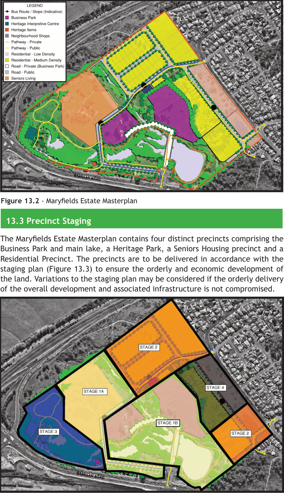

### 13.2 Key Development Objectives and Controls

#### Key Development

Objectives and

#### Objectives

#### Controls

■

■ Provide a high quality landscaped Business Park that complements and enhances the main lake setting and natural attributes of the site.

■

■ Generate employment and economic growth for the Campbelltown- Macarthur Regional Centre through collaborative research and development  opportunities involving the Western Sydney University, Campbelltown TAFE College, 	 Campbelltown Hospitals and other enterprises in the Macarthur Region.

■

■ Create a high quality residential environment with a variety of housing choice options.

■

■ Deliver an appropriately landscaped and managed network of passive recreation and private open spaces.

■

■ Provide a safe and efficient system of roads and pathways within a quality 	 landscaped setting.

■

■ Protect and enhance the important visual, ecological, and riparian qualities of the site.

■

■ Conserve and promote the heritage significance of the site.

#### Controls

1\.	 Masterplan - Subdivision layout and land uses to generally comply with the Masterplan shown at Figure 13.2.

The Masterplan provides the conceptual road design, subdivision layout and land use outcomes for the development of Maryfields Estate. All development applications relating to the Maryfields Estate are to be generally consistent with the Masterplan.

This Masterplan has been informed by detailed environmental planning studies undertaken during the rezoning of the land. Any deviations to the Masterplan may only be considered having regard to any relevant studies informing the Masterplan and where the general development objectives are achieved.

#### Precinct Staging

> [Picture on page 9: a picture, saved as a picture (images/vol-2-part-13-maryfields-development-control-plan-page-9-2.gif, 150 dpi).]

Figure 13.2 - Maryfields Estate Masterplan
