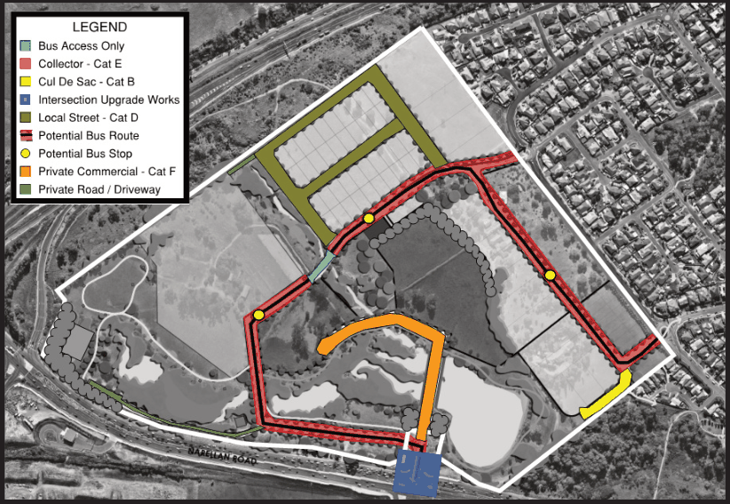

### 13.4 13.4 Streetscape and Connectivity

Streetscape and

#### Objectives

#### Connectivity

■

■ To provide for an efficient and connected street and pathway network for vehicular traffic, pedestrians and cyclists

■

■ To provide an attractive and safe urban streetscape environment with integrated landscaping.

■

■ To mitigate any adverse impacts of through traffic on the local road network by restricting the movement of private vehicles between Narellan Road and Blair Athol.

#### Controls

1\.	 The street and pathway network is to be provided by the developer in conjunction with the corresponding development/subdivision of each staged precinct generally in accordance with the masterplan layout and Figure 13.4.

2\.	 The technical design of all streets and pathways is to comply with the Campbelltown City Council Engineering Design Guide for Development.

3\.	 Tree planting is to be integrated into the street design consistent with the Indicative Street Tree Hierarchy provided at Appendix 1.

4\.	 A Street Tree Planting Plan for each Precinct, prepared by a suitably qualified landscape designer and including drawings, costings, materials and planting palettes shall be submitted to Council for approval in conjunction with the subdivision/development of each staged precinct.

Streetscape and

#### Connectivity

5\.	 A distinctive framed vista and formal entry design is to be provided for the entrance road to the Business Park precinct to achieve a high quality presentation from the Narellan Road frontage. Entry design shall include high quality paving, street lighting, entry signage, advanced tree planting and irrigated mass planting beds.

6\.	 Street Tree planting shall be provided to both sides of all streets, comprising of minimum 100L pot size and corralled by hardwood timber tree guards.

7\.	 The intersection of Maryfields Estate with Narellan Road shall be upgraded by the developer in conjunction with the construction of road works for the Business Park precinct. The upgrade works are to comply with the requirements of Campbelltown City Council and NSW Roads and Maritime Service, as generally depicted in Appendix 3.

8\.	 A single lane restricted road link across the riparian corridor between the residential and seniors living precincts of the Maryfields Estate shall be 	 provided for the use of bus and emergency vehicles only. The subject road link is to comply with any design requirements of local bus operators and emergency authorities.

9\.	 Bus stops shall be provided as generally shown on the masterplan, including 	in proximity to the local neighbourhood shops. Where bus stops are provided consideration shall be given to wideing the road carriageway to accommodate a 2.5m wide bus parking bay. Roadside seating or shelters shall be provided at all bus stops.

Streetscape and

#### Connectivity

10\.	Pedestrian and cycle pathways are to be designed having regard to the principles of Crime Prevention through Environmental Design to promote safety and security for users, including clear sight lines and provision of night lighting.

11\.	All street lighting is to be LED “Smart” lighting to Council’s specification. The street lighting plan must consider the impact of street tree planting (at planting and mature height and form) on the lighting. 12 The street lighting and associated infrastructure for all public roads is to be dedicated to Council. The design and installation of the street lighting is to be such that Council can take ownership of the street lighting in this subdivision

(ie. separate circuit to residential supply).

> [Picture on page 12: a picture, saved as a picture (images/vol-2-part-13-maryfields-development-control-plan-page-12-26.gif, 150 dpi).]

Figure 13.4 Road Hierarchy
