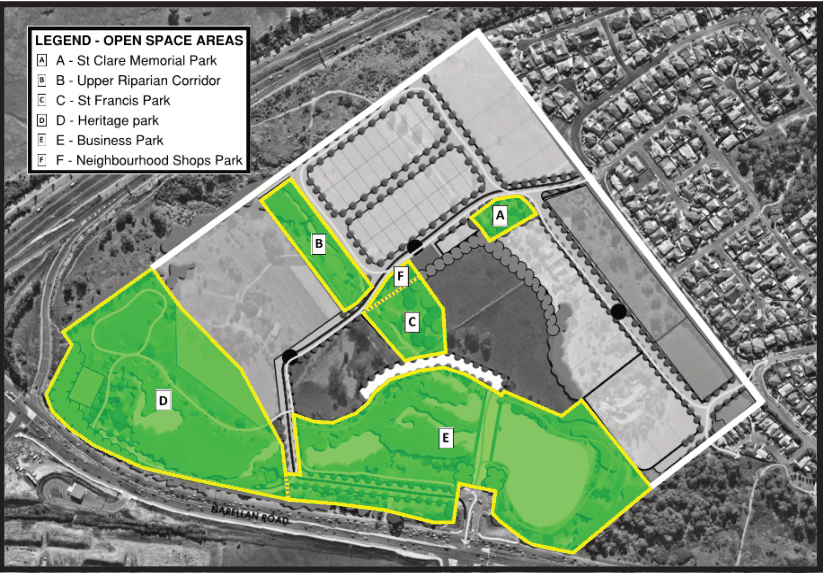

### 13.5 Open Space Areas

#### Open Space

#### Objectives

#### Areas

■

■ Provide a coordinated and managed open space network delivered in a timely manner with the development of the respective precincts identified under the Maryfields Staging Plan.

■

■ Maintain and enhance the visual qualities of the main lake and associated open space areas as viewed from the Narellan Road frontage.

■

■ Maintain and enhance riparian habitat and remnant Cumberland Plain Woodland of ecological significance.

#### Controls

1\.	 Open space areas within Maryfields Estate are to be generally provided in accordance with Figure 13.5 (Open Space Areas), including connection with pedestrian and bicycle pathways. Specific controls for each open space area are provided in Table 13.1.

2\.	 Open space areas are to be progressively embellished and managed by the developer at no cost to Council in conjunction with the development of the corresponding stage of Maryfields Estate.

3\. 	 Native vegetation within open space areas and riparian corridors are to be rehabilitated and managed in accordance with a Vegetation Management Plan (VMP) prepared by a suitably qualified environmental consultant in accordance with Council’s Guide for the preparation of Vegetation Management Plans. VMPs for Stages 1A (Seniors Living), 1B (Business Park) and 3 (Heritage Precinct) are to be submitted with the initial development application for subdivision or development works for each of these precincts.

#### Open Space

#### Areas

> [Picture on page 14: a picture, saved as a picture (images/vol-2-part-13-maryfields-development-control-plan-page-14-3.gif, 150 dpi).]

Figure 13.5 Open Space Areas

#### Open Space

#### Areas

| Table 13.1 |  |
|---|---|
| Open Space Area | Specific Controls and Management Criteria |
| A. St Clare Memorial Park | 1. This Park comprises the existing designated cemetery at Bethlehem Monastery and adjacent grassed verge to the immediate west. These two spaces are to collectively comprise the St Clare Memorial Park. 2. The site is to include signature signage, sensitively designed with respect to the character of the landscape setting and presence of the existing cemetery. 3. The open structure and simple style of the landscape is to be maintained. Upgrade existing turf to match existing. Retain and protect existing vegetation and enhance with limited tree planting to the western side of the site. 4. Provide for passive recreation and surveillance through the use of seating and subtle lighting, styled to reflect the landscape character of the site. 5. Repair any dilapidated elements within the cemetery with approval from representatives of the Bethlehem Monastery and/or the Trustees of the Poor Clare Colletines. 6. Where required, restrict vehicular access to St Clare Memorial Park with landscape elements that reflect the landscape character of the site and with respect for the presence of the existing cemetery. 7. A Landscape Concept Plan for St Clare Memorial Park including drawings, costings, materials and planting palettes, shall be submitted to Council for review and approval as part of the Stage 2 development proposal. 8. Construction Certificate Plans for St Clare Memorial Park including drawings, details, costings, maintenance program and specifications shall be submitted to Council for review and approval, prior to construction. 9. Due to the existence of the cemetery, park ownership is to be retained and managed by the developer / private owner in accordance with the relevant legislation. |

#### Open Space

#### Areas

| Open Space Area | Specific Controls and Management Criteria |
|---|---|
| B.Upper Riparian Corridor | 1. A Vegetation Management Plan shall be submitted to Council for the rehabilitation of the Upper Riparian Corridor in accordance with the requirements of Campbelltown City Councils Vegetation Management Plan: Guide to Vegetation Management Plan within the Campbelltown City Council Local Government Area, and the objectives of the Campbelltown (Sustainable City) Development Control Plan 2015. 2. Rehabilitation and management of the riparian corridor is to be undertaken by the private owner / developer of the Seniors Living Precinct in accordance with a Council approved VMP. 3. As a minimum, rehabilitation works shall be provided to enhance the quality of the Cumberland Plain Woodland (CPW), offer wildlife (terrestrial and aquatic) habitats and connectivity, ensure long-term bank stabilisation and improvements to water quality, and increase the bio-diversity value of the riparian corridor. 4. Maintenance access for on-going management of the Upper Riparian Corridor shall be provided. The width for Council maintenance access requirements is typically 3m. Subtle methods to prevent general vehicular access from the adjacent road shall also be incorporated. 5. A Landscape Concept Plan for the Upper Riparian Corridor including drawings, costings, materials and planting palettes, shall be submitted to Council for review and approval as part of the Stage 1A development proposal. The Landscape Concept Plan must reflect the objectives and strategies outlined in the Council approved VMP. 6. Construction Certificate Plans for the Upper Riparian Corridor including drawings, details, costings, maintenance program and specifications shall be submitted to Council for review and approval, prior to construction. |

#### Open Space

#### Areas

| Open Space Area | Specific Controls and Management Criteria |
|---|---|
| C.St Francis Park | 1. St Francis Park is to be delivered to the requirements of Campbelltown City Council as part of the initial development application for subdivision or development of the adjoining Business Park Precinct (Stage 1B). 2. The embellishment of the park is to be provided by the developer at no cost to Council in a manner consistent with informal health and fitness pursuits. This includes as a minimum, a playground area covered by a shade structure/sails that comprises a variety of play equipment catering to the 0-5 year old and 5-10 year old age groups, wetpour rubber safety softfall to enable access to all play equipment items, advanced tree plantings, furniture items such as picnic settings, picnic shelters, drinking station, rubbish bins, and bench seating, accessible pedestrian pathways and connections that are appropriately lit to meet the relevant Australian Standards. 3. The western edge of St Francis Park consists of a riparian corridor that connects to the Upper Riparian Corridor. A Vegetation Management Plan shall be submitted to Council for the rehabilitation of the riparian corridor in accordance with the requirements of Campbelltown City Councils Vegetation Management Plan: Guide to Vegetation Management Plan within the Campbelltown City Council Local Government Area, and the objectives of the Campbelltown (Sustainable City) Development Control Plan 2015. 4. Rehabilitation and management of the riparian corridor is to be undertaken by the private owner / developer in accordance with a Council approved VMP. |

#### Open Space

#### Areas

| Open Space Area | Specific Controls and Management Criteria |
|---|---|
| C.St Francis Park | 5. As a minimum, rehabilitation works to the riparian corridor shall be provided to enhance the quality of the Cumberland Plain Woodland (CPW), offer wildlife (terrestrial and aquatic) habitats and connectivity, ensure long-term bank stabilisation and improvements to water quality, and increase the bio-diversity value of the riparian corridor. 6. Maintenance access for on-going management of St Francis Park shall be provided. The width for Council maintenance access requirements is typically 3m. Subtle methods to prevent general vehicular access from the adjacent road shall also be incorporated. 7. Vegetation within St Francis Park (outside of the riparian corridor) is to generally comprise irrigated open turfed areas with a mix of intermittent deciduous and native tree and mass plantings. A remote sensored subsoil irrigation system shall be provided to all mass planting beds in St Francis Park. 8. The Park contains a potential archaeological deposit (refer ‘Aboriginal Heritage Due Diligence Assessment Maryfields Estate, Campbelltown’ prepared by Niche environment and Heritage Consultants, October 2013). Any development involving soil disturbance is to consider the archaeological sensitivities of the site and comply with any relevant legislative requirements prior to ground disturbing woks commencing. 9. A Landscape Concept Plan for St Francis Park including drawings, costings, materials and planting palettes, shall be submitted to Council for review and approval as part of the initial development application for subdivision or development of the adjoining business precinct. The Landscape Concept Plan must reflect the objectives and strategies outlined in the Council approved VMP for the riparian corridor. 10. Construction Certificate Plans for St Francis Park including drawings, details, costings, maintenance program and specifications shall be submitted to Council for review and approval, prior to construction |

#### Open Space

#### Areas

| Open Space Area | Specific Controls and Management Criteria |
|---|---|
| C.St Francis Park | 11. Following completion of works to the requirements of Council, St Francis Park may be considered for dedication at no cost to Council as public land, in conjunction with the subdivision and development of the adjoining land. |
| D. Heritage Precinct | 1. The Heritage Precinct forms the heritage listed curtilage of the Stations of the Cross (local heritage listed item). 2. The use and embellishment of the Heritage Precinct is to be consistent with a Conservation Management Plan and Vegetation Management Plan approved by Campbelltown City Council. 3. A Vegetation Management Plan shall be submitted to Council for the rehabilitation of the riparian corridor and system of ponds within the Heritage Precinct in accordance with the requirements of Campbelltown City Councils Vegetation Management Plan: Guide to Vegetation Management Plan within the Campbelltown City Council Local Government Area, and the objectives of the Campbelltown (Sustainable City) Development Control Plan 2015. 4. As a minimum, rehabilitation works shall be provided to enhance the quality of the Cumberland Plain Woodland (CPW), offer wildlife (terrestrial and aquatic) habitats and connectivity, ensure long-term bank stabilisation and improvements to water quality, and increase the bio-diversity value of the riparian corridor. 5. Access into and around the Heritage Precinct via a minimum 2.5m wide accessible bike and pedestrian pathway network with associated lighting, bike parking, seating, drinking stations and interpretive signage shall be provided for use by the general public as required for religious ceremonies or operation of the interpretive centre. |

#### Open Space

#### Areas

| Open Space Area | Specific Controls and Management Criteria |
|---|---|
| D. Heritage Precinct | 6. A Landscape Concept Plan for the Heritage Precinct including drawings, costings, materials and planting palettes, shall be submitted to Council for review and approval as part of the Stage 3 development proposal. The Landscape Concept Plan must reflect the objectives and strategies outlined in the Council approved Conservation Management Plan and Vegetation Management Plan. 7. Construction Certificate Plans for the Heritage Precinct including drawings, details, costings, maintenance program and specifications shall be submitted to Council for review and approval, prior to construction. 8. The Heritage Precinct is to be retained as a single allotment in the care and control of private ownership and managed in conjunction with an environmental/ religious community interpretive centre and /or by the owner(s) of the adjoining Seniors Living Precinct. |
| E.Business Park Precinct | 1. A Vegetation Management Plan shall be submitted to Council for the rehabilitation of the riparian corridor, system of ponds and lake/dam within the Business Park Precinct and in accordance with the requirements of Campbelltown City Councils Vegetation Management Plan: Guide to Vegetation Management Plan within the Campbelltown City Council Local Government Area, and the objectives of the Campbelltown (Sustainable City) Development Control Plan 2015. 2. Rehabilitation and management of the riparian corridor, system of ponds and lake/dam, Asset Protection Zones and remnant Cumberland Plain Woodland, is to be undertaken by the private owner / developer of the Business Park Precinct in accordance with a Council approved VMP. 3. As a minimum, rehabilitation works shall be provided to enhance the quality of the remnant Cumberland Plain Woodland (CPW), offer wildlife (terrestrial and aquatic) habitats and connectivity, ensure long-term bank stabilisation and improvements to water quality, and increase the bio-diversity value of the riparian corridor, system of ponds and lake/dam. |

#### Open Space

#### Areas

| Open Space Area | Specific Controls and Management Criteria |
|---|---|
| E.Business Park Precinct | 4. Open space within the Business Park Precinct shall be retained and managed by the private owner as an accessible passive recreation space including accessible pedestrian boardwalks, shaded seating areas, open grassed picnic areas, viewing platforms, drinking stations and rubbish bins. 5. Access into and around the Business Park Precinct via a minimum 2.5m wide accessible bike and pedestrian pathway network with associated lighting, bike parking, seating and drinking stations shall be provided for all users of the Business Park Precinct. 6. Proposed vegetation to the lake/dam perimeter shall be designed to maintain clear and unobstructed sight lines. 7. A Landscape Concept Plan for the Business Park Precinct including drawings, costings, materials and planting palettes, shall be submitted to Council for review and approval as part of the Stage 1B development proposal. The Landscape Concept Plan must reflect the objectives and strategies outlined in the Council approved Vegetation Management Plan. 8. A Landscape Concept Plan for the proposed landscape buffer between Narellan Road and the Business Park Precinct and the entry into the business Park Precinct including drawings, costings, materials and planting palettes, shall be submitted to Council for review and approval as part of the Stage 1A development proposal. 9. Construction Certificate Plans for the Business Park Precinct including design drawings, details, costings, maintenance program and specifications shall be submitted to Council for review and approval, prior to construction. |

#### Open Space

#### Areas

| Open Space Area | Specific Controls and Management Criteria |
|---|---|
| E.Business Park Precinct | 10. Any required works to ensure the long-term structural integrity of the dam wall must be undertaken as a part of the first stage of the Maryfields Estate. |
| F. Neighbourhood Shops Park | 1. The Neighbourhood Shops Park is to be delivered to the requirements of Campbelltown City Council as part of the initial development application for subdivision or development of the adjoining Residential Precinct (Stage 2). 2. The embellishment of the park is to be provided by the developer at no cost to Council in a manner consistent with the adjoining St Francis Park and include as a minimum, high quality accessible pavements, accessible connections to both the Neighbourhood Shops and St Francis Park, an accessible toilet facility, outdoor seating areas, bike parking, advanced tree planting, pedestrian lighting, irrigated mass planting beds and rubbish bins. 3. Subject to Council approval, part of the Neighbourhood Shops Park may be utilised by the adjoining neighbourhood shops. 4. Following completion of works to the requirements of Council, the Neighbourhood Shops Park may be dedicated to Council as public land, at no cost to Council and in conjunction with the subdivision and development of the adjoining land or held in private ownership. |
