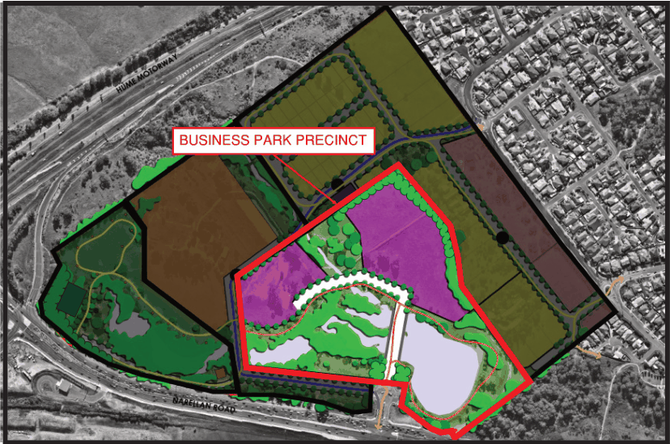
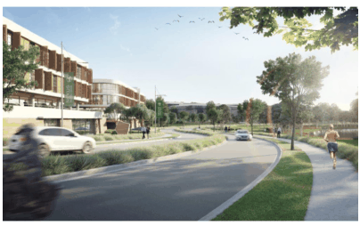
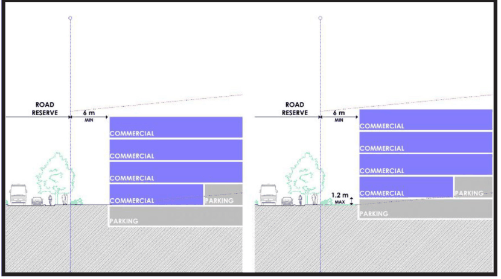
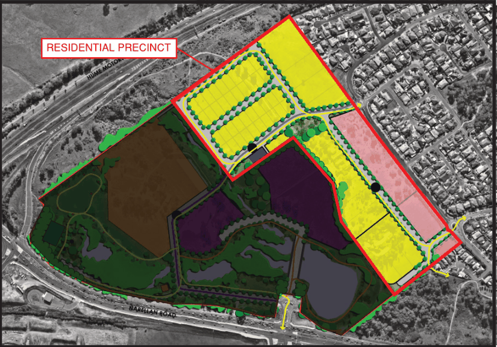
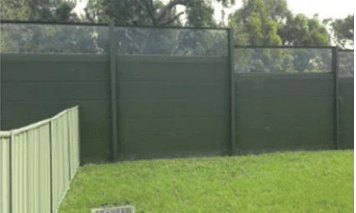
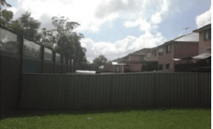
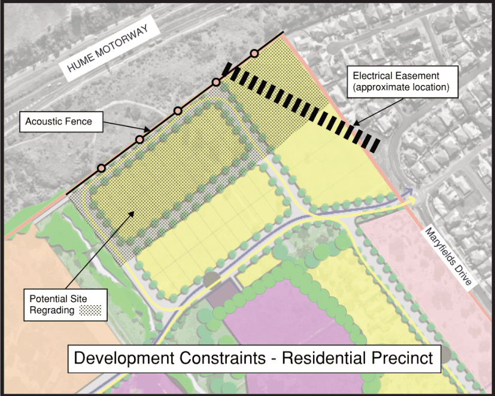

### 13.6 13.6.1 Business Park

#### Business Park

#### Objectives

■

■ Create a high quality landscaped campus-style business park that promotes employment and economic growth in the Campbelltown Region.

■

■ Deliver high quality architectural building designs within an extensively landscaped and planned setting.

■

■ Promote the main dam and associated riparian corridor as an integral landscaped feature of the business park.

The masterplan layout of the Business Park Precinct, incorporating the main water body and dam, is illustrated at Figure 13.6.

> [Picture on page 24: a picture, saved as a picture (images/vol-2-part-13-maryfields-development-control-plan-page-24-15.gif, 150 dpi).]

Figure 13.6 Business Park Precinct

#### 13.6.1.1 Building Design

#### Business Park

#### Controls

1\.	 Buildings must be designed by a qualified and registered architect.

2\.	 All proposed building designs shall incorporate the following unifying elements:

a.	 Campus-style arrangement of building forms with a high quality architectural presentation to publicly accessible spaces, including views across the main dam from the Narellan Road frontage.

> [Picture on page 25: a picture, saved as a picture (images/vol-2-part-13-maryfields-development-control-plan-page-25-16.gif, 150 dpi).]

Figure 13.7 Business Park - Artist Impression

b.	 An active interface to the streetscape and adjoining open spaces, including pedestrian entry treatments comprising podiums and forecourts at ground 	level.

c.	 Integration of common landscaping 	 e l e m e n t s including tree planting, paving, lighting and furniture.

3\.	 The visual impact of building facades is to be moderated by detailed architectural treatment incorporating the following treatments:

a.	 Extensive use of glass, expressed steelwork and louvers.

b.	Use of panelised materials for general external cladding.

c.	 A generally monochromatic colour scheme based on the use of off-white/light greys/natural/aluminium/ stainless steel tones.

d.	 Contrast or feature elements which should be generally organic in character and may include timber, stone-faced cladding, terracotta tiles cladding and bronze or

other metal finish colours.

e.	 Window-shading treatments and

#### Business Park

other façade elements.

4\.	 Perspectives,photomontages, sections and other appropriate diagrams are to accompany all development applications.

5\.	 Buildings shall generally present as four stories(or lesser) when viewed from surrounding landscape so as to comply with the height limit prescribed by Campbelltown Local Environmental Plan 2015.

6\.	 Crime Prevention through Environmental Design (CPTED) principles should be considered in the building design and layout to minimise opportunities for crime and enhance security.

#### 13.6.1.2 Building Setbacks

#### Controls

1\.	 Building setbacks shall be provided in accordance with Figure 13.8, generally comprising:

a.	 Minimum 6 metre building setback to streets and open space areas.

b.	 Minimum 10 metre setback to the northern precinct boundary of the business park adjoining residential land uses and the neighbourhood shops.

2\.	 All rooftop exposed structures including lift motor rooms and plant rooms together with air conditioning, ventilation and exhaust systems must be suitably screened and integrated with the building design and set back 6 metres from all sides of the building to minimise any visual impact.

3\.	 At least 50% of the area of required building setbacks is to be utilised for landscaping incorporating

significant shade trees, and landscape screening where appropriate.

#### Business Park

4\.	 Building setbacks for development adjoining park spaces are to incorporate paving and lighting to facilitate pedestrian activity and connections between the building and the park space.

#### 13.6.1.3 Landscaping

1\.	 Regular tree planting to both sides of streets and within building street setbacks and open car parking spaces shall be provided as required to deliver a tree dominated precinct.

2\.	 Landscaping, paving and lighting shall be provided to the main access road from Narellan Road to deliver a framed vista of formal tree planting and a heightened sense of entry to the precinct.

3\.	 The open space, riparian areas and main dam of the Business Park precinct are to be retained and managed as an accessible passive recreation space for users of the Business Park. Requirements for the embellishment of these areas are provided in Part 13.5.

#### 13.6.1.4 Car Parking

1\.	 Car parking spaces are to be provided on site to satisfy the parking demand generated by the business park development. This requirement may be satisfied by the provision of on-site parking at the following rates:

a.	 A general parking rate of 1 space per 70m2 of Gross Floor Area. A higher parking ratio may be required having regard to the final mix of development types, ongoing monitoring of parking demand and actual take-up of public and alternative transportation strategies.

b.	 One bicycle rack space must

#### Business Park

be provided for every 10 car parking spaces allowed and should be located in close proximity to the building’s entrance.

c.	 One motor cycle space must be provided for every 20 car parking spaces provided.

d.	 Provision of accessible car spaces as prescribed by the Building Code of Australia (BCA).

2\.	 Provision of parking shall be configured to provide a suitable distribution and mix of parking spaces, including;

a.	 Clearly legible visitor parking to service each building.

b.    Centralised staff parking.

c.	 Parking bays for service vehicles, taxis, bus bays and the like.

3\.	 Parking spaces shall generally be provided within centralised locations and basement car parks to minimise visual impacts to the streetscape.

4\.	 Temporary on-grade parking areas may be provided in developable areas and progressively reduced as the Business Park Precinct is developed.

5\.	 The depth of any required setback area may be partially used for car parking purposes, provided car parking areas do not dominate the landscape nor compromise the architectural value and visual interest of the development.

6\.	 Basement parking adjoining the streetfront must be located fully below footpath level if feasible. On sloping sites, consideration will be

#### Business Park

given to a portion of the basement level exceeding ground level by a maximum of 1.2 metres provided the street elevation of the building is not compromised. (Figure 13.8)

7\.	 Vehicular circulation areas for each development site must be designed to facilitate forward direction of vehicle movements at all times.

8\.	 Outdoor parking areas are to be provided with shade trees at regular intervals.

#### 13.6.1.5 Signage

1\.	 Use of signage on buildings must not detract from the architectural qualities of the building and shall be located below the roofline and/ or parapets.

2\.	 Use of common directional signage for multi-tenanted buildings must be designed and constructed from durable materials to complement the architectural theme of the business park buildings. The placement of these signs should be at the main entrance points to buildings.

3\.	 The maximum height of all free standing signs should not exceed 3 metres, with the exception of a signature business park sign at the main entrance which must not exceed 5-metres in height.

#### Business Park

> [Picture on page 30: a picture, saved as a picture (images/vol-2-part-13-maryfields-development-control-plan-page-30-2.gif, 150 dpi).]

Figure 13.8 Business Park - Street Setback and Carparking Option

#### 13.6.2 Residential Precinct

#### Residential

#### Precinct

Objectives

■

■ Provide a variety of housing choice to promote a diverse residential community.

■

■ Integrate the new residential precinct with the existing neighbourhood of Blair 	Athol and adjacent masterplan precincts, including St Clare Memorial Park.

■

■ Provide a built form that appropriately responds to the site context and constraints.

The Masterplan for the residential precinct has been informed by a number of considerations including the site context, local topography, promotion of a diversity of housing types, and limiting traffic impacts on the local road network. Provision has also been made in the residential precinct for  local neighbourhood shops and enhanced connectivity with adjoining open space areas.

Building Design, setbacks and landscaping shall comply with the general

development controls for low and medium density housing under Campbelltown (Sustainable City) Development Control Plan 2015 (as amended).

Additional site specific controls for development of the residential precinct are outlined as follows:

#### Controls

1\.	 All development sharing a boundary with Maryfields Drive must be designed to front and be accessed from Maryfields Drive. Consideration is to be given to split level dwelling designs to accomodate garage access at street level and minimise site regrading.

2\.	 Any development of land affected by the existing electrical easement (Figure 13.11) must demonstrate a suitable residential design outcome having regard to the restrictions imposed by that easement, and safety clearances required by relevant Australian Standards.

#### Residential

#### Precinct

3\.	 Development of the residential precinct adjoining the Hume Motorway boundary shall incorporate suitable noise attenuation measures to address acoustic impacts from this traffic corridor in accordance with relevant Australian Standards and noise planning criteria. This may require:

> [Picture on page 32: a picture, saved as a picture (images/vol-2-part-13-maryfields-development-control-plan-page-32-12.gif, 150 dpi).]

Figure 13.9 Residential Precinct

a.	 Acoustic fencing or shielding along the Hume Motorway boundary to be provided at the subdivision works stage consistent with that already in place for existing dwellings in the adjoining residential subdivision of Blair Athol.

b.	 Site regrading of dwelling lots at the subdivision works stage to enhance the effectiveness of any acoustic shielding along the common boundary.

> [Picture on page 32: a picture, saved as a picture (images/vol-2-part-13-maryfields-development-control-plan-page-32-27.gif, 150 dpi).]

> [Picture on page 32: a picture, saved as a picture (images/vol-2-part-13-maryfields-development-control-plan-page-32-28.gif, 150 dpi).]

Figure 13.10 Acoustic Fence Example

c.	 Mitigation measures used in

#### Residential

#### Precinct

the dwelling design, including dwelling layout, positioning on the allotment, landscaping, and use of acoustically rated windows, doors, ventilation systems and facade treatments.

4\.	 Common boundary fencing treatment with the St Clare Memorial Park must use wood panelling or similar natural material.

> [Picture on page 33: a picture, saved as a picture (images/vol-2-part-13-maryfields-development-control-plan-page-33-14.gif, 150 dpi).]

Figure 13.11 Development Constraints- Residential Precinct
